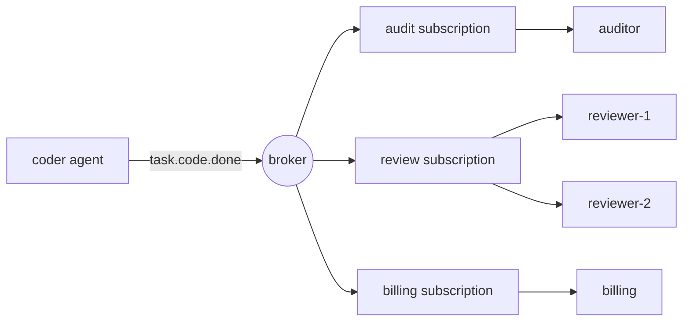

# رسائل الحانة/البوابات الفرعية للعملاء

> "فأنك تفعل هذا" يقول أحد المشاركين "هذا حدث" والنشر لا يعرف من يستمع، وهذا هو المقصود.

**Type:** Build
**Languages:** Python
**Prerequisites:** Phase 16 · 13 (Shared Memory and Blackboard Patterns), Phase 16 · 22 (Production Scaling)
**Time:** ~75 minutes

## أهداف التعلم

- شرح ثلاثة أنواع من الانفصال التي يقدمها النشر-التسجيلات وما تكلفة كل منها.
- تنفيذ وسيط مع بطاقات برية موضوعية، الاشتراكات، التأكيدات، إعادة تسليم، وقائمة من الخطوط الميتة.
- تمييز المُعجبين بين الاشتراكات من المستهلكين المتنافسين داخل الاشتراك الواحد.
- الحفاظ على طلبات كل جولة مع مفتاح التوجيه مع استمرار توسيع مستخدمي.
- أظهر لماذا في المرة القادمة على الأقل يكرر التأثيرات الجانبية، و إصلاحها مع عامل غير قادر.
- اختر بين المفتاح / الفرع ، صف العمل ، مكالمة مباشرة ، و لوحة سوداء للتفاعل مع الوكيل المعين.

## المشكلة

وكيل التشفير ينهي مهمة، وكيل المراجعة يجب أن يتحقق منها، لذا يتصل المبرمج بالمراجعة.

الشهر المقبل تضيف الفواتير، التي يجب أن تتقاضى مقابل كل مهمة مكتملة. ثم سجل مراجعة. ثم تقييم الذي يختار النتائج. كل إضافة تحرير البرمجة: مكالمة واحدة أخرى، فشل آخر في التعامل، سبب آخر البرمجة بطيئة. إذا كان الفواتير منخفضة، فهل البرمجة يفشل؟ إذا استغرق المقييم 40 ثانية، هل ينتظر البرمجة؟

أصبح المبرمج المكان الذي تلبي فيه متطلبات كل عميل آخر يعرف من هم، يدعوهم بالترتيب، ويرث إخفاقاتهم.

نشر-التسجيل يغير الاعتماد حول.`task.code.done`و يتوقف. أي شخص يهتم يشترك. إضافة المقيّم لا يغير أيّ شيء في المُرمّع.

## المفهوم

### ثلاثة أنواع من إزالة الروابط

المسح الكلاسيكي للأنماط (Eugster et al., 2003) يسمي ثلاثة:

| Decoupling | Meaning | What it costs |
|------------|---------|---------------|
| Space | Publisher and subscriber do not know each other | No one place shows the full workflow |
| Time | They need not be running at the same moment | The broker must store messages |
| Synchronization | The publisher does not block waiting for subscribers | There is no return value and no error to catch |

كل سطر هو فائدة حقيقية وخسارة حقيقية. لا يزيل Pub/sub التنسيق. إنه يُنقلها خارج الرمز إلى أسماء الموضوعات والإشتراكات.

### الموضوعات والبطاقات البرية

الموضوع هو اسم لنوع من الأحداث. الأسماء الهرمية تسمح للمشترك باختيار مستوى اهتمامه. هذا الدروس يستخدم اتفاقية NATS: رموز منفصلة بالنقاط،`*`يطابق بالضبط رمز واحد، و`>`يطابق رمز واحد أو أكثر في النهاية.

| Pattern | Matches | Does not match |
|---------|---------|----------------|
| `task.code.done` | `task.code.done` | `task.research.done` |
| `task.*.done` | `task.code.done`, `task.research.done` | `task.code.failed` |
| `task.>` | `task.code.done`, `task.code.failed` | `task`, `metrics.tokens` |

أسماء الموضوعات للحقائق في الوقت الماضي (`task.code.done`) ، ليس للقيام بالأوامر (`review.this`تتميز الأوامر بمستقبل واحد ويتم إرسالها بشكل أفضل إلى صف أو كدعوة مباشرة.

### المستهلكين المتواصلين والمنافسين

آلية واحدة توفر سلوكين متناقضين، والربط بينهما هو الخطأ الأكثر شيوعا.



- **Across subscriptions: fan-out.**كل اشتراك يتلقى نسخة خاصة من كل رسالة مطابقة.
- **Inside one subscription: competing consumers.**يشارك الأعضاء رسائل الاشتراك. كل رسالة تذهب إلى عضو واحد بالضبط. إضافة `reviewer-2`يقلل من نصف الحمل`reviewer-1`لا تجد كل شيء مرتين

كافكا يسمي الاشتراك مجموعة * المستهلكين *، ناتس يسميها مجموعة * الصف *، و Google Cloud Pub / Sub يسميها * الاشتراك *.

### ضمانات التسليم

| Guarantee | Broker behaviour | Failure you accept |
|-----------|-----------------|--------------------|
| At-most-once | Send once, never retry | Messages are lost |
| At-least-once | Retry until acknowledged | Messages are duplicated |
| Exactly-once | Not available across a network in general | — |

يقر المستهلك رسالة بعد التعامل معها، وإذا لم يسمع الوسيط شيئاً، أو تلقى إقرار سلبي، فإنه يقدمها مرة أخرى.

الفجوة هي هذه: يقوم المستهلك بالعمل، ثم الخسارة الخسارة. لا يستطيع الوسيط أن يخبر "لا يتم معالجة" عن "معتمد، الخسارة الخسارة"، لذلك يعيد التسليم. العمل يدير مرتين. ما يسميه الناس بالضبط مرة واحدة هو في الواقع على الأقل مرة واحدة التسليم زائد * المستهلك المتميز، واحد الذي ينتج نفس النتيجة عندما يرى نفس الرسالة مرة أخرى.

بالنسبة للعملاء هذه مشكلة تكلفة وكذلك مشكلة صحة. قد يعني المعاملة المكررة مكالمة LLM الثانية، أو رسالة بريد إلكتروني ثانية إلى عميل.

### رسائل سموم و صف الحروف الميتة

بعض الرسائل لا يمكن أن تنجح أبدا: عبء مفيد غير مصمم، مخطط لا يفهم المستهلك. إعادة المحاولة يمنع إلى الأبد كل شيء وراء ذلك. حد التسليم يحد من الضرر. بعد `max_deliveries`محاولات الوسيط يُحرك الرسالة إلى * صف من الحروف الميتة* (DLQ) ، حيث يمكن أن يفتنه إنسان أو عمل إصلاح، ويتحرك التيار.

### الطلب

مع المستهلكين المتنافسين، قد تصل رسالتين من نفس العميل إلى أعضاء مختلفين وتنتهي من النظام.`run-a`يصل إلى مراجعة واحدة، في ترتيب نشر، بينما يذهب الرسائل الأخرى إلى مكان آخر بالتوازي.

التطلب له ثمن. للحفاظ على النظام، يجب أن يتم محاولة رسالة فشلت قبل تسليم آخر، لذلك تبقي رسالة سامة صفها حتى يتم تحريرها. هذا هو *مراقبة رأس الخط *.

### اختيار النمط

| Pattern | Use when | Example |
|---------|----------|---------|
| Direct call | One receiver, and you need the answer now | Agent calls a tool |
| Work queue | One receiver type, the work must happen once | Dispatch a task to any free worker |
| Pub/sub | Zero or more receivers react to a fact | `task.code.done` triggers review, billing, audit |
| Blackboard (Phase 16 · 13) | Agents share state and read it later | A shared plan that agents refine |

لوحات السوداء تخزين الحالة الحالية. الحانة / الفرع تحمل التغييرات. العديد من الأنظمة تستخدم كليهما.

## بناءها

الوسيط الكامل في`code/main.py`إنه يعمل في عملية واحدة بدون خيوط، لذا كل اختبار هو تحديد.

### الخطوة الأولى: تطابق الموضوع مع النمط

```python
def topic_matches(pattern: str, topic: str) -> bool:
    pattern_tokens = pattern.split(".")
    topic_tokens = topic.split(".")
    for index, token in enumerate(pattern_tokens):
        if token == ">":
            return index == len(pattern_tokens) - 1 and len(topic_tokens) > index
        if index >= len(topic_tokens):
            return False
        if token != "*" and token != topic_tokens[index]:
            return False
    return len(pattern_tokens) == len(topic_tokens)
```

### الخطوة الثانية: نشر نسخة لكل اشتراك متطابق

```python
def publish(self, topic: str, payload: str, key: str | None = None) -> Message:
    message = Message(self._next_id, topic, payload, key)
    self._next_id += 1
    matched = [group for group in self.groups.values() if topic_matches(group.pattern, topic)]
    if not matched:
        self.dropped.append(message)
    for group in matched:
        group.queue.append(Delivery(message))
    return message
```

كل واحد`Group`يمتلك صف. هذا القرار واحد ينتج المُعجبين: ثلاث مجموعات متطابقة تعني ثلاث إدخالات في صف لكل رسالة. لاحظ `dropped`رسالة نشرت قبل أن يشترك أي شخص قد اختفت`publish`لا يزال يعود طبيعياً

### الخطوة الثالثة: اختر عضو واحد من المجموعة

```python
def _pick(self, group: Group, message: Message) -> tuple[str, Handler]:
    if message.key is not None:
        digest = hashlib.sha256(message.key.encode()).digest()
        index = int.from_bytes(digest[:8], "big") % len(group.members)
    else:
        index = group.next_member % len(group.members)
        group.next_member += 1
    return group.members[index]
```

بدون مفتاح، يتناوب الأعضاء مع مفتاح، القيادة هي الهاش`hash()`لا يستخدم لأنه يتم ترتيبه عشوائيًا لكل عملية للسلسلة ، لذلك لن يتفق عمليات وسيطين على من يملك مفتاحًا.

### الخطوة الرابعة: تسليم، ثم إعادة، محاولة أخرى، أو حرف ميت

```python
def _deliver(self, group: Group) -> None:
    delivery = group.queue.popleft()
    consumer, handler = self._pick(group, delivery.message)
    self.log.append((group.name, consumer, delivery.message.id, delivery.attempt))
    try:
        acked = handler(delivery.message)
    except Exception:
        acked = False
    if acked:
        return
    if delivery.attempt >= self.max_deliveries:
        self.dead_letters.append((group.name, delivery.message))
    else:
        group.queue.appendleft(Delivery(delivery.message, delivery.attempt + 1))
```

المدير يعود`True`عودة`False`أو رفع هو عقدة. المحاولة الإعادة تعود إلى * مقدمة * من الصف مع`appendleft`، مما يحافظ على النظام و يسبب حظر خط الرأس`append`و تحصل على التجارة المعاكسة

### الخطوة 5: جعل المستهلك غير قادر

```python
class IdempotentHandler:
    def __call__(self, message: Message) -> bool:
        if message.id in self.seen:
            self.duplicates += 1
            return True
        acked = self.handler(message)
        if acked:
            self.seen.add(message.id)
        return acked
```

يتم الاعتراف بمثابة نسخة دون تشغيل التأثير. يتم تذكر رسالة فقط بعد نجاحها، لذلك يتم محاولة فشل حقيقي مرة أخرى.

### إشغله

```bash
cd phases/16-multi-agent-and-swarms/26-pubsub-messaging-for-agents/code
python3 main.py
python3 -m unittest discover tests -v
```

النسخة التجريبية تنشر سبعة أحداث من اثنين من العملاء يذهب إلى ثلاثة اشتراكات. الفواتير تفقد تأكيد واحد، وفرصة واحدة تكون خاطئة.

```text
delivery attempts:      19
audit received:         6 events
reviewer-1 handled:    run-a:step-1, run-a:step-2
reviewer-2 handled:    run-e:step-1, run-e:step-3
dead letters:           [('review', 5)]
dropped, no subscriber: ['metrics.tokens']

billing lost the acknowledgement for message 2, so the broker redelivered it.
charges with a plain handler:       6 (5 billable events)
charges with an idempotent handler: 5
```

اقرأ كل سطر مقابل المفهوم الذي يظهر:

- سبعة أحداث أدت إلى 19 محاولة تسليم.
- كل جولة بقيت على راقٍ واحد، بالترتيب.
- تم محاولة الرسالة 5 ثلاث مرات من خلال مراجعة ثم تم إصدارها بدون رسالة. قام المراجعة والفواتير بمعالجة نفس الرسالة دون مشاكل، لأن كل اشتراك يفشل بشكل مستقل.
- `metrics.tokens`لم يكن لديه أحد المشتركين و اختفى دون خطأ
- المدير العادي لتحويل الفواتير دفع ستة مرات لخمسة أحداث

## استخدمها

يختلف وسطاء الإنتاج في الغالب في ما يحتفظون به وما يضمنونه. تحقق من الوثائق الحالية قبل الاعتماد على الاختلاف.

| System | Subscription model | Delivery | Ordering |
|--------|-------------------|----------|----------|
| Apache Kafka | Consumer groups read a partitioned log by offset | At-least-once by default | Per partition, chosen by message key |
| NATS | Subjects with `*` and `>`; queue groups | Core NATS is at-most-once; JetStream adds at-least-once | Per stream in JetStream |
| Google Cloud Pub/Sub | Topics and named subscriptions | At-least-once, with an ack deadline and dead-letter topics | Optional ordering keys |
| Redis Pub/Sub | Channels and patterns | At-most-once; offline subscribers miss messages | None |
| Redis Streams | Consumer groups with explicit `XACK` | At-least-once | Per stream |

كافكا وجيتستريم يحفظون سجلًا، حتى يتمكن المشترك الجديد من إعادة تشغيل التاريخ. الوسيط في هذه الدروس، مثل ريديس بار / سب، لا يحتفظ بأي شيء لمشترك لم يكن هناك.

بين إطاريات الوكيل، تم بناء AutoGen Core على هذا النموذج: يقوم الوكلاء بنشر الرسائل إلى موضوع ويتم تسليمها في الوقت المحدد إلى الوكلاء الذين تتطابق اشتراكاتهم.

ما يتركه الوسيط في الذاكرة:

- **Persistence.**تحطم يفقد كل صف
- **Ack deadlines.**وسيط حقيقي يُعيد التسليم عندما يبقى المستهلك صامتًا لفترة طويلة جداً هنا يتعامل مع إما يعود أو يرفع.
- **Backpressure.**الطوابير لا حدود لها، المشترك البطيء يزيد طابره حتى تنتهي الذاكرة
- **Atomic dedupe.** `IdempotentHandler`تسجل الهوية بعد التأثير. يحدث حادث بين الاثنين يكرر التأثير. في الإنتاج، اكتب التأثير والهوية المعالجة في معاملة قاعدة البيانات واحدة، أو تمرر رسالة الهوية إلى النظام التدريجي كمفتاح إزالة.

لأنظمة الوكيل على وجه التحديد:

- **Carry a correlation id.**بدون كومة مكالمات، فإن إطار تشغيل الهوية والعقب في كل رسالة هو الطريقة الوحيدة لإعادة بناء ما حدث (المرحلة 14 · 23).
- **Guard against event loops.**العميل (أ) يتفاعل مع حدث (ب) و ينشر أحد الحدث الذي يتفاعل به (ب) أضف عدد من الرسائل و اتركها تتجاوز الحد
- **Version the payload.**المشتركون الذين لا تعرفونهم يعتمدون على مخططك إضافة الحقول لا تغير اسمها أو إزالتها

## أرسله

هذا الدرس يُنتج`outputs/skill-pubsub-design-review.md`. بالنظر إلى مجموعة من الوكلاء والأحداث بينهم، فإنه يراجع الاسم الموضوعي، وتخطيط الاشتراك، وضمانات التسليم، والإمكانية المفرطة، والطلب، ومعالجة الخطابات الميتة.

## التمارين

1. أركض`code/main.py`- تغيير محاولة إعادة`_deliver`من`appendleft`إلى`append`في أي ترتيب`reviewer-2`الآن قم بتسوية الأحداث`run-e`، ومتى سيكون هذا الأمر مقبولًا؟
2. إضافة صف محدود: `publish`يزيد عندما يملك صف مجموعة أكثر من `max_queue`ما الذي يجب على الناشر فعله عندما يتم رفعها: حظر أو إسقاط أو فشل؟
3. إضافة`hops`المجال إلى `Message`و جعل الوسيط لا يكتب أي رسالة نشرتها المدير مرة واحدة`hops`يمر الحد. اكتب اختبار مع اثنين من الملاعب التي تثير بعضها البعض.
4. إضافة إعادة التمثيل: احتفظ بكل رسالة نشرت في سجل وتسمح لمجموعة جديدة بالتسجيل منذ البداية. ما الذي يغيره هذا حول `dropped`قائمة؟
5. المراجعة الثالثة تنضم إلى `review`المجموعة بينما الرسائل`run-a`أي مفاتيح تغير مالك تحت`hash % members`اقرأ عن التشغيل المتواصل و اشرح كيف يقلل من الحركة

## الشروط الرئيسية

| Term | What people say | What it actually means |
|------|----------------|------------------------|
| Pub/sub | "Event bus" | Messaging where publishers send to a topic and the broker delivers to whoever subscribed |
| Topic | "Channel" | A name for a kind of event; called a subject in NATS |
| Subscription | "Consumer group" | A named interest in a topic pattern with its own copy of each message |
| Fan-out | "Broadcast" | Each subscription receives every matching message |
| Competing consumers | "Load balancing" | Members of one subscription share its messages; each message goes to one |
| Ack / nack | "Confirm" | The consumer's report that handling succeeded or failed |
| At-least-once | "Guaranteed delivery" | Redelivery until acknowledged, so duplicates are possible |
| Idempotent consumer | "Dedupe" | A handler that gives the same result when a message is delivered again |
| Dead-letter queue | "DLQ" | Where a message goes after it exhausts its delivery attempts |
| Routing key | "Partition key" | A value hashed to pick the consumer, so related messages stay in order |
| Head-of-line blocking | "Stuck queue" | A failing message that delays everything behind it in an ordered queue |

## المزيد من القراءة

- [Eugster, Felber, Guerraoui, Kermarrec — The Many Faces of Publish/Subscribe (ACM Computing Surveys, 2003)](https://dl.acm.org/doi/10.1145/857076.857078) المسح الذي يحدد الفضاء والزمان، وتفكيك التزامن.
- [NATS — Subject-Based Messaging](https://docs.nats.io/nats-concepts/subjects) قواعد البطاقة البرية تنطبق هذه الدروس.
- [Apache Kafka — Documentation](https://kafka.apache.org/documentation/) التقسيمات، مجموعات المستهلكين، والتعويضات.
- [Google Cloud Pub/Sub — Overview](https://cloud.google.com/pubsub/docs/overview) الاشتراكات، المواعيد المحددة، الموضوعات المفتوحة، طلب المفاتيح.
- [Redis — Pub/Sub](https://redis.io/docs/latest/develop/pubsub/) في أقصى وقت رسائل القناة.
- [AutoGen Core — Topic and Subscription](https://microsoft.github.io/autogen/stable/user-guide/core-user-guide/core-concepts/topic-and-subscription.html)نفس النموذج داخل وقت تشغيل العميل
