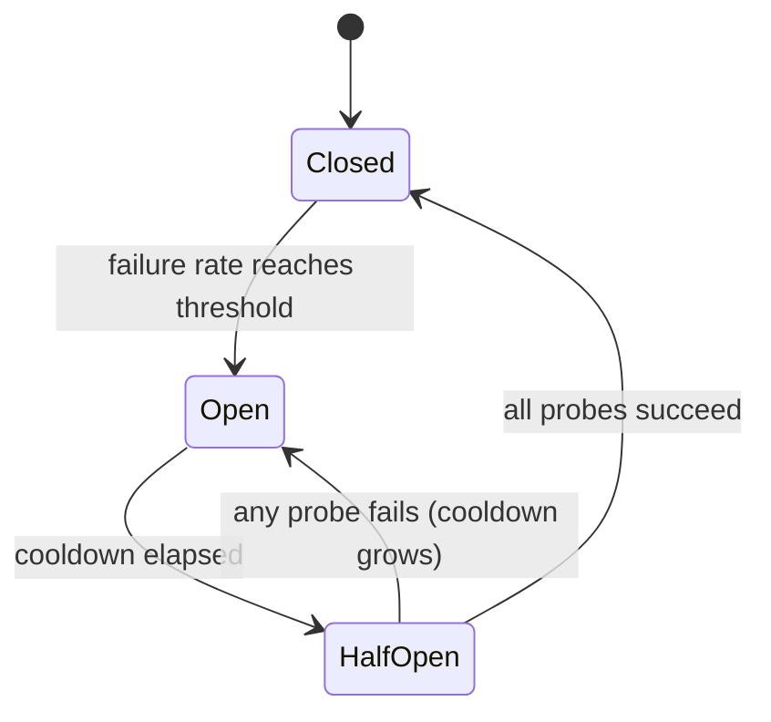

# مقاطع لشركات تقديم القانون

> يسأل محطم الطوب "هل يجب أن يحاول هذا الطلب مرة أخرى؟" يسأل "هل يجب أن يتصل أحد بهذا المزود الآن؟" الأول يحمي الطلب الواحد. والثاني يحمي النظام بأكمله.

**Type:** Build
**Languages:** Python
**Prerequisites:** Phase 17 · 19 (AI Gateways), Phase 17 · 24 (Chaos Engineering)
**Time:** ~75 minutes

## أهداف التعلم

- شرح الحالات الثلاثة التي تعطلها الحالة والحدث الذي يسبب كل انتقال.
- قم بتنفيذ قطع حلقة للنوافذ المنزلقة مع الحارس الحد الأدنى من المكالمة وميزانية صفقة نصف مفتوحة.
- تصنيف أخطاء مقدم القانون في تلك التي تشير إلى مقدم غير صحي وأولئك الذين يلومون الطلب.
- قم بتكوين المقطع مع التوقفات، والإعادة، والمسار للعودة بالترتيب الصحيح.
- قياس ما يوفره المقطع أثناء انقطاع المزود، وما تكلفه بعد الاسترداد.
- اختر نطاق الاختراق (المزود، النموذج، المنطقة) لتنفيذ معين.

## المشكلة

يرسل بوابة المكالمة كل طلب إلى مزود أساسي ويعود إلى آخر عند الفشل. يتم إبطال الأساسي. كل مكالمة تنتظر الآن 10 ثوان كاملة قبل أن يتم إعادة التأجيل.

لا شيء ضائع. كل طلب لا يزال يجيب. ولكن كل طلب يستغرق الآن 11 ثانية بدلا من 1 ، طالما استمر الانقطاع. خيوط العمال يجلس محاصرا على مزود لا يستجيب. ينمو الصفوف. المكالمين فوق التيار يضربون وقتهم الخاص وتجربة ثانية ، مما يضيف المزيد من الحمل. الانقطاع الجزئي في مزود واحد يصبح انقطاعًا كاملًا في خدمةك.

منطق محاولة وإعادتها صحيحة لمطالبة واحدة. الخطأ هو أن الطلب رقم 500 لا يتعلم شيئا من 499 فشل قبل ذلك. مفصل الدوائر هو ذاكرة مشتركة التي تصحيح هذا.

## المفهوم

### ثلاث ولايات

يأتي الاسم من الجهاز الكهربائي: عندما يتم الكشف عن الفشل، يفتح الدائرة و يتوقف التيار.



- **Closed**العملية الطبيعية، المكالمات تمر ويتم تسجيل كل نتيجة
- **Open**يعني أن المزود يعامل كمنع. يتم رفض المكالمات على الفور، دون الاتصال بالمزود. هذا هو *فشل سريع*.
- **Half-open**بعد التبريد، يتم السماح بعد عدد صغير من المكالمات الحقيقية بالمرور ك "مراقبات".

لاحظ الفخ المسمى: * مغلق * هو الحالة الصحية و * مفتوح * هو الفخ المكسور ، عكس الباب.

### متى يجب أن تعثّر

أسهل بناء، ولكن نجاح واحد محظوظ يعيد العد، لذلك مقدم خدمة يفشل 80٪ من المكالمات قد لا تعثره أبدا.

معدل الفشل على نافذة زلقة أكثر قوة`window_size`النتائج وفتح عندما يصل الفصل الفاشل إلى العد.`minimum_calls`أو فشل واحد من كل مكالمة واحدة يقرأ بمعدل فشل بنسبة 100٪ ويطرد المقطع عند الخطأ الأول بعد إعادة تشغيل.

### ما يعتبر فشلاً

الاختراق يقيس صحة المزود، لذلك يجب أن تعتبر فقط الأخطاء التي تصف المزود.

| Outcome | Counts as failure? | Reason |
|---------|-------------------|--------|
| Timeout or connection error | Yes | The provider did not answer |
| 5xx (500, 502, 503, 529) | Yes | The provider failed |
| 429 rate limit | Yes | The provider cannot serve you right now |
| 400 bad request, context too long | No | The request is wrong; another provider's model may reject it too |
| 401 or 403 | No | Your credentials are wrong; alert on this instead |
| Content filter refusal | No | The provider answered; the answer was a refusal |

في الواقع، فإن 400 هو دليل على أن المقدم صحي: لقد تلقى الطلب، وافق عليه، وأجاب بسرعة.

### نصف مفتوحة و التبريد

عندما ينتهي التبريد، لا يفتح المقطع البوابات، بل يسمح بعدد محدد من المراقبات، إذا نجحت كلّها، فإنه يغلق ويقلّف نافذته، وإذا فشلت أيّة، فإنه يفتح مرة أخرى.

يجب أن يطول المسبار الفاشل التبريد التالي، حتى حد أقصى. من المرجح أن يكون مزود ما زال في حالة انقطاع بعد 30 ثانية في حالة انقطاع بعد 60 ثانية، وكل مسبار يكلف المستخدم الحقيقي وقتًا.

### نطاق العمل

كسر واحد لكل مزود عادة ما يكون قاسياً جداً. غالباً ما يقتصر انقطاع التشغيل على نموذج واحد أو منطقة واحدة ، ويقطع كسر على نطاق المزود التنفيذ الصحيح. كسر واحد لكل مفتاح API ونموذج ومناطق ومستأجر جيد جداً: لا يرى كسر واحد `minimum_calls`نقطة انطلاق مشتركة هي كسر واحد لكل نشر، أي المزود، النموذج، والمنطقة.

### ترتيب التركيب

ثلاثة عناصر تحكم تتعلق بنفس المكالمة والطلب مهم:

```text
retry  ->  circuit breaker  ->  timeout  ->  provider call
```

إن الموقف هو الداخلي ، لذلك يصبح المكالمة المعلقة فشلاً يمكن للكسر أن يحسب. يجلس الكسر داخل محاولة إعادة التجربة ، لذلك كل محاولة إعادة التجربة تسأل الكسر أولاً ولا يمكن لفة إعادة التجربة أن تضرب دائرة مفتوحة. دون وقف الوقت لا يرى الكسر مزود بطيء على الإطلاق.

### كيف تختلف عن جيرانها

| Control | Question it answers | Triggered by |
|---------|--------------------|--------------|
| Timeout | How long may one call take? | A single slow call |
| Retry with backoff | Should this request try again? | A single failed call |
| Rate limit | How much traffic may a caller send? | Request volume |
| Circuit breaker | Is this dependency healthy enough to call? | Failures across many calls |
| Kill switch (Phase 15 · 14) | Should this system run at all? | A human or a safety policy |

## بناءها

التنفيذ الكامل في `code/main.py`. يستخدم`ManualClock`أن المُتصل يقدم يدوياً، لذا فإنّ التجربة وكل اختبار يُجرى على الفور دون أن ينام.

### الخطوة الأولى: تصنيف الخطأ

```python
def counts_as_failure(status: int | None) -> bool:
    """Timeouts, 429 and 5xx blame the provider. Any other 4xx blames the request."""
    if status is None:
        return True
    return status == 429 or status >= 500
```

`status`هو`None`لفترة توقف، لأن مكالمة لم ترد أبدا ليس لديها رمز حالة.

### الخطوة الثانية: تقرر ما إذا كان بإمكان المكالمة أن تستمر

```python
def allow(self) -> bool:
    if self.state == OPEN and self.clock.now() - self.opened_at >= self.cooldown:
        self.probes_issued = 0
        self.probe_successes = 0
        self._move(HALF_OPEN)
    if self.state == CLOSED:
        return True
    if self.state == HALF_OPEN and self.probes_issued < self.config.half_open_probes:
        self.probes_issued += 1
        return True
    return False
```

لا يوجد توقيت خلفي، الانتقال من مفتوح إلى نصف مفتوح يحدث بسهولة، أول مرة يطلب فيها المُتصل بعد مرور التبريد.

### الخطوة الثالثة: سجلي النتيجة

```python
def record_failure(self) -> None:
    if self.state == OPEN:
        return
    if self.state == HALF_OPEN:
        self.cooldown = min(
            self.cooldown * self.config.cooldown_multiplier,
            self.config.max_cooldown_seconds,
        )
        self._trip()
        return
    self.window.append(False)
    enough_calls = len(self.window) >= self.config.minimum_calls
    if enough_calls and self.failure_rate() >= self.config.failure_rate_threshold:
        self._trip()
```

أول عملية التحقق مهمة في الأنظمة الحقيقية. المكالمات التي كانت بالفعل في الطيران عندما فتح المقطع سوف تبلغ عن فشلها في وقت متأخر. إذا كانت تلك النتائج المتأخرة إعادة تشغيل التبريد، تدفق ثابت من بينهم يمكن أن تبقي المقطع مفتوحة إلى الأبد.

`record_success`يعكس هذا: في نصف مفتوحة يحتسب المراقبات ويغلق عندما يتم الوفاء بالميزانية، يطهر النافذة حتى فشل القديمة لا تعطي الثغرة مرة أخرى في وقت واحد.

### الخطوة الرابعة: إغلاق المكالمة

```python
def call(self, fn: Callable[[], str]) -> str:
    if not self.allow():
        raise CircuitOpenError(self.name)
    try:
        result = fn()
    except ProviderError as error:
        if counts_as_failure(error.status):
            self.record_failure()
        else:
            self.record_success()
        raise
    except Exception:
        self.record_failure()
        raise
    self.record_success()
    return result
```

كل طريق يمر`allow()`إذا نسيت المسار تسجيل، فإن المقطع نصف مفتوح سوف يمنح أجهزة استشعارها، لا يسمع أي رد، ويبقى نصف مفتوحا بشكل دائم.

### الخطوة 5: اتجه حول المقطع المفتوح

`FallbackRouter`يمر قائمة مرتبة من الطرق.`CircuitOpenError`يتحرك إلى الطريق التالي دون أي تكلفة. يتحرك فشل المزود إلى الطريق التالي بعد دفع الدفع. يتم رفع خطأ طلب مثل 400 إلى المتصل ولا يتم إغلاقه.

### إشغله

```bash
cd phases/17-infrastructure-and-production/30-circuit-breakers-llm-providers/code
python3 main.py
python3 -m unittest discover tests -v
```

يرسل الديمو 150 طلباً، واحدًا في الثانية، من خلال أولية تقل من الثانية 20 إلى الثانية 80:

```text
metric                        retry only     breaker
----------------------------------------------------
requests answered                    150         150
timeouts paid on primary              60           6
calls skipped (fast fail)              0          88
calls sent to fallback                60          94
mean latency (seconds)              5.00        1.40

breaker transitions:
  t=   24s     closed -> open
  t=   54s       open -> half_open
  t=   54s  half_open -> open
  t=  114s       open -> half_open
  t=  115s  half_open -> closed
```

اقرأ التكاليف لقد دفع المقطع 6 وقت بدلاً من 60: خمسة للكشف عن الانقطاع و واحدة فشلت في الاختبار في الثانية 54. لكن تلك القناة الفاشلة مضاعفة التبريد، لذا لم يختبر المقطع مرة أخرى حتى الثانية 114. كانت المرحلة الأولى صحية من الثانية 80، و 34 طلبات ذهبت إلى الردع التي لم يكن بحاجة إلى ذلك. المقطع يتداول مع التعافي البطيء مقابل انقطاع أرخص التبريد، المضاعف، والحدحد يحدد هذا التجارة.

## استخدمها

بوابات الإنتاج والوكلاء يرسلون هذا النمط تحت أسماء مختلفة. تحقق من الوثائق الحالية لمعرفة الافتراضات قبل الاعتماد عليها.

- **Resilience4j**(JVM) هو أقرب تطابق لهذه الدروس.`failureRateThreshold`،`slidingWindowSize`،`minimumNumberOfCalls`،`waitDurationInOpenState`و`permittedNumberOfCallsInHalfOpenState`كما أنها تعتبر المكالمات البطيئة فشل`slowCallDurationThreshold`. . .
- **Envoy**يطلق عليه هذا * التعرف على الاختلافات *: يتم طرد مضيف بعد `consecutive_5xx`أخطاء`base_ejection_time`"الخصة التي يطلق عليها "المبعوث " "تقطع الدائرة" هي شيء مختلف،
- **LiteLLM Router**يضع نشاط في التبريد بعد `allowed_fails`الفشل في`cooldown_time`ثواني وطرق إلى عمليات نشر أخرى في الوقت نفسه

هناك شيئين إضافيتين في الإصدارات الإنتاجية يبتعد عنهما المحاكي:

- **Concurrency.**يجب أن يحدّ من المراقبة في الطيران، والتي تحتاج إلى قفل أو مقعد ذريّ.
- **Shared state.**تحتوي عشرة نسخة من بوابات البوابة على عشرة مفكّرات منفصلة. يجب على كلّ منّا أن يرى فشلها الخاصّ قبل أن يفتح. يجعل الحالة المشتركة في Redis من الموافقة بشكل أسرع ولكنها تضيف اعتمادًا إلى المسار الذي يهدف إلى البقاء على قيد الحياة من فشل الإعتماد. فان مفكّرات لكل نسخة هي الخيار المعتاد.

بالنسبة لحركة التجارة في مجال القانون العلمي:

- حدد الوقت المحدد في الوقت المناسب لتكون أول رمز للتصوير. يختلف وقت توليد الكل كثيراً مع طول الخروج لتكون إشارة صحية.
- عندما يحمل 429`Retry-After`العنوان، استخدم هذه القيمة كالتبريد بدلا من افتراضك.
- تحقق من أن القارب يمكن أن تتحمل الحمل الكامل. نقل 100٪ من حركة المرور إلى ثانوية مع حد سرعة أقل يطير كسر ثانوي التالي.

## أرسله

هذا الدرس يُنتج`outputs/skill-circuit-breaker-review.md`. في ضوء مسار الاتصال مع المقدم، فإنه يعيد النظر في قاعدة الرحلة، وتصنيف الخطأ، والسلوك نصف مفتوح، ومدى، وتسلسل التركيب، ويرسل الفجوات.

## التمارين

1. أركض`code/main.py`- أُحدد`cooldown_multiplier`كم عدد المقاطع الإضافية يدفعها المقطع، وكم ثانية أسرع يغلقها؟
2. قم بإختبار مع مقدم خدمة تفشل أربع مكالمات من بين كل خمسة وتظهر أن العداد لا يطيح أبدا عند عتبة خمسة.
3. إضافة الكشف عن المكالمة البطيئة: مكالمة تنجح ولكن تستغرق وقتا أطول من حد يعتبر فشلا. ما هو العد الذي ستختارينه للوقت الأول؟
4. أعطني`ProviderError`اختيارية`retry_after`القيمة و جعل المقطع يستخدمها كالتبريد عندما يكون موجودا.
5. لا تفشل إعادة التجربة في التجربة. أعطها كسر وتحديد سرعة 0.5 طلبات في الثانية. ماذا يحدث أثناء الانقطاع، وما الذي يجب أن يعود إليه جهاز التوجيه عندما تكون كل طريق مفتوح؟

## الشروط الرئيسية

| Term | What people say | What it actually means |
|------|----------------|------------------------|
| Circuit breaker | "Stop calling it" | A state machine that refuses calls to a dependency after failures cross a threshold, then probes for recovery |
| Closed | "Healthy" | Calls pass through and outcomes are recorded |
| Open | "Tripped" | Calls are refused without contacting the dependency |
| Half-open | "Testing" | A limited number of probe calls decide whether to close or reopen |
| Fast fail | "Fail quickly" | Returning an error at once instead of waiting for a timeout |
| Sliding window | "Recent calls" | The last N outcomes used to compute the failure rate |
| Minimum calls | "Warm-up guard" | The fewest recorded calls before the failure rate is trusted |
| Cooldown | "Wait duration" | Time the breaker stays open before it allows probes |
| Probe | "Trial request" | A real request let through in half-open to test recovery |
| Outlier detection | "Envoy's breaker" | Ejecting an unhealthy host from a load-balancing pool |

## المزيد من القراءة

- [Michael Nygard — Release It! (2nd edition)](https://pragprog.com/titles/mnee2/release-it-second-edition/)الكتاب الذي سمى النمط، في فصل نمط الاستقرار.
- [Martin Fowler — CircuitBreaker](https://martinfowler.com/bliki/CircuitBreaker.html) إشارة قصيرة للدول الثلاث.
- [Resilience4j — CircuitBreaker](https://resilience4j.readme.io/docs/circuitbreaker) النوافذ المنزلقة القائمة على العد والوقت، وعلى حدود الاتصال البطيء.
- [Envoy — Outlier detection](https://www.envoyproxy.io/docs/envoy/latest/intro/arch_overview/upstream/outlier)قواعد الإفراز وزيادة وقت الإفراز
- [LiteLLM — Routing](https://docs.litellm.ai/docs/routing) التراجع في التنفيذ والانحدارات.
- [AWS Builders' Library — Timeouts, retries, and backoff with jitter](https://aws.amazon.com/builders-library/timeouts-retries-and-backoff-with-jitter/) التحكمات التي يكوّن بها المقطع.
