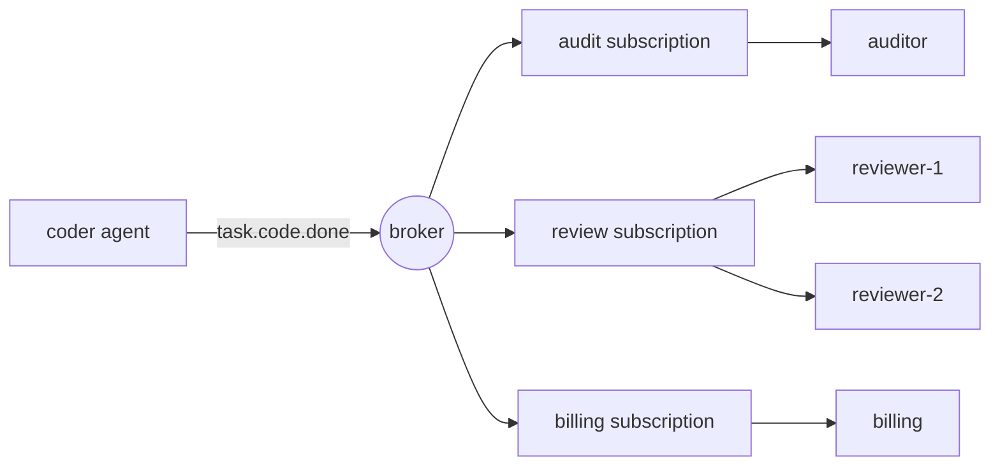

# Pub/Sub Mensajes para agentes

> Un llamado directo dice: "Haz esto". Un evento publicado dice: "Esto sucedió". El editor no sabe quién está escuchando, y ese es el punto.

**Type:** Build
**Languages:** Python
**Prerequisites:** Phase 16 · 13 (Shared Memory and Blackboard Patterns), Phase 16 · 22 (Production Scaling)
**Time:** ~75 minutes

## Objetivos de aprendizaje

- Explica los tres tipos de desacoplamiento que ofrece el editor-abonado y cuánto cuesta cada uno.
- Implemente un corredor con tarjetas salvajes temáticas, suscripciones, reconocimientos, re-entrega y una lista de letras muertas.
- Distinguir entre los fans de suscripciones y los consumidores competidores dentro de una sola suscripción.
- Preservar el pedido por ejecución con una clave de enrutamiento mientras se escala a los consumidores.
- Muestre por qué al menos una vez el parto repite efectos secundarios, y arregláelo con un manipulador idempotente.
- Elija entre el pub/sub, una cola de trabajo, una llamada directa y una pizarra para una interacción de agente dada.

## El problema

Un agente de codificación termina una tarea, un agente de revisores debe comprobarla, así que el codificador llama al revisor.

El mes que viene añade facturación, que debe cobrar por cada tarea terminada. Luego un registro de auditoría. Luego un evaluador que muestra los resultados. Cada adición edita el codificador: una llamada más, una falla más en manejar, una razón más por la que el codificador es lento. Si la facturación está baja, ¿el codificador falla? Si el evaluador tarda 40 segundos, el codificador espera?

El codificador se ha convertido en el lugar donde cumplen los requisitos de todos los demás agentes.

Public-subscribe cambia la dependencia. El codificador anuncia `task.code.done`Si se les importa suscriben, añadir el evaluador no cambia nada en el codificador.

## El concepto

### Tres tipos de desacoplamiento

La encuesta clásica del patrón (Eugster et al., 2003) nombra tres:

| Decoupling | Meaning | What it costs |
|------------|---------|---------------|
| Space | Publisher and subscriber do not know each other | No one place shows the full workflow |
| Time | They need not be running at the same moment | The broker must store messages |
| Synchronization | The publisher does not block waiting for subscribers | There is no return value and no error to catch |

Cada fila es un beneficio real y una pérdida real. Pub/sub no elimina la coordinación.

### Temas y cartas salvajes

Un tema es un nombre para una especie de evento. Los nombres jerárquicos permiten a un suscriptor elegir su nivel de interés.`*`coincide exactamente con una sola ficha, y `>`coincide con uno o más tokens al final.

| Pattern | Matches | Does not match |
|---------|---------|----------------|
| `task.code.done` | `task.code.done` | `task.research.done` |
| `task.*.done` | `task.code.done`, `task.research.done` | `task.code.failed` |
| `task.>` | `task.code.done`, `task.code.failed` | `task`, `metrics.tokens` |

Nombrar los temas de los hechos en el tiempo pasado (`task.code.done`), no para órdenes (`review.this`Un comando tiene un receptor previsto y es mejor enviado a una cola o como una llamada directa.

### Consumidores de venta y consumidores de competencia

Un mecanismo da dos comportamientos opuestos, y confundirlos es el error más común de pub/sub.



- **Across subscriptions: fan-out.**Cada suscripción recibe su propia copia de cada mensaje correspondiente.
- **Inside one subscription: competing consumers.**Los miembros comparten los mensajes de la suscripción. Cada mensaje va a exactamente un miembro.`reviewer-2`reduce a la mitad la carga .`reviewer-1`No revisará todo dos veces.

Kafka llama a la suscripción un *grupo de consumidores*, NATS lo llama un *grupo de colas* y Google Cloud Pub/Sub lo llama una *subscripción*. La idea es la misma.

### Garantias de entrega

| Guarantee | Broker behaviour | Failure you accept |
|-----------|-----------------|--------------------|
| At-most-once | Send once, never retry | Messages are lost |
| At-least-once | Retry until acknowledged | Messages are duplicated |
| Exactly-once | Not available across a network in general | — |

El consumidor reconoce un mensaje (*ack*) después de manejarlo, si el corredor no escucha nada o recibe un reconocimiento negativo (*nack*), vuelve a entregarlo.

El consumidor hace el trabajo, y luego el ac se pierde. El corredor no puede distinguir "nunca procesado" de "procesado, ac perdido", por lo que vuelve a entregar. El trabajo se realiza dos veces. Lo que la gente llama exactamente una vez es en la práctica al menos una vez entrega más un consumidor *idempotent*, que produce el mismo resultado cuando ve el mismo mensaje de nuevo.

Para los agentes, este es un problema de costo, así como un problema de corrección.

### Mensajes venenosos y la cola de letras muertas

Algunos mensajes nunca pueden tener éxito: una carga útil malformada, un esquema que el consumidor no entiende.`max_deliveries`Intentos el corredor traslada el mensaje a una cola de letras muertas (DLQ), donde un ser humano o un trabajo de reparación puede inspeccionarlo, y la corriente se mueve.

### Ordenamiento

En el caso de los consumidores que compiten, dos mensajes de la misma dirección de agente pueden llegar a diferentes miembros y terminar fuera de orden.`run-a`El objetivo de la Comisión es que las empresas puedan llegar a un revisor en orden de publicación, mientras que otras carreras se realicen en otro lugar en paralelo.

Para mantener el orden, un mensaje fallido debe ser retestado antes de que se entregue el siguiente, por lo que un mensaje venenoso bloquea su cola hasta que esté en letra muerta. Esto es *bloqueo de cabeza de línea*.

### Elegir el patrón

| Pattern | Use when | Example |
|---------|----------|---------|
| Direct call | One receiver, and you need the answer now | Agent calls a tool |
| Work queue | One receiver type, the work must happen once | Dispatch a task to any free worker |
| Pub/sub | Zero or more receivers react to a fact | `task.code.done` triggers review, billing, audit |
| Blackboard (Phase 16 · 13) | Agents share state and read it later | A shared plan that agents refine |

Una pizarra almacena el estado actual. Pub / sub lleva los cambios. Muchos sistemas usan ambos.

## Construye el mismo

El corredor completo está en .`code/main.py`Se ejecuta en un proceso sin hilos, por lo que cada prueba es determinista.

### Paso 1: Compare un tema con un patrón

```python
def topic_matches(pattern: str, topic: str) -> bool:
    pattern_tokens = pattern.split(".")
    topic_tokens = topic.split(".")
    for index, token in enumerate(pattern_tokens):
        if token == ">":
            return index == len(pattern_tokens) - 1 and len(topic_tokens) > index
        if index >= len(topic_tokens):
            return False
        if token != "*" and token != topic_tokens[index]:
            return False
    return len(pattern_tokens) == len(topic_tokens)
```

### Paso 2: Publica una copia a cada suscripción que coincida

```python
def publish(self, topic: str, payload: str, key: str | None = None) -> Message:
    message = Message(self._next_id, topic, payload, key)
    self._next_id += 1
    matched = [group for group in self.groups.values() if topic_matches(group.pattern, topic)]
    if not matched:
        self.dropped.append(message)
    for group in matched:
        group.queue.append(Delivery(message))
    return message
```

Cada uno .`Group`La decisión de un usuario de una línea de trabajo es una decisión que produce un fan out: tres grupos correspondientes significa tres entradas de fila para un mensaje.`dropped`Un mensaje publicado antes de que alguien se suscriba se ha ido, y `publish`sigue volviendo a la normalidad.

### Paso 3: Seleccione a un miembro del grupo

```python
def _pick(self, group: Group, message: Message) -> tuple[str, Handler]:
    if message.key is not None:
        digest = hashlib.sha256(message.key.encode()).digest()
        index = int.from_bytes(digest[:8], "big") % len(group.members)
    else:
        index = group.next_member % len(group.members)
        group.next_member += 1
    return group.members[index]
```

Sin llave, los miembros se turnan, con llave, el hash decide.`hash()`no se utiliza porque se aleatoriza por proceso para cadenas, por lo que dos procesos de corredor no estarían de acuerdo sobre quién posee una llave.

### Paso 4: Entrega, luego ac, retoma, o letra muerta

```python
def _deliver(self, group: Group) -> None:
    delivery = group.queue.popleft()
    consumer, handler = self._pick(group, delivery.message)
    self.log.append((group.name, consumer, delivery.message.id, delivery.attempt))
    try:
        acked = handler(delivery.message)
    except Exception:
        acked = False
    if acked:
        return
    if delivery.attempt >= self.max_deliveries:
        self.dead_letters.append((group.name, delivery.message))
    else:
        group.queue.appendleft(Delivery(delivery.message, delivery.attempt + 1))
```

Un manipulador regresa .`True`De vuelta.`False`El retraso se vuelve a la primera fila con`appendleft`, que mantiene el orden y causa el bloqueo de cabeza de línea.`append`y obtienes el intercambio opuesto.

### Paso 5: Hacer que el consumidor sea idempotente

```python
class IdempotentHandler:
    def __call__(self, message: Message) -> bool:
        if message.id in self.seen:
            self.duplicates += 1
            return True
        acked = self.handler(message)
        if acked:
            self.seen.add(message.id)
        return acked
```

Un mensaje se recuerda sólo después de que tiene éxito, por lo que un fallo real se vuelve a intentar.

### - ¡Corre el juego!

```bash
cd phases/16-multi-agent-and-swarms/26-pubsub-messaging-for-agents/code
python3 main.py
python3 -m unittest discover tests -v
```

La demostración publica siete eventos de dos agentes se ejecuta en tres suscripciones.

```text
delivery attempts:      19
audit received:         6 events
reviewer-1 handled:    run-a:step-1, run-a:step-2
reviewer-2 handled:    run-e:step-1, run-e:step-3
dead letters:           [('review', 5)]
dropped, no subscriber: ['metrics.tokens']

billing lost the acknowledgement for message 2, so the broker redelivered it.
charges with a plain handler:       6 (5 billable events)
charges with an idempotent handler: 5
```

Lea cada línea en contra del concepto que muestra:

- Siete eventos causaron 19 intentos de entrega.
- Cada carrera se mantuvo en un revisor, en orden.
- El mensaje 5 fue probado tres veces por revisión y luego muerto.
- `metrics.tokens`No tenía suscriptor y desapareció sin error.
- El simple encargado de facturación cobró seis veces por cinco eventos.

## Usalo

Los intermediarios de producción difieren principalmente en lo que almacenan y lo que garantizan.

| System | Subscription model | Delivery | Ordering |
|--------|-------------------|----------|----------|
| Apache Kafka | Consumer groups read a partitioned log by offset | At-least-once by default | Per partition, chosen by message key |
| NATS | Subjects with `*` and `>`; queue groups | Core NATS is at-most-once; JetStream adds at-least-once | Per stream in JetStream |
| Google Cloud Pub/Sub | Topics and named subscriptions | At-least-once, with an ack deadline and dead-letter topics | Optional ordering keys |
| Redis Pub/Sub | Channels and patterns | At-most-once; offline subscribers miss messages | None |
| Redis Streams | Consumer groups with explicit `XACK` | At-least-once | Per stream |

Kafka y JetStream mantienen un registro, para que un nuevo suscriptor pueda reproducir la historia.

Entre los marcos de agentes, AutoGen Core se basa en este modelo: los agentes publican mensajes a un tema y el runtime los entrega a los agentes cuyas suscripciones coinciden.

Lo que el corredor de memoria deja fuera:

- **Persistence.**Un accidente pierde todas las colas.
- **Ack deadlines.**Un verdadero corredor vuelve a entregar cuando un consumidor permanece en silencio demasiado tiempo.
- **Backpressure.**Las colas son ilimitadas, un suscriptor lento hace crecer su cola hasta que se agota la memoria.
- **Atomic dedupe.** `IdempotentHandler`En la producción, escriba el efecto y el ID procesado en una transacción de base de datos, o pasa el ID del mensaje al sistema en el torrente descendente como una clave de idempotencia.

Para los sistemas de agentes específicamente:

- **Carry a correlation id.**Sin una pila de llamadas, el contexto de ejecución y rastreo en cada mensaje son la única forma de reconstruir lo ocurrido (fase 14 · 23).
- **Guard against event loops.**El agente A reacciona al evento de B y publica uno al que reacciona B. Añade un recuento de saltos a cada mensaje y déjalo más allá de un límite.
- **Version the payload.**Los suscriptores que no conoces dependen de tu esquema. Añada campos; no los renombres ni los elimines.

## Envío

Esta lección produce`outputs/skill-pubsub-design-review.md`. Dado un conjunto de agentes y los acontecimientos entre ellos, revisa el nombre de los temas, la distribución de suscripciones, las garantías de entrega, la capacidad de compra, los pedidos y el manejo de letras muertas.

## Los ejercicios

1. - ¿ Qué ?`code/main.py`Cambiar el retiro en .`_deliver`de la`appendleft`¿ Qué ?`append`En qué orden se hace`reviewer-2`Ahora maneja los eventos para `run-e`¿Y cuándo sería aceptable esa orden?
2. Añadir una cola limitada: `publish`aumenta cuando la cola de un grupo tiene más de `max_queue`¿Qué debe hacer el editor cuando se eleva: bloquear, dejar caer o fallar?
3. Añadir un`hops`campo a`Message`y hacer que el corredor sea un mensaje muerto publicado por un manipulador una vez `hops`escribe una prueba con dos manipuladores que se activan mutuamente.
4. Añadir repetición: mantener cada mensaje publicado en un registro y dejar que un nuevo grupo se suscriba desde el principio. ¿Qué cambia esto acerca de la `dropped`¿La lista?
5. Un tercer revisor se une a la`review`grupo mientras los mensajes para `run-a`¿Cuáles son las claves que cambian de propietario?`hash % members`Lea sobre el hashing consistente y explique cómo reduce el movimiento.

## Términos clave

| Term | What people say | What it actually means |
|------|----------------|------------------------|
| Pub/sub | "Event bus" | Messaging where publishers send to a topic and the broker delivers to whoever subscribed |
| Topic | "Channel" | A name for a kind of event; called a subject in NATS |
| Subscription | "Consumer group" | A named interest in a topic pattern with its own copy of each message |
| Fan-out | "Broadcast" | Each subscription receives every matching message |
| Competing consumers | "Load balancing" | Members of one subscription share its messages; each message goes to one |
| Ack / nack | "Confirm" | The consumer's report that handling succeeded or failed |
| At-least-once | "Guaranteed delivery" | Redelivery until acknowledged, so duplicates are possible |
| Idempotent consumer | "Dedupe" | A handler that gives the same result when a message is delivered again |
| Dead-letter queue | "DLQ" | Where a message goes after it exhausts its delivery attempts |
| Routing key | "Partition key" | A value hashed to pick the consumer, so related messages stay in order |
| Head-of-line blocking | "Stuck queue" | A failing message that delays everything behind it in an ordered queue |

## Leer más

- [Eugster, Felber, Guerraoui, Kermarrec — The Many Faces of Publish/Subscribe (ACM Computing Surveys, 2003)](https://dl.acm.org/doi/10.1145/857076.857078) la encuesta que define el espacio, el tiempo y la desacoplamiento de sincronización.
- [NATS — Subject-Based Messaging](https://docs.nats.io/nats-concepts/subjects) las reglas de la tarjeta salvaje se aplican en esta lección.
- [Apache Kafka — Documentation](https://kafka.apache.org/documentation/) particiones, grupos de consumidores y compensaciones.
- [Google Cloud Pub/Sub — Overview](https://cloud.google.com/pubsub/docs/overview) suscripciones, plazos, temas de letra muerta, claves de pedido.
- [Redis — Pub/Sub](https://redis.io/docs/latest/develop/pubsub/) en el canal de mensajería más de una vez.
- [AutoGen Core — Topic and Subscription](https://microsoft.github.io/autogen/stable/user-guide/core-user-guide/core-concepts/topic-and-subscription.html) el mismo modelo dentro de un agente en tiempo de ejecución.
