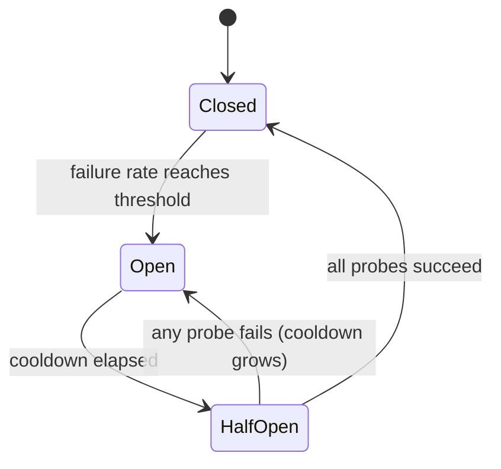

# Disminución de circuitos para los proveedores de LLM

> Una nueva prueba pregunta "¿debería intentarse esta solicitud de nuevo?" Una interruptor de circuito pregunta "¿debería alguien llamar a este proveedor ahora mismo?" La primera protege una solicitud.

**Type:** Build
**Languages:** Python
**Prerequisites:** Phase 17 · 19 (AI Gateways), Phase 17 · 24 (Chaos Engineering)
**Time:** ~75 minutes

## Objetivos de aprendizaje

- Explica los tres estados de ruptura y el evento que causa cada transición.
- Implemente un interruptor de circuito de ventanas deslizantes con un mínimo de guardia de llamada y un presupuesto de sonda medio abierto.
- Clasificar los errores del proveedor de LLM en aquellos que indican un proveedor enfermo y aquellos que culpan a la solicitud.
- Compone un interruptor con tiempos de espera, retos y una ruta de retrocesión en el orden correcto.
- Medir lo que un interruptor ahorra durante una interrupción del proveedor y cuánto cuesta después de la recuperación.
- Seleccione el alcance del interruptor (proveedor, modelo, región) para una implementación dada.

## El problema

La puerta de entrada envía cada solicitud a un proveedor primario y vuelve a una segunda en caso de fallo. La primera cae. Cada llamada ahora espera el tiempo completo de 10 segundos antes de que la caída se ejecute.

No se pierde nada. Cada solicitud sigue siendo respondida. Pero cada solicitud ahora tarda 11 segundos en lugar de 1, mientras dure el apagón. Los hilos de trabajadores permanecen bloqueados en un proveedor que no responderá. Las colas crecen. Los llamados de aguas arriba golpean sus propios tiempos de espera y vuelven a intentar, lo que agrega más carga. Una interrupción parcial en un proveedor se convierte en una interrupción completa en su servicio.

La lógica de retraso y retrocesión es correcta para una solicitud. El error es que la solicitud número 500 no aprende nada de los 499 fallos anteriores.

## El concepto

### Tres estados

El nombre proviene del dispositivo eléctrico: cuando se detecta la falla, se abre el circuito y se detiene la corriente.



- **Closed**Las llamadas pasan y cada resultado se registra.
- **Open**Las llamadas se rechazan inmediatamente, sin ponerse en contacto con el proveedor.
- **Half-open**Después de una enfriamiento, un pequeño número de llamadas reales se permiten pasar como * sondas*. Su resultado decide el siguiente estado.

Nota la trampa de nombramiento: *cerrado* es el estado sano y *abierto* es el roto, lo contrario de una puerta.

### Cuando tropezar

La regla más simple es "abrir después de N fallas consecutivas". Es fácil de construir, pero un éxito afortunado restablece el recuento, por lo que un proveedor que falla en el 80% de las llamadas puede que nunca lo haga.

Una tasa de fallas sobre una ventana deslizante es más robusta.`window_size`Los resultados se abren cuando la fracción fallida alcanza el umbral.`minimum_calls`guard, o un fallo de una llamada se lee como una tasa de fallo del 100% y hace que el interruptor se bloquee en el primer error después de una reiniciación.

### Lo que se considera un fracaso

Un interruptor mide la salud del proveedor, por lo que solo los errores que describen al proveedor deben contar.

| Outcome | Counts as failure? | Reason |
|---------|-------------------|--------|
| Timeout or connection error | Yes | The provider did not answer |
| 5xx (500, 502, 503, 529) | Yes | The provider failed |
| 429 rate limit | Yes | The provider cannot serve you right now |
| 400 bad request, context too long | No | The request is wrong; another provider's model may reject it too |
| 401 or 403 | No | Your credentials are wrong; alert on this instead |
| Content filter refusal | No | The provider answered; the answer was a refusal |

De hecho, un 400 es una prueba de que el proveedor está sano: recibió la solicitud, la validó y respondió rápidamente.

### Medio abierto y el enfriamiento

Cuando se termina la refrigeración, el interruptor no vuelve a abrir las compuertas, sino que admite un número fijo de sondas, si todas tienen éxito, cierra y despeja su ventana, si alguna falla, se abre de nuevo.

Una sonda fallida también debería prolongar la próxima refrenación, hasta un límite. Un proveedor que sigue bajando después de 30 segundos es probable que esté bajando después de 60, y cada sonda cuesta a un usuario real un tiempo fuera.

### El alcance

Un interruptor por proveedor es generalmente demasiado grueso. Un interruptor a menudo se limita a un modelo o una región, y un interruptor a nivel de proveedor cortaría las implementaciones saludables. Un interruptor por clave de API y modelo y región y inquilino es demasiado fino: ningún interruptor único ve `minimum_calls`Un punto de partida común es un interruptor por despliegue, es decir, el proveedor, modelo y región.

### Orden de composición

Tres controles envuelven la misma llamada y el pedido importa:

```text
retry  ->  circuit breaker  ->  timeout  ->  provider call
```

El tiempo de espera es más interno, por lo que una llamada de llamada se convierte en un fracaso que el interruptor puede contar. El interruptor se sienta dentro del retrayo, por lo que cada intento de retrayo le pide al interruptor primero y un bucle de retrayo no puede martillar un circuito abierto. Sin un tiempo de espera el interruptor nunca ve un proveedor lento en absoluto.

### Cómo se diferencia de sus vecinos

| Control | Question it answers | Triggered by |
|---------|--------------------|--------------|
| Timeout | How long may one call take? | A single slow call |
| Retry with backoff | Should this request try again? | A single failed call |
| Rate limit | How much traffic may a caller send? | Request volume |
| Circuit breaker | Is this dependency healthy enough to call? | Failures across many calls |
| Kill switch (Phase 15 · 14) | Should this system run at all? | A human or a safety policy |

## Construye el mismo

La aplicación completa se realiza en `code/main.py`- Se utiliza una .`ManualClock`que el que llama avanza a mano, así que la demostración y cada prueba se ejecutan instantáneamente sin dormir.

### Paso 1: Clasificar el error

```python
def counts_as_failure(status: int | None) -> bool:
    """Timeouts, 429 and 5xx blame the provider. Any other 4xx blames the request."""
    if status is None:
        return True
    return status == 429 or status >= 500
```

`status`¿ Es verdad ?`None`por un tiempo de espera, porque una llamada que nunca regresó no tiene código de estado.

### Paso 2: Decidir si se puede proceder a una llamada

```python
def allow(self) -> bool:
    if self.state == OPEN and self.clock.now() - self.opened_at >= self.cooldown:
        self.probes_issued = 0
        self.probe_successes = 0
        self._move(HALF_OPEN)
    if self.state == CLOSED:
        return True
    if self.state == HALF_OPEN and self.probes_issued < self.config.half_open_probes:
        self.probes_issued += 1
        return True
    return False
```

El cambio de apertura a mitad de apertura ocurre a laza, la primera vez que un llamador pregunta después de que la enfriamiento ha pasado.

### Paso 3: Registra el resultado

```python
def record_failure(self) -> None:
    if self.state == OPEN:
        return
    if self.state == HALF_OPEN:
        self.cooldown = min(
            self.cooldown * self.config.cooldown_multiplier,
            self.config.max_cooldown_seconds,
        )
        self._trip()
        return
    self.window.append(False)
    enough_calls = len(self.window) >= self.config.minimum_calls
    if enough_calls and self.failure_rate() >= self.config.failure_rate_threshold:
        self._trip()
```

Las llamadas que ya estaban en vuelo cuando se abrió el interruptor reportarán sus fallos tarde si esos resultados tardíos reinician la enfriamiento, una gota constante de ellos podría mantener el interruptor abierto para siempre.

`record_success`En medio de la apertura, cuenta las sondas y se cierra cuando se cumple el presupuesto, limpiando la ventana para que los viejos fallos no vuelvan a tropezar el interruptor de nuevo de una vez.

### Paso 4: Envuelve la llamada

```python
def call(self, fn: Callable[[], str]) -> str:
    if not self.allow():
        raise CircuitOpenError(self.name)
    try:
        result = fn()
    except ProviderError as error:
        if counts_as_failure(error.status):
            self.record_failure()
        else:
            self.record_success()
        raise
    except Exception:
        self.record_failure()
        raise
    self.record_success()
    return result
```

Cada camino que pasa .`allow()`Si un camino se olvida de grabar, un interruptor medio abierto distribuirá sus sondas, no escuchará nada y permanecerá medio abierto permanentemente.

### Paso 5: Recorrida alrededor de un interruptor abierto

`FallbackRouter`Caminar por una lista ordenada de rutas.`CircuitOpenError`El error de solicitud, como un 400, se levanta al solicitante y no se le falla.

### - ¡Corre el juego!

```bash
cd phases/17-infrastructure-and-production/30-circuit-breakers-llm-providers/code
python3 main.py
python3 -m unittest discover tests -v
```

La demostración envía 150 solicitudes, una por segundo, a través de una primaria que baja del segundo 20 al segundo 80:

```text
metric                        retry only     breaker
----------------------------------------------------
requests answered                    150         150
timeouts paid on primary              60           6
calls skipped (fast fail)              0          88
calls sent to fallback                60          94
mean latency (seconds)              5.00        1.40

breaker transitions:
  t=   24s     closed -> open
  t=   54s       open -> half_open
  t=   54s  half_open -> open
  t=  114s       open -> half_open
  t=  115s  half_open -> closed
```

Lea los dos costos. El interruptor pagó 6 temporadas en lugar de 60: cinco para detectar el apagón y una sonda fallida en el segundo 54. Pero esa sonda fallida duplicó el enfriamiento, así que el interruptor no volvió a probar hasta el segundo 114. La primera fue saludable desde la segunda 80, y 34 solicitudes fueron a la caída que no necesitaba. Un interruptor cambia la recuperación más lenta por interrupciones más baratas. La reducción, el multiplicador y el límite establecen ese comercio.

## Usalo

Los gateways de producción y los proxies envían este patrón con diferentes nombres.

- **Resilience4j**(JVM) es el más cercano a esta lección.`failureRateThreshold`¿ Qué ?`slidingWindowSize`¿ Qué ?`minimumNumberOfCalls`¿ Qué ?`waitDurationInOpenState`, y `permittedNumberOfCallsInHalfOpenState`También cuenta las llamadas lentas como fallas en el proceso de transmisión .`slowCallDurationThreshold`¿ Qué ?
- **Envoy**llama esto * detección de estrellas*: un huésped es expulsado después de `consecutive_5xx`errores para `base_ejection_time`La característica del enviado llamada "ruptura de circuito" es algo diferente, un límite en las conexiones y solicitudes pendientes.
- **LiteLLM Router**pone un despliegue en el enfriamiento después de `allowed_fails`fallas para `cooldown_time`segundos y rutas a otros despliegues mientras tanto.

Dos cosas que las versiones de producción añaden que el simulador deja fuera:

- **Concurrency.**La mitad abierta debe limitar las sondas en vuelo, que necesitan un bloqueo o un contador atómico.
- **Shared state.**Las réplicas de diez puertas de entrada contienen diez interruptores separados. Cada uno debe ver sus propios fallos antes de abrirse. El estado compartido en Redis hace que coincidan más rápido, pero añade una dependencia al camino que se supone que sobreviva a los fallos de dependencia.

Para el tráfico de LLM específicamente:

- Establezca el tiempo de espera en el tiempo para el primer token para las llamadas de transmisión. El tiempo total de generación varía demasiado con la longitud de salida para ser una señal de salud.
- Cuando un 429 lleva un`Retry-After`Header, utiliza ese valor como la reducción de frío en lugar de su predeterminado.
- Compruebe si el retroceso puede absorber toda la carga.

## Envío

Esta lección produce`outputs/skill-circuit-breaker-review.md`. Dado el camino de la llamada de proveedor, revisa la regla de viaje, la clasificación de errores, el comportamiento medio abierto, el alcance y el orden de composición, y enumera las lagunas.

## Los ejercicios

1. - ¿ Qué ?`code/main.py`- El juego .`cooldown_multiplier`¿Cuántos tiempos adicionales paga el interruptor, y cuántos segundos antes se cierra?
2. Reemplaza la ventana deslizante con un contador de fallas consecutivas. Escriba una prueba con un proveedor que falle cuatro llamadas de cada cinco y muestre que el contador nunca falla en un umbral de cinco.
3. Añadir detección de llamadas lentas: una llamada que tiene éxito pero tarda más que un umbral se considera un fracaso. ¿Qué umbral elegirías para el tiempo para marcar primero?
4. - ¿ Qué ?`ProviderError`una opción `retry_after`el valor y hacer que el interruptor lo utilice como refrigeración cuando esté presente.
5. ¿Qué pasa durante el apagón y qué debe regresar el router cuando cada ruta esté abierta?

## Términos clave

| Term | What people say | What it actually means |
|------|----------------|------------------------|
| Circuit breaker | "Stop calling it" | A state machine that refuses calls to a dependency after failures cross a threshold, then probes for recovery |
| Closed | "Healthy" | Calls pass through and outcomes are recorded |
| Open | "Tripped" | Calls are refused without contacting the dependency |
| Half-open | "Testing" | A limited number of probe calls decide whether to close or reopen |
| Fast fail | "Fail quickly" | Returning an error at once instead of waiting for a timeout |
| Sliding window | "Recent calls" | The last N outcomes used to compute the failure rate |
| Minimum calls | "Warm-up guard" | The fewest recorded calls before the failure rate is trusted |
| Cooldown | "Wait duration" | Time the breaker stays open before it allows probes |
| Probe | "Trial request" | A real request let through in half-open to test recovery |
| Outlier detection | "Envoy's breaker" | Ejecting an unhealthy host from a load-balancing pool |

## Leer más

- [Michael Nygard — Release It! (2nd edition)](https://pragprog.com/titles/mnee2/release-it-second-edition/) el libro que nombró el patrón, en el capítulo de patrones de estabilidad.
- [Martin Fowler — CircuitBreaker](https://martinfowler.com/bliki/CircuitBreaker.html) Breve referencia para los tres Estados.
- [Resilience4j — CircuitBreaker](https://resilience4j.readme.io/docs/circuitbreaker) ventanas correderas basadas en el recuento y en el tiempo, umbrales de llamadas lentas.
- [Envoy — Outlier detection](https://www.envoyproxy.io/docs/envoy/latest/intro/arch_overview/upstream/outlier) Reglas de expulsión y tiempo de expulsión creciente.
- [LiteLLM — Routing](https://docs.litellm.ai/docs/routing) descenso y retrocesos en el despliegue.
- [AWS Builders' Library — Timeouts, retries, and backoff with jitter](https://aws.amazon.com/builders-library/timeouts-retries-and-backoff-with-jitter/) los controles con los que se compone un interruptor.
