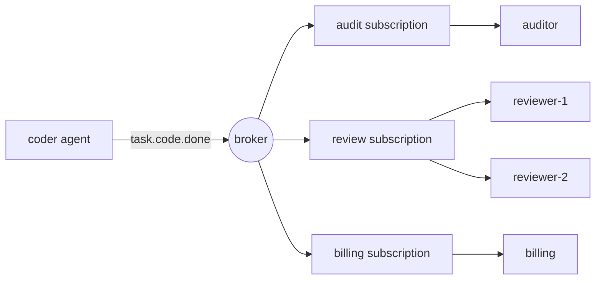

# پيام رساني هاي پاب/ ذيلي براي ماموران

> یک تماس مستقیم می گوید: "شما این کار را بکنید". یک رویداد منتشر شده می گوید: "این اتفاق افتاد".

**Type:** Build
**Languages:** Python
**Prerequisites:** Phase 16 · 13 (Shared Memory and Blackboard Patterns), Phase 16 · 22 (Production Scaling)
**Time:** ~75 minutes

## اهداف یادگیری

- سه نوع از قطع ارتباط که توسط نشریات و اشتراک کنندگان ارائه می شود و هزینه هر یک را توضیح دهید.
- یک دلال با کارت های وحشی موضوعی، اشتراک، تایید، تحویل مجدد و یک لیست حرف مرده را اجرا کنید.
- فرقی بین فرمول های فان و فرمول های دیگر از مصرف کنندگان رقابتی در یک فرمول ایجاد کنید.
- حفظ سفارشات در هر اجرا با کلید مسیریابی در حالی که مصرف کنندگان را مقیاس بندی می کنند.
- نشان دهید که چرا حداقل یک بار به زایمان می رسد، عوارض جانبی تکرار می شود و با یک عامل بی قدرت آن را حل کنید.
- برای تعامل با یک عامل مشخص بین پب/سب، یک صف کار، یک تماس مستقیم و یک صفحه سیاه انتخاب کنید.

## مشکل

یک کدر یک کار را انجام می دهد، یک کدر باید آن را بررسی کند، پس کدر به کدر زنگ می زند.

ماه آینده شما صورتحساب اضافه می کنید که باید برای هر کار انجام شده هزینه ای را بپردازید. سپس یک دفترچه حسابرسی. سپس یک ارزیابی کننده که نتایج را نمونه می کند. هر اضافه کاری کدگر را ویرایش می کند: یک تماس بیشتر، یک شکست دیگر برای رسیدگی، یک دلیل دیگر برای کند شدن کدگر. اگر صورتحساب پایین باشد، کدگر شکست می خورد؟ اگر ارزیابی کننده 40 ثانیه طول بکشد، کدگر صبر می کند؟

کدگر به جایی تبدیل شده که نیازهای هر عامل دیگر را برآورده کند. می داند که آنها چه کسانی هستند، آنها را به ترتیب می نامد و شکست های آنها را به ارث می برد.

Publish-subscribe وابستگی را تغییر می دهد. کدگر اعلام می کند `task.code.done`هرکس که اهمیت میده، به اشتراک می گذارد. اضافه کردن ارزیابی کننده چیزی در کدگر تغییر نمی کند.

## مفهوم

### سه نوع جداسازی

بررسی کلاسیک این الگوی (Eugster و همکاران، 2003) سه مورد را ذکر می کند:

| Decoupling | Meaning | What it costs |
|------------|---------|---------------|
| Space | Publisher and subscriber do not know each other | No one place shows the full workflow |
| Time | They need not be running at the same moment | The broker must store messages |
| Synchronization | The publisher does not block waiting for subscribers | There is no return value and no error to catch |

هر ردیف یک سود و یک ضرر واقعی است. Pub / sub هماهنگی را حذف نمی کند. آن را از کد خارج می کند و به نام های موضوع و اشتراک گذاری می کند.

### موضوعات و کارت های وحشی

یک موضوع نامی برای یک نوع رویداد است. نام های سلسله مراتبی به مشترک اجازه می دهند که سطح علاقه خود را انتخاب کنند. این درس از کنوانسیون NATS استفاده می کند: توکن های جدا شده توسط نقاط،`*`دقیقاً با یه رمز مطابقت داره و`>`در پایان یک یا چند توکن را مطابقت می دهد.

| Pattern | Matches | Does not match |
|---------|---------|----------------|
| `task.code.done` | `task.code.done` | `task.research.done` |
| `task.*.done` | `task.code.done`, `task.research.done` | `task.code.failed` |
| `task.>` | `task.code.done`, `task.code.failed` | `task`, `metrics.tokens` |

موضوعات را با زمان گذشته نام دهید (`task.code.done`), نه برای دستورات (`review.this`) یک فرمان دارای یک گیرنده هدف است و بهتر است به یک صف یا به عنوان یک تماس مستقیم ارسال شود.

### مصرف کنندگان در حال رقابت

یک مکانیسم دو رفتار متناقض را می دهد و اشتباهشان رایج ترین اشتباه است.



- **Across subscriptions: fan-out.**هر اشتراکگر نسخه ی خودش از هر پیام مطابقت پذیر دریافت می کند. حسابرسی، بررسی و صورتحساب همه این رویداد را می بینند.
- **Inside one subscription: competing consumers.**اعضای پیام های اشتراک گذاری را به اشتراک می گذارند. هر پیام به یک عضو دقیقا می رود. اضافه کردن `reviewer-2`نصف بار رو کاهش ميده`reviewer-1`؛ همه چیز را دو بار بررسی نمی کند.

کافکا این اشتراک را * گروه مصرف کننده*، NATS آن را * گروه صف*، و Google Cloud Pub/Sub آن را * اشتراک* می نامد. ایده یکسان است.

### تضمین تحویل

| Guarantee | Broker behaviour | Failure you accept |
|-----------|-----------------|--------------------|
| At-most-once | Send once, never retry | Messages are lost |
| At-least-once | Retry until acknowledged | Messages are duplicated |
| Exactly-once | Not available across a network in general | — |

مصرف کننده بعد از پردازش یک پیام (*ack*) را تایید می کند. اگر کارگزار چیزی نشنود یا تایید منفی (*nack*) را دریافت کند، دوباره تحویل می دهد.

شکاف این است که مصرف کننده کار را انجام می دهد، سپس ack از دست می رود. بروکر نمی تواند "هیچ وقت پردازش نشده" را از "معالجه شده، ack از دست رفته" تشخیص دهد، بنابراین دوباره تحویل می دهد. کار دو بار انجام می شود. آنچه که مردم دقیقا یک بار می گویند در عمل حداقل یک بار تحویل است و مصرف کننده *idempotent*، یکی که نتیجه مشابه را به دست می آورد وقتی دوباره همان پیام را می بیند.

برای نمایندگان این یک مسئله هزینه و همچنین یک مسئله درست است. یک دستیار تکراری ممکن است به معنای تماس دوم LLM، هزینه دوم یا ایمیل دوم به یک مشتری باشد.

### پيام هاي سمي و صف حرف مرده

بعضی پیام ها هرگز موفق نمی شوند: یک بار مفید بد شکل، یک طرح مصرف کننده نمی فهمد. دوباره تلاش برای همیشه همه چیز را پشت سر می گذارد. یک محدودیت تحویل آسیب را محدود می کند. پس از `max_deliveries`در تلاش ها، بروکر پیام را به *مرگ خط* (DLQ) منتقل می کند، جایی که یک انسان یا یک کار تعمیر و تعمیر می تواند آن را بررسی کند و جریان حرکت می کند.

### سفارش دادن

در مورد مصرف کنندگان رقابتی، دو پیام از یک عامل اجرا می تواند به اعضای مختلف برسد و از ترتیب خارج شود.`run-a`به یک بازرس در ترتیب انتشار، در حالی که سایر اجراها به جای دیگر به طور موازی می روند.

سفارش دادن قیمت دارد. برای حفظ نظم، یک پیام شکست خورده باید قبل از تحویل پیام بعدی دوباره امتحان شود، بنابراین یک پیام سمی صف خود را تا زمانی که نامزدی نباشد مسدود می کند. این *ممنوع کردن خط* است.

### انتخاب الگوی

| Pattern | Use when | Example |
|---------|----------|---------|
| Direct call | One receiver, and you need the answer now | Agent calls a tool |
| Work queue | One receiver type, the work must happen once | Dispatch a task to any free worker |
| Pub/sub | Zero or more receivers react to a fact | `task.code.done` triggers review, billing, audit |
| Blackboard (Phase 16 · 13) | Agents share state and read it later | A shared plan that agents refine |

یک صفحه سیاه وضعیت فعلی را ذخیره می کند. پاب / زیر تغییرات را حمل می کند. بسیاری از سیستم ها از هر دو استفاده می کنند.

## آن را بسازید

بروکر کامل وارد شده`code/main.py`بدون رشته ها در یک فرآیند اجرا می شود، بنابراین هر آزمون تعیین کننده است.

### مرحله اول: یک موضوع را با یک الگوی تطابق دهید

```python
def topic_matches(pattern: str, topic: str) -> bool:
    pattern_tokens = pattern.split(".")
    topic_tokens = topic.split(".")
    for index, token in enumerate(pattern_tokens):
        if token == ">":
            return index == len(pattern_tokens) - 1 and len(topic_tokens) > index
        if index >= len(topic_tokens):
            return False
        if token != "*" and token != topic_tokens[index]:
            return False
    return len(pattern_tokens) == len(topic_tokens)
```

### مرحله دوم: یک نسخه را به هر اشتراک مشابه منتشر کنید

```python
def publish(self, topic: str, payload: str, key: str | None = None) -> Message:
    message = Message(self._next_id, topic, payload, key)
    self._next_id += 1
    matched = [group for group in self.groups.values() if topic_matches(group.pattern, topic)]
    if not matched:
        self.dropped.append(message)
    for group in matched:
        group.queue.append(Delivery(message))
    return message
```

هرکدوم`Group`این یک تصمیم باعث ایجاد فان-آउट می شود: سه گروه مطابقت دهنده به معنای سه ورودی صف برای یک پیام است. توجه کنید `dropped`يه پيام منتشر شده قبل از اينکه کسي به اون اشتراک بگذارد گم شده و`publish`هنوز به حالت عادی برمیگرده

### مرحله سوم: یکی از اعضای گروه را انتخاب کنید

```python
def _pick(self, group: Group, message: Message) -> tuple[str, Handler]:
    if message.key is not None:
        digest = hashlib.sha256(message.key.encode()).digest()
        index = int.from_bytes(digest[:8], "big") % len(group.members)
    else:
        index = group.next_member % len(group.members)
        group.next_member += 1
    return group.members[index]
```

بدون کلید، اعضای به نوبت می آیند. با کلید، هاش تصمیم می گیرد. پایتون ساخته شده است.`hash()`از آن استفاده نمی شود چون به صورت تصادفی در هر فرآیند برای رشته ها استفاده می شود، بنابراین دو فرآیند دلال در مورد اینکه چه کسی کلید را دارد، اختلاف می کنند.

### مرحله چهارم: تحویل، سپس ack، دوباره امتحان، یا حرف مرده

```python
def _deliver(self, group: Group) -> None:
    delivery = group.queue.popleft()
    consumer, handler = self._pick(group, delivery.message)
    self.log.append((group.name, consumer, delivery.message.id, delivery.attempt))
    try:
        acked = handler(delivery.message)
    except Exception:
        acked = False
    if acked:
        return
    if delivery.attempt >= self.max_deliveries:
        self.dead_letters.append((group.name, delivery.message))
    else:
        group.queue.appendleft(Delivery(delivery.message, delivery.attempt + 1))
```

يه بازنده برگشته`True`برگردم`False`یا بلند کردن یک گردن است. دوباره به *در مقابل* ردیف می رود با`appendleft`، که نظم رو حفظ ميکنه و باعث مسدود شدن خط اول ميشه`append`و شما معامله مخالف رو بدست میارید.

### مرحله پنجم: مصرف کننده را بی اختیار کنید

```python
class IdempotentHandler:
    def __call__(self, message: Message) -> bool:
        if message.id in self.seen:
            self.duplicates += 1
            return True
        acked = self.handler(message)
        if acked:
            self.seen.add(message.id)
        return acked
```

یک پیام تنها پس از موفقیت آن به یاد می آید، بنابراین یک شکست واقعی هنوز دوباره امتحان می شود.

### -بذارش رو اجرا کنم

```bash
cd phases/16-multi-agent-and-swarms/26-pubsub-messaging-for-agents/code
python3 main.py
python3 -m unittest discover tests -v
```

در این نمایش هفت رویداد از دو نماینده منتشر شده و به سه اشتراک گذاشته شده است.

```text
delivery attempts:      19
audit received:         6 events
reviewer-1 handled:    run-a:step-1, run-a:step-2
reviewer-2 handled:    run-e:step-1, run-e:step-3
dead letters:           [('review', 5)]
dropped, no subscriber: ['metrics.tokens']

billing lost the acknowledgement for message 2, so the broker redelivered it.
charges with a plain handler:       6 (5 billable events)
charges with an idempotent handler: 5
```

هر خط رو با مفهومي که داره ميگه بخونيد:

- هفت اتفاق باعث 19 تلاش برای ارسال شده است. پخش پیام ها را چند برابر می کند و تلاش های دوباره بیشتر می شود.
- هر رنده روی یک بازرس باقی می ماند، به ترتیب.
- پیام 5 سه بار با بررسی و سپس نامعلوم آزموده شد. حسابرسی و صورتحساب بدون مشکل با همان پیام برخورد کردند، زیرا هر اشتراک به طور مستقل شکست می خورد.
- `metrics.tokens`بدون مشترک و بدون خطا ناپدید شد
- اداره حسابداري 6 بار براي 5 اتفاق پرداخت کرد

## ازش استفاده کن

در واقع، در این زمینه، در نظر گرفته می شود که در این زمینه، در نظر گرفته شده است که در این زمینه، در نظر گرفته شده است که در این زمینه، در نظر گرفته شده است که در نظر گرفته شده است که در این زمینه، در نظر گرفته شده است که در نظر گرفته شده است که در نظر گرفته شده است که در نظر گرفته شده است که در نظر گرفته شده است که در نظر گرفته شده است که در نظر گرفته شده است که در نظر گرفته شده است که در نظر گرفته شده است که در نظر گرفته شده است که در نظر گرفته شده است که در نظر گرفته شده است که در نظر گرفته شده است که در نظر گرفته شده است که در نظر گرفته شده است که در نظر گرفته شده است که در نظر گرفته شده است که در نظر گرفته شده است که در نظر گرفته شده است که در نظر گرفته شده است که در نظر گرفته شده است که در نظر گرفته شده است که در نظر گرفته شده است که در نظر گرفته شده است که در نظر گرفته شده است که در نظر گرفته شده است که در نظر گرفته شده است.

| System | Subscription model | Delivery | Ordering |
|--------|-------------------|----------|----------|
| Apache Kafka | Consumer groups read a partitioned log by offset | At-least-once by default | Per partition, chosen by message key |
| NATS | Subjects with `*` and `>`; queue groups | Core NATS is at-most-once; JetStream adds at-least-once | Per stream in JetStream |
| Google Cloud Pub/Sub | Topics and named subscriptions | At-least-once, with an ack deadline and dead-letter topics | Optional ordering keys |
| Redis Pub/Sub | Channels and patterns | At-most-once; offline subscribers miss messages | None |
| Redis Streams | Consumer groups with explicit `XACK` | At-least-once | Per stream |

کافکا و جیت استریم یک دفترچه ثبت نام دارند، بنابراین یک مشترک جدید می تواند تاریخ را بازخورد. بروکر در این درس، مانند Redis Pub / Sub، هیچ چیز را برای یک مشترک که آنجا نبود نگه می دارد.

در میان چارچوب های عامل، AutoGen Core بر این مدل ساخته شده است: عوامل پیام ها را به یک موضوع منتشر می کنند و زمان اجرا آنها را به عوامل که اشتراک آنها مطابقت دارد تحویل می دهد.

چيزي که وسيله ي حافظه خارج ميکنه:

- **Persistence.**يه تصادف هر قطار رو از دست ميده
- **Ack deadlines.**یک دلال واقعی وقتی مصرف کننده خیلی وقت ساکت می ماند، بازپرداخت می کند.
- **Backpressure.**صفها بدون مرز هستن، يه مشترک آهسته تا حافظه اش تموم بشه صفش رو مي افزونه
- **Atomic dedupe.** `IdempotentHandler`در تولید، اثر و ID پردازش شده را در یک معامله پایگاه داده بنویسید یا پیام ID را به سیستم پایین به عنوان کلید idempotency منتقل کنید.

برای سیستم های عامل به طور خاص:

- **Carry a correlation id.**بدون هیچ ردیف تماس، اجرا id و زمینه ردیابی در هر پیام تنها راه برای بازسازی آنچه اتفاق افتاده است (فاز 14 · 23).
- **Guard against event loops.**مامور "آ" به اتفاقات "ب" واکنش نشان ميده و يک اتفاقي که "ب" به آن واکنش نشان ميده منتشر ميکنه.
- **Version the payload.**اشتراک کنندگان که نمی دانید از طرح شما بستگی دارند. زمینه ها را اضافه کنید؛ نامشان را تغییر ندهید یا حذف نکنید.

## -باده

این درس به ما کمک می کند`outputs/skill-pubsub-design-review.md`. با توجه به مجموعه ای از عوامل و رویدادهای بین آنها، آن را بررسی نام گذاری موضوع، طرح اشتراک، تضمین تحویل، آزاد بودن، سفارش و کار با نامه های مرده.

## تمرینات

1. فرار کن`code/main.py`. دوباره امتحان کن`_deliver`از`appendleft`به`append`. به چه ترتیب`reviewer-2`حالا به خاطر اتفاقات رو انجام بده`run-e`، و اين دستور چه وقت قابل قبول ميشه؟
2. یک صف محدود اضافه کنید: `publish`افزایش می یابد وقتی صف یک گروه بیش از `max_queue`چه کاری باید ناشر انجام دهد وقتی که آن را بالا می برد: بلاک، سقوط یا شکست؟
3. اضافه کنید`hops`به میدان`Message`و به بروکر اجازه بده هر پيغامي که توسط يه بازرسي منتشر بشه رو يه بار از دست بده`hops`یک آزمون با دو دستیار که یکدیگر را تحریک می کنند بنویسید.
4. اضافه کردن تکرار: هر پیام منتشر شده را در یک دفترچه نگه دارید و اجازه دهید یک گروه جدید از ابتدا اشتراک بگذارد. این چه تغییری در مورد `dropped`لیست؟
5. یک بازرس سوم به گروه پیوسته است`review`گروه در حالی که پیام ها برای `run-a`در پرواز هستند. کليد هاي تبديل مالکي در چه صورت است؟`hash % members`درباره هشینگ ثابت مطالعه کن و توضیح بده که چطور حرکت رو کاهش میده

## اصطلاحات کلیدی

| Term | What people say | What it actually means |
|------|----------------|------------------------|
| Pub/sub | "Event bus" | Messaging where publishers send to a topic and the broker delivers to whoever subscribed |
| Topic | "Channel" | A name for a kind of event; called a subject in NATS |
| Subscription | "Consumer group" | A named interest in a topic pattern with its own copy of each message |
| Fan-out | "Broadcast" | Each subscription receives every matching message |
| Competing consumers | "Load balancing" | Members of one subscription share its messages; each message goes to one |
| Ack / nack | "Confirm" | The consumer's report that handling succeeded or failed |
| At-least-once | "Guaranteed delivery" | Redelivery until acknowledged, so duplicates are possible |
| Idempotent consumer | "Dedupe" | A handler that gives the same result when a message is delivered again |
| Dead-letter queue | "DLQ" | Where a message goes after it exhausts its delivery attempts |
| Routing key | "Partition key" | A value hashed to pick the consumer, so related messages stay in order |
| Head-of-line blocking | "Stuck queue" | A failing message that delays everything behind it in an ordered queue |

## خواندن بیشتر

- [Eugster, Felber, Guerraoui, Kermarrec — The Many Faces of Publish/Subscribe (ACM Computing Surveys, 2003)](https://dl.acm.org/doi/10.1145/857076.857078) بررسی که فضا، زمان و همبستگی را از همبستگی جدا می کند.
- [NATS — Subject-Based Messaging](https://docs.nats.io/nats-concepts/subjects) قانون کارت وحشی این درس را اجرا می کند.
- [Apache Kafka — Documentation](https://kafka.apache.org/documentation/) تقسیم بندی ها، گروه های مصرف کننده و تعویضات.
- [Google Cloud Pub/Sub — Overview](https://cloud.google.com/pubsub/docs/overview) اشتراک، مهلت های جمع آوری، موضوعات نامعلوم، سفارش کلید.
- [Redis — Pub/Sub](https://redis.io/docs/latest/develop/pubsub/) ارسال پیام های یک کانال
- [AutoGen Core — Topic and Subscription](https://microsoft.github.io/autogen/stable/user-guide/core-user-guide/core-concepts/topic-and-subscription.html) همان مدل در زمان اجرا یک عامل
