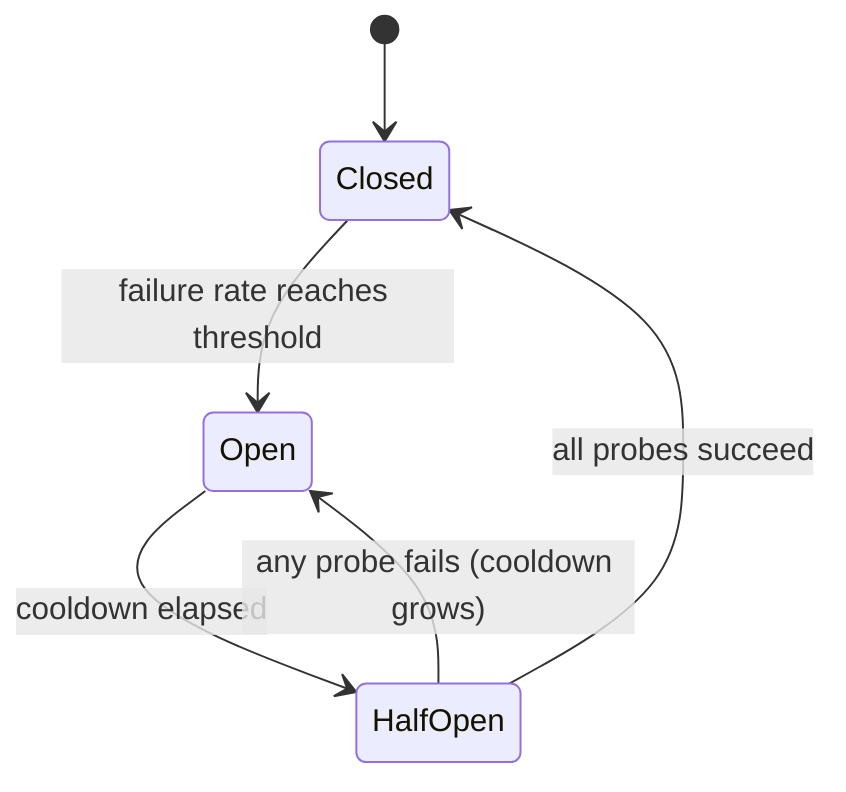

# قطع مدار برای ارائه دهندگان LLM

> یک آزمایش مجدد می پرسد "آیا این درخواست باید دوباره امتحان شود؟" یک قطع مدار می پرسد "آیا کسی باید همین الان به این ارائه دهنده زنگ بزند؟" اولین درخواست یک درخواست را محافظت می کند. دوم سیستم را محافظت می کند.

**Type:** Build
**Languages:** Python
**Prerequisites:** Phase 17 · 19 (AI Gateways), Phase 17 · 24 (Chaos Engineering)
**Time:** ~75 minutes

## اهداف یادگیری

- سه حالت قطع و رویداد که باعث هر انتقال می شود را توضیح دهید.
- یک قطع مدار پنجره ای با حداقل محافظ تماس و بودجه نیمه بازي زيرکاره را اجرا کنید.
- اشتباهات ارائه دهنده LLM را به اشتباهاتی که به ارائه دهنده بیمار اشاره می کنند و اشتباهاتی که به درخواست سرزنش می کنند طبقه بندی کنید.
- یک قطع کننده با زمان بندی، تلاش مجدد و مسیر برگشت را در ترتیب درست ترکیب کنید.
- اندازه گیری آنچه که یک قطع کننده در طول قطع سرویس دهنده ذخیره می کند و هزینه آن پس از بازیابی.
- دامنه شکاف را انتخاب کنید (پرویدر، مدل، منطقه) برای یک انتشار خاص.

## مشکل

دروازه شما هر درخواست را به یک ارائه دهنده اصلی ارسال می کند و در صورت شکست به دوم می افتد. اولین می رود پایین. هر تماس در حال حاضر منتظر تمام 10 ثانیه است قبل از بازگشت به اجرا.

هیچ چیز از دست نمی رود. هر درخواست هنوز پاسخ داده می شود. اما هر درخواست در حال حاضر 11 ثانیه به جای 1 طول می کشد تا زمان قطع برق ادامه یابد. موضوعات کارکن در یک ارائه دهنده که پاسخ نمی دهد، مسدود می شوند. صفها رشد می کنند. تماس گیرندگان پیش از جریان زمان خود را به دست می دهند و دوباره تلاش می کنند، که بار بیشتری را اضافه می کند. قطع قطع جزئی در یک ارائه دهنده به یک قطع کامل در خدمات شما تبدیل می شود.

منطق تکرار و بازپسین برای یک درخواست درست است. اشتباه این است که درخواست شماره 500 از 499 شکست قبل از آن چیزی یاد نمی گیرد. یک شکاف مدار حافظه مشترک است که این را حل می کند.

## مفهوم

### سه ایالت

نامش از دستگاه الکتریکی آمده است: وقتی نقص تشخیص داده می شود، مدار باز می شود و جریان متوقف می شود.



- **Closed**تماس ها از طریق می گذرد و هر نتیجه ثبت می شود.
- **Open**تماس ها بدون تماس با ارائه دهنده رد می شوند. این "شکست سریع" است.
- **Half-open**پس از خنک شدن، تعداد کمی از تماس های واقعی به عنوان "سوند" اجازه می دهند. نتیجه آنها وضعیت بعدی را تعیین می کند.

توجه به تله نامگذاری کنید: * بسته * حالت سالم است و * باز * حالت شکسته است، برعکس یک درب.

### چه وقت بايد سرزنش كنم

ساده ترین قانون این است که "پس از شکست های N متوالی باز شود". ساخت آن آسان است، اما یک موفقیت موفق، شمارش را تنظیم می کند، بنابراین یک ارائه دهنده که 80٪ از تماس ها را شکست می دهد ممکن است هرگز آن را شکست ندهد.

نرخ شکست در پنجره ای که میچرخد قوی تر است.`window_size`نتایج و باز شدن زمانی که بخش شکست خورده به حد رسیدن. اضافه کنید `minimum_calls`guard، یا یک شکست از یک تماس به عنوان یک نرخ شکست 100٪ خوانده می شود و برقراری خطا در اولین خطا پس از یک راه اندازی مجدد.

### چه چیزی به عنوان شکست محسوب می شود

یک قطع کننده اندازه گیری سلامت ارائه دهنده، بنابراین فقط اشتباهاتی که ارائه دهنده را توصیف می کنند باید حساب شود.

| Outcome | Counts as failure? | Reason |
|---------|-------------------|--------|
| Timeout or connection error | Yes | The provider did not answer |
| 5xx (500, 502, 503, 529) | Yes | The provider failed |
| 429 rate limit | Yes | The provider cannot serve you right now |
| 400 bad request, context too long | No | The request is wrong; another provider's model may reject it too |
| 401 or 403 | No | Your credentials are wrong; alert on this instead |
| Content filter refusal | No | The provider answered; the answer was a refusal |

یک 400 در واقع اثبات این است که ارائه دهنده سالم است: درخواست را دریافت کرده، تأیید کرده و به سرعت پاسخ داده است.

### نیمه باز و خنک

وقتی خنک کننده تمام می شود، باز کننده دروازه ها را باز نمی کند. تعداد مشخصی از سوند ها را می پذیرد. اگر همه موفق شوند، پنجره خود را می کند و پاک می کند. اگر یکی از آنها شکست خورده باشد، دوباره باز می شود.

یک سوند شکست خورده همچنین باید خنک کننده بعدی را تا حدودی طولانی کند. یک ارائه دهنده که بعد از 30 ثانیه هنوز پایین است احتمالاً بعد از 60 ثانیه پایین خواهد بود و هر سوند هزینه ای برای کاربر واقعی دارد.

### دامنه

یک بروکر در هر ارائه دهنده معمولاً بیش از حد خشن است. یک قطع اغلب به یک مدل یا یک منطقه محدود می شود و یک بروکر در سراسر ارائه دهنده، انتشار سالم را قطع می کند. یک بروکر در هر کلید API و مدل و منطقه و مستاجر خیلی خوب است: هیچ یک از بروکر ها نمی بینند.`minimum_calls`یک نقطه شروع مشترک یک شکاف در هر انتشار است، یعنی ارائه دهنده، مدل و منطقه.

### ترتیب ترکیب

سه کنترل به طور همزمان تماس می گیرند و سفارش مهم است:

```text
retry  ->  circuit breaker  ->  timeout  ->  provider call
```

زمان توقف در درون است، بنابراین تماس تماس تلفظ شده به یک شکست تبدیل می شود که شکافگر می تواند حساب کند. شکافگر در داخل دوباره تلاش می کند، بنابراین هر تلاش دوباره از شکافگر ابتدا می پرسد و یک حلقه دوباره نمی تواند یک مدار باز را ضربه بزند. بدون زمان توقف، شکافگر هرگز یک ارائه دهنده کند را نمی بیند.

### چگونه از همسایه های خود متفاوت است

| Control | Question it answers | Triggered by |
|---------|--------------------|--------------|
| Timeout | How long may one call take? | A single slow call |
| Retry with backoff | Should this request try again? | A single failed call |
| Rate limit | How much traffic may a caller send? | Request volume |
| Circuit breaker | Is this dependency healthy enough to call? | Failures across many calls |
| Kill switch (Phase 15 · 14) | Should this system run at all? | A human or a safety policy |

## آن را بسازید

اجرای کامل در سال`code/main.py`. از يه .`ManualClock`که تماس گیرنده به دست حرکت می کند، بنابراین نمایش و هر آزمون بلافاصله بدون خواب اجرا می شود.

### مرحله اول: طبقه بندی خطا

```python
def counts_as_failure(status: int | None) -> bool:
    """Timeouts, 429 and 5xx blame the provider. Any other 4xx blames the request."""
    if status is None:
        return True
    return status == 429 or status >= 500
```

`status`.`None`برای یک زمان توقف، چون یک تماس که هرگز بازنویسی ندارد کد وضعیت.

### مرحله دوم: تصمیم بگیرید که آیا می توانید تماس بگیرید

```python
def allow(self) -> bool:
    if self.state == OPEN and self.clock.now() - self.opened_at >= self.cooldown:
        self.probes_issued = 0
        self.probe_successes = 0
        self._move(HALF_OPEN)
    if self.state == CLOSED:
        return True
    if self.state == HALF_OPEN and self.probes_issued < self.config.half_open_probes:
        self.probes_issued += 1
        return True
    return False
```

هیچ تایمر پس زمینه ای وجود ندارد. انتقال از باز به نیمه باز به صورت تنبل اتفاق می افتد، اولین بار که یک تماس گیرنده بعد از گذشت خنک کننده می پرسد.

### مرحله سوم: نتیجه را ثبت کنید

```python
def record_failure(self) -> None:
    if self.state == OPEN:
        return
    if self.state == HALF_OPEN:
        self.cooldown = min(
            self.cooldown * self.config.cooldown_multiplier,
            self.config.max_cooldown_seconds,
        )
        self._trip()
        return
    self.window.append(False)
    enough_calls = len(self.window) >= self.config.minimum_calls
    if enough_calls and self.failure_rate() >= self.config.failure_rate_threshold:
        self._trip()
```

اولین بررسی در سیستم های واقعی مهم است. تماس هایی که در زمان باز شدن بریکر در حال پرواز بودند، شکست های خود را دیر گزارش می دهند. اگر این نتایج دیر به بارگیری مجدد شروع شود، یک خربت ثابت از آنها می تواند بریکر را برای همیشه باز نگه دارد.

`record_success`این عکس این است: در نیمه باز، آن را شمارش استند ها و بسته زمانی که بودجه را برآورده می کند، پنجره را پاک می کند تا شکست های قدیمی دوباره شکاف را به یکباره.

### مرحله 4: تماس را انجام دهید

```python
def call(self, fn: Callable[[], str]) -> str:
    if not self.allow():
        raise CircuitOpenError(self.name)
    try:
        result = fn()
    except ProviderError as error:
        if counts_as_failure(error.status):
            self.record_failure()
        else:
            self.record_success()
        raise
    except Exception:
        self.record_failure()
        raise
    self.record_success()
    return result
```

هر راهي که از اينجا مي گذره`allow()`اگر یک مسیر فراموش کند ضبط کند، یک شکاف نیمه باز، سونودها را به دست می دهد، هیچ چیزی را به شما نمی شنود و نیمه باز باقی می ماند.

### مرحله 5: مسیر اطراف یک شکاف باز

`FallbackRouter`در لیست راه های مرتب حرکت می کند.`CircuitOpenError`یک خطا در درخواست مانند 400 به تماس گیرنده بالا می رود و از آن باز نمی گردد.

### -بذارش رو اجرا کنم

```bash
cd phases/17-infrastructure-and-production/30-circuit-breakers-llm-providers/code
python3 main.py
python3 -m unittest discover tests -v
```

در این نمایش 150 درخواست، یک بار در ثانیه، از طریق یک برنامه اولیه ارسال می شود که از 20 ثانیه به 80 ثانیه کاهش می یابد:

```text
metric                        retry only     breaker
----------------------------------------------------
requests answered                    150         150
timeouts paid on primary              60           6
calls skipped (fast fail)              0          88
calls sent to fallback                60          94
mean latency (seconds)              5.00        1.40

breaker transitions:
  t=   24s     closed -> open
  t=   54s       open -> half_open
  t=   54s  half_open -> open
  t=  114s       open -> half_open
  t=  115s  half_open -> closed
```

دوتا هزینه رو بخوني .برک 6تا تایم آوات عوض از 60تا پرداخت کرد: 5تا از قطع برق استفاده کنه و 1تا از سوند ها در ثانیه 54 شکست خورده اما اون سوند شکست خورده باعث شد که خنک شدن دو برابر بشه، پس بریکر تا 114 ثانیه دوباره امتحان نکرد. اولين مورد از 80 مورد سالم بود و 34 مورد از درخواست ها به عقب نشيني که نياز نداشت، رفت. یک قطع کننده به سرعت تر به دست آوردن قطع برق ارزان تر می پردازد. خنک کردن، ضرب و شرط، این تجارت را تعیین می کند.

## ازش استفاده کن

دروازه های تولید و استازیان این الگوی را تحت نام های مختلف ارسال می کنند. قبل از اینکه به آنها اعتماد کنید، اسناد فعلی را برای معیارهای پیش فرض بررسی کنید.

- **Resilience4j**(JVM) نزدیک ترین با این درس مطابقت دارد. تنظیمات آن نقشه یک به یک: `failureRateThreshold`،`slidingWindowSize`،`minimumNumberOfCalls`،`waitDurationInOpenState`و`permittedNumberOfCallsInHalfOpenState`. همچنین زنگ های کند را به عنوان شکست در طول حساب می کند`slowCallDurationThreshold`. .
- **Envoy**این را "تشخیص غیر معمول" می نامد: یک میزبان پس از`consecutive_5xx`اشتباهات`base_ejection_time`ویژگی فرستنده به نام "شکستن مدار" چیز متفاوتی است، یک محدود کردن در اتصال و درخواست های منتظر.
- **LiteLLM Router**بعد از اينکه يه عمليات رو به حالت خنک کننده تبديل کرد`allowed_fails`شکست های`cooldown_time`در ضمن، چند ثانیه و مسیرها به سایر عملیات ها

دو چیز در نسخه های تولید اضافه شده که شبیه ساز خارج می کند:

- **Concurrency.**نیمه باز باید سوند های پرواز را محدود کند که نیاز به قفل یا یک شمارنده اتمی دارد.
- **Shared state.**در 10 نسخه دروازه، 10 شکنده جداگانه وجود دارد. هر کدام باید شکست های خود را قبل از باز شدن ببینند. حالت مشترک در Redis باعث می شود آنها سریعتر موافقت کنند اما به مسیر وابسته ای اضافه می کند که برای زنده ماندن از شکست های وابسته است. شکنده های هر نسخه انتخاب معمول هستند.

برای ترافیک LLM به طور خاص:

- زمان توقف زمان را برای اولین نشانه برای جریان تماس ها تنظیم کنید. زمان تولید کل با طول خروجی بیش از حد متفاوت است تا یک سیگنال سلامتی باشد.
- وقتی که 429 یه ماشین حمل می کنه`Retry-After`سرنخ، از اون ارزش به جاي ديفرنت به عنوان خنک کننده استفاده کن
- بررسی کنید که آیا عقب نشینی می تواند تمام بار را جذب کند. حرکت 100٪ ترافیک به یک ثانویه با محدودیت سرعت پایین تر، بروکر ثانویه را بعد از حرکت می کند.

## -باده

این درس به ما کمک می کند`outputs/skill-circuit-breaker-review.md`. در نظر گرفتن مسیر تماس ارائه دهنده، آن را بررسی می کند سفر قانون، طبقه بندی خطا، نیمه باز رفتار، دامنه و ترکیب ترتیب و فهرست شکاف.

## تمرینات

1. فرار کن`code/main.py`. تنظیم`cooldown_multiplier`تا 1.0 و دوباره اجرا کنید. چقدر وقت اضافی برای توقف پرداخت می کند و چند ثانیه زودتر بسته می شود؟
2. پنجره ای را با یک شمارشگر شکست های متوالی جایگزین کنید. یک آزمون را با یک ارائه دهنده بنویسید که هر پنج تماس را چهار بار شکست دهد و نشان دهد که شمارشگر هرگز در حد پنج سقوط نمی کند.
3. اضافه کردن تشخیص تماس آهسته: یک تماس که موفق می شود اما بیش از حد طول می کشد به عنوان شکست حساب می شود. چه حد زمانی را برای اولین بار انتخاب می کنید؟
4. بده`ProviderError`یک گزینه ای`retry_after`ارزش و استفاده از شکاف به عنوان خنک کننده در صورت وجود.
5. بازپرداخت دیمو هرگز شکست نمی خورد. به آن یک شکاف و یک حد سرعت 0.5 درخواست در ثانیه بدهید. در طول قطع، چه اتفاقی می افتد و روتر باید چه چیزی را پس از هر مسیر باز کند؟

## اصطلاحات کلیدی

| Term | What people say | What it actually means |
|------|----------------|------------------------|
| Circuit breaker | "Stop calling it" | A state machine that refuses calls to a dependency after failures cross a threshold, then probes for recovery |
| Closed | "Healthy" | Calls pass through and outcomes are recorded |
| Open | "Tripped" | Calls are refused without contacting the dependency |
| Half-open | "Testing" | A limited number of probe calls decide whether to close or reopen |
| Fast fail | "Fail quickly" | Returning an error at once instead of waiting for a timeout |
| Sliding window | "Recent calls" | The last N outcomes used to compute the failure rate |
| Minimum calls | "Warm-up guard" | The fewest recorded calls before the failure rate is trusted |
| Cooldown | "Wait duration" | Time the breaker stays open before it allows probes |
| Probe | "Trial request" | A real request let through in half-open to test recovery |
| Outlier detection | "Envoy's breaker" | Ejecting an unhealthy host from a load-balancing pool |

## خواندن بیشتر

- [Michael Nygard — Release It! (2nd edition)](https://pragprog.com/titles/mnee2/release-it-second-edition/)کتابی که نام این الگوی را در فصل الگوهای ثبات گذاشته است.
- [Martin Fowler — CircuitBreaker](https://martinfowler.com/bliki/CircuitBreaker.html) اشاره کوتاه برای سه کشور.
- [Resilience4j — CircuitBreaker](https://resilience4j.readme.io/docs/circuitbreaker) پنجره های شیفتی مبتنی بر شمارش و زمان، آستانه تماس آهسته
- [Envoy — Outlier detection](https://www.envoyproxy.io/docs/envoy/latest/intro/arch_overview/upstream/outlier) قوانین اخراج و زمان افزایش اخراج.
- [LiteLLM — Routing](https://docs.litellm.ai/docs/routing) کاهش سرعت و عقب نشینی در راه اندازی
- [AWS Builders' Library — Timeouts, retries, and backoff with jitter](https://aws.amazon.com/builders-library/timeouts-retries-and-backoff-with-jitter/) کنترل هایی که یک شکاف با آن ترکیب می شود.
