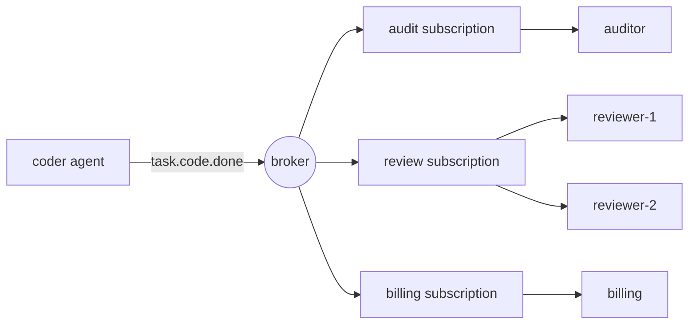

# Pub/submessage pour les agents

> Un appel direct dit: " Fais ceci. " Un événement publié dit: " Cela s'est passé. " L'éditeur ne sait pas qui écoute, et c'est là le point.

**Type:** Build
**Languages:** Python
**Prerequisites:** Phase 16 · 13 (Shared Memory and Blackboard Patterns), Phase 16 · 22 (Production Scaling)
**Time:** ~75 minutes

## Objectifs d'apprentissage

- Expliquez les trois types de déconnexion que donne le public-abonné et le coût de chacun.
- Mettre en œuvre un courtier avec des cartes sauvages de thème, des abonnements, des récompenses, une livraison et une liste de lettres mortes.
- Distinguer les fans-out entre les abonnements et les consommateurs concurrents à l'intérieur d'un abonnement.
- Préserver les commandes par exécution avec une clé de routage tout en évolutionnant les consommateurs.
- Montrez pourquoi au moins une fois la livraison répète des effets secondaires, et réparer avec un manipulateur idempotent.
- Choisissez entre pub/sub, une file d'attente de travail, un appel direct et un tableau noir pour une interaction d'agent donnée.

## Le problème

Un agent de codeur termine une tâche, un agent de réviseur doit la vérifier, alors le codeur appelle le réviseur.

Le mois prochain, vous ajoutez la facturation, qui doit facturer pour chaque tâche terminée. Ensuite, un journal d'audit. Ensuite, un évaluateur qui prélève des échantillons. Chaque addition modifie le codeur: un appel de plus, une autre défaillance de traitement, une autre raison pour laquelle le codeur est lent. Si la facturation est en panne, le codeur échoue-t-il? Si l'évaluateur prend 40 secondes, le codeur attend-il?

Le codeur est devenu l'endroit où les exigences de chaque autre agent sont satisfaites.

Publier-abonner renverse la dépendance.`task.code.done`Tout le monde qui se soucie s'abonne, l'ajout de l'évaluateur ne change rien au codeur.

## Le concept

### Trois types de découplings

L'enquête classique sur le modèle (Eugster et coll., 2003) énumère trois:

| Decoupling | Meaning | What it costs |
|------------|---------|---------------|
| Space | Publisher and subscriber do not know each other | No one place shows the full workflow |
| Time | They need not be running at the same moment | The broker must store messages |
| Synchronization | The publisher does not block waiting for subscribers | There is no return value and no error to catch |

Chaque ligne est un véritable avantage et une véritable perte. Pub/sub ne supprime pas la coordination. Elle la déplace hors du code et dans les noms de sujets et les abonnements.

### Thèmes et cartes sauvages

Un sujet est un nom pour une sorte d'événement. Les noms hiérarchiques permettent à un abonné de choisir son niveau d'intérêt.`*`correspond exactement à un symbole, et `>`correspond à un ou plusieurs jetons à la fin.

| Pattern | Matches | Does not match |
|---------|---------|----------------|
| `task.code.done` | `task.code.done` | `task.research.done` |
| `task.*.done` | `task.code.done`, `task.research.done` | `task.code.failed` |
| `task.>` | `task.code.done`, `task.code.failed` | `task`, `metrics.tokens` |

Nommer les sujets pour les faits dans le passé (`task.code.done`), pas pour les commandes (`review.this`Une commande a un destinataire et est mieux envoyée à la file d'attente ou en tant qu'appel direct.

### Consommateurs en concurrence et en diffusion

Un mécanisme donne deux comportements opposés, et les confondre est l'erreur pub/sub la plus courante.



- **Across subscriptions: fan-out.**Chaque abonnement reçoit sa propre copie de chaque message correspondant.
- **Inside one subscription: competing consumers.**Les membres partagent les messages de l'abonnement. Chaque message va à un membre précis.`reviewer-2`réduit de moitié la charge.`reviewer-1`Elle ne révise pas tout deux fois.

Kafka appelle l'abonnement un groupe de consommateurs, NATS un groupe de files d'attente et Google Cloud Pub/Sub un abonnement.

### Garanties de livraison

| Guarantee | Broker behaviour | Failure you accept |
|-----------|-----------------|--------------------|
| At-most-once | Send once, never retry | Messages are lost |
| At-least-once | Retry until acknowledged | Messages are duplicated |
| Exactly-once | Not available across a network in general | — |

Un consommateur reconnaît un message (*ack*) après l'avoir traité; si le courtier n'entend rien ou reçoit un avis négatif (*nack*), il le remet à nouveau.

Le courtier ne peut pas distinguer "ne jamais traité" de "processé, acc perdu", il redépart donc le travail. Le travail se fait deux fois. Ce que les gens appellent exactement-une fois est en pratique au moins-une fois de livraison plus un consommateur *idempotent*, qui produit le même résultat lorsqu'il voit le même message à nouveau.

Pour les agents, il s'agit d'un problème de coûts ainsi qu'un problème de précision.

### Des messages empoisonnés et la file d'attente de lettres mortes

Certains messages ne réussissent jamais: une charge utile malformée, un schéma que le consommateur ne comprend pas.`max_deliveries`Les tentatives de courtage le courtier déplace le message vers une file d'attente de *dead-letter* (DLQ), où un humain ou un ouvrier de réparation peut l'inspecter, et le flux se déplace.

### Commande

Dans le cas des consommateurs concurrents, deux messages d'un même agent peuvent atteindre différents membres et finir hors d'ordre.`run-a`Les résultats de la recherche sont en accord avec les résultats obtenus par les chercheurs.

Pour maintenir l'ordre, un message échoué doit être retesté avant la livraison du suivant, de sorte qu'un message toxique bloque sa file d'attente jusqu'à ce qu'il soit mort.

### Choisir le modèle

| Pattern | Use when | Example |
|---------|----------|---------|
| Direct call | One receiver, and you need the answer now | Agent calls a tool |
| Work queue | One receiver type, the work must happen once | Dispatch a task to any free worker |
| Pub/sub | Zero or more receivers react to a fact | `task.code.done` triggers review, billing, audit |
| Blackboard (Phase 16 · 13) | Agents share state and read it later | A shared plan that agents refine |

Un tableau noir stocke l'état actuel. Pub/sub porte les modifications. De nombreux systèmes utilisent les deux.

## Faites-le

Le courtier est là .`code/main.py`Il fonctionne en un seul processus sans fil, donc chaque test est déterministe.

### Étape 1: Comparez un sujet avec un schéma

```python
def topic_matches(pattern: str, topic: str) -> bool:
    pattern_tokens = pattern.split(".")
    topic_tokens = topic.split(".")
    for index, token in enumerate(pattern_tokens):
        if token == ">":
            return index == len(pattern_tokens) - 1 and len(topic_tokens) > index
        if index >= len(topic_tokens):
            return False
        if token != "*" and token != topic_tokens[index]:
            return False
    return len(pattern_tokens) == len(topic_tokens)
```

### Étape 2: Publier une copie à chaque abonnement correspondant

```python
def publish(self, topic: str, payload: str, key: str | None = None) -> Message:
    message = Message(self._next_id, topic, payload, key)
    self._next_id += 1
    matched = [group for group in self.groups.values() if topic_matches(group.pattern, topic)]
    if not matched:
        self.dropped.append(message)
    for group in matched:
        group.queue.append(Delivery(message))
    return message
```

Chacun d' eux .`Group`Cette décision produit un fan-out: trois groupes correspondants signifient trois entrées de file d'attente pour un message.`dropped`Un message publié avant que quiconque s'abonne est parti, et `publish`Il revient toujours normalement.

### Étape 3: Choisissez un membre du groupe

```python
def _pick(self, group: Group, message: Message) -> tuple[str, Handler]:
    if message.key is not None:
        digest = hashlib.sha256(message.key.encode()).digest()
        index = int.from_bytes(digest[:8], "big") % len(group.members)
    else:
        index = group.next_member % len(group.members)
        group.next_member += 1
    return group.members[index]
```

Sans clé, les membres se tournent, avec une clé, le hash décide.`hash()`n'est pas utilisé parce qu'il est randomisé par processus pour les chaînes, donc deux processus de courtage ne seraient pas d'accord sur qui possède une clé.

### Étape 4: Livrer, puis acc, réessayer, ou lettre morte

```python
def _deliver(self, group: Group) -> None:
    delivery = group.queue.popleft()
    consumer, handler = self._pick(group, delivery.message)
    self.log.append((group.name, consumer, delivery.message.id, delivery.attempt))
    try:
        acked = handler(delivery.message)
    except Exception:
        acked = False
    if acked:
        return
    if delivery.attempt >= self.max_deliveries:
        self.dead_letters.append((group.name, delivery.message))
    else:
        group.queue.appendleft(Delivery(delivery.message, delivery.attempt + 1))
```

Un gestionnaire revient .`True`Je reviens.`False`La nouvelle tentative revient au premier rang de la file d'attente avec`appendleft`, qui maintient l'ordre et provoque le blocage de la ligne de tête.`append`et vous obtenez le commerce inverse.

### Étape 5: Faire du consommateur un idempotent

```python
class IdempotentHandler:
    def __call__(self, message: Message) -> bool:
        if message.id in self.seen:
            self.duplicates += 1
            return True
        acked = self.handler(message)
        if acked:
            self.seen.add(message.id)
        return acked
```

Un message ne se souvient qu'après son succès, de sorte qu'un échec réel est encore réessayer.

### Faites-le fonctionner .

```bash
cd phases/16-multi-agent-and-swarms/26-pubsub-messaging-for-agents/code
python3 main.py
python3 -m unittest discover tests -v
```

La démo publie sept événements de deux agents et se compose de trois abonnements.

```text
delivery attempts:      19
audit received:         6 events
reviewer-1 handled:    run-a:step-1, run-a:step-2
reviewer-2 handled:    run-e:step-1, run-e:step-3
dead letters:           [('review', 5)]
dropped, no subscriber: ['metrics.tokens']

billing lost the acknowledgement for message 2, so the broker redelivered it.
charges with a plain handler:       6 (5 billable events)
charges with an idempotent handler: 5
```

Lisez chaque ligne par rapport au concept qu'elle montre:

- Sept événements ont provoqué 19 tentatives de livraison.
- Chaque course était sur un critique, dans l'ordre.
- Le message 5 a été testé trois fois par révision puis par lettre morte.
- `metrics.tokens`Il n'avait pas d'abonné et a disparu sans erreur.
- Le simple gestionnaire de facturation a facturé six fois pour cinq événements.

## Utilisez-le

Les courtiers de production diffèrent principalement par ce qu'ils stockent et ce qu'ils garantissent.

| System | Subscription model | Delivery | Ordering |
|--------|-------------------|----------|----------|
| Apache Kafka | Consumer groups read a partitioned log by offset | At-least-once by default | Per partition, chosen by message key |
| NATS | Subjects with `*` and `>`; queue groups | Core NATS is at-most-once; JetStream adds at-least-once | Per stream in JetStream |
| Google Cloud Pub/Sub | Topics and named subscriptions | At-least-once, with an ack deadline and dead-letter topics | Optional ordering keys |
| Redis Pub/Sub | Channels and patterns | At-most-once; offline subscribers miss messages | None |
| Redis Streams | Consumer groups with explicit `XACK` | At-least-once | Per stream |

Le courtier de cette leçon, comme Redis Pub/Sub, ne garde rien pour un abonné qui n'était pas là.

Parmi les cadres d'agents, AutoGen Core est construit sur ce modèle: les agents publient des messages sur un sujet et le runtime les livre aux agents dont les abonnements correspondent.

Ce que le courtier en mémoire laisse de côté:

- **Persistence.**Un accident perd toutes les files d'attente.
- **Ack deadlines.**Un vrai courtier renvoie quand un consommateur reste silencieux trop longtemps.
- **Backpressure.**Les files d'attente sont illimitées. Un abonné lent fait croître sa file d'attente jusqu'à ce que la mémoire se termine.
- **Atomic dedupe.** `IdempotentHandler`En production, écrivez l'effet et l'id traité dans une transaction de base de données, ou passez l'id du message au système en aval comme clé d'idempotence.

Pour les systèmes d'agents spécifiquement:

- **Carry a correlation id.**Sans pile d'appels, le contexte d'exécution et de trace de chaque message sont le seul moyen de reconstruire ce qui s'est passé (phase 14 · 23).
- **Guard against event loops.**L'agent A réagit à l'événement de B et publie un événement auquel B réagit.
- **Version the payload.**Les abonnés que vous ne connaissez pas dépendent de votre schéma. Ajoutez des champs; ne les renommez pas ou ne les supprimez pas.

## La faire partir

Cette leçon produit `outputs/skill-pubsub-design-review.md`- compte tenu d'un ensemble d'agents et des événements entre eux, il examine le nom de thème, la disposition des abonnements, les garanties de livraison, l'impunité, la commande et le traitement des lettres mortes.

## Exercices

1. On court .`code/main.py`- Changez de réessayer .`_deliver`de `appendleft`à `append`Dans quel ordre ?`reviewer-2`Maintenant, gère les événements pour `run-e`, et quand cet ordre serait acceptable ?
2. Ajouter une file d'attente délimitée: `publish`augmentent lorsque la file d'attente d'un groupe détient plus de `max_queue`Les éditeurs doivent-ils faire quoi lorsqu'ils sont élevés: bloquer, déposer ou échouer?
3. Ajouter un `hops`champ à `Message`et faire du courtier une lettre morte tout message publié par un gestionnaire une fois `hops`écrire un test avec deux manipulateurs qui se déclenchent mutuellement.
4. Ajouter une répétition: conservez chaque message publié dans un journal et laissez un nouveau groupe s'abonner dès le début.`dropped`La liste ?
5. Un troisième réviseur rejoint le comité .`review`groupe alors que les messages pour `run-a`Les clés changent de propriétaire.`hash % members`Lisez sur le hachage constant et expliquez comment il réduit le mouvement.

## Les termes clés

| Term | What people say | What it actually means |
|------|----------------|------------------------|
| Pub/sub | "Event bus" | Messaging where publishers send to a topic and the broker delivers to whoever subscribed |
| Topic | "Channel" | A name for a kind of event; called a subject in NATS |
| Subscription | "Consumer group" | A named interest in a topic pattern with its own copy of each message |
| Fan-out | "Broadcast" | Each subscription receives every matching message |
| Competing consumers | "Load balancing" | Members of one subscription share its messages; each message goes to one |
| Ack / nack | "Confirm" | The consumer's report that handling succeeded or failed |
| At-least-once | "Guaranteed delivery" | Redelivery until acknowledged, so duplicates are possible |
| Idempotent consumer | "Dedupe" | A handler that gives the same result when a message is delivered again |
| Dead-letter queue | "DLQ" | Where a message goes after it exhausts its delivery attempts |
| Routing key | "Partition key" | A value hashed to pick the consumer, so related messages stay in order |
| Head-of-line blocking | "Stuck queue" | A failing message that delays everything behind it in an ordered queue |

## Pour en savoir plus

- [Eugster, Felber, Guerraoui, Kermarrec — The Many Faces of Publish/Subscribe (ACM Computing Surveys, 2003)](https://dl.acm.org/doi/10.1145/857076.857078) l'enquête qui définit l'espace, le temps et la découpling de synchronisation.
- [NATS — Subject-Based Messaging](https://docs.nats.io/nats-concepts/subjects) les règles de la carte sauvage sont mises en œuvre dans cette leçon.
- [Apache Kafka — Documentation](https://kafka.apache.org/documentation/) partitions, groupes de consommateurs et compensations.
- [Google Cloud Pub/Sub — Overview](https://cloud.google.com/pubsub/docs/overview) abonnements, délais d'accès, sujets à caractère mort, commandes de clés.
- [Redis — Pub/Sub](https://redis.io/docs/latest/develop/pubsub/) à la plupart des canaux de messagerie.
- [AutoGen Core — Topic and Subscription](https://microsoft.github.io/autogen/stable/user-guide/core-user-guide/core-concepts/topic-and-subscription.html) le même modèle dans un agent runtime.
