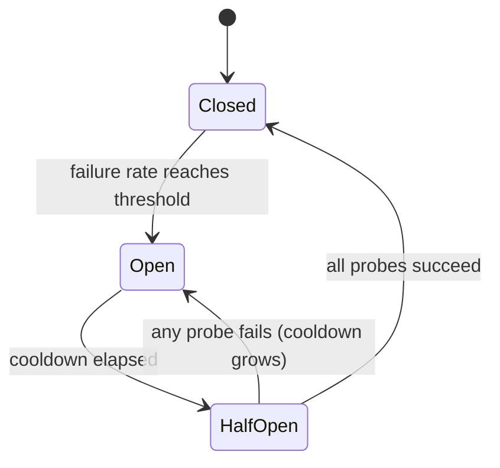

# Les interrupteurs de circuit pour les prestataires de LLM

> Une nouvelle tentative demande " devrait-elle réessayer cette demande ? " Une interruption de circuit demande " devrait- on appeler ce fournisseur maintenant ? " La première protège une demande.

**Type:** Build
**Languages:** Python
**Prerequisites:** Phase 17 · 19 (AI Gateways), Phase 17 · 24 (Chaos Engineering)
**Time:** ~75 minutes

## Objectifs d'apprentissage

- Expliquez les trois états de rupture et l'événement qui provoque chaque transition.
- Mettre en place un disjoncteur de fenêtre coulissante avec un protecteur d'appel minimum et un budget de sonde à moitié ouvert.
- Classifier les erreurs du fournisseur de LLM en celles qui signalent un fournisseur malsain et celles qui blâment la demande.
- Composer un interrupteur avec des temps d'arrêt, des retemps et une route de retour dans l'ordre correct.
- Mesurer ce qu'un interrupteur économise pendant une panne de service et ce qu'il coûte après la récupération.
- Choisissez la portée du disjoncteur (fournisseur, modèle, région) pour un déploiement donné.

## Le problème

Votre passerelle envoie chaque demande à un fournisseur principal et revient à un deuxième en cas d'échec. Le premier est descendu. Chaque appel attend maintenant le temps de 10 secondes avant le retrait.

Toutes les demandes sont toujours répondues. Mais chaque demande prend maintenant 11 secondes au lieu de 1, aussi longtemps que la panne dure. Les fils de travailleurs restent bloqués sur un fournisseur qui ne répond pas. Les files d'attente augmentent. Les appelants en amont touchent leurs propres temps de sortie et réessayer, ce qui ajoute plus de charge. Une panne partielle à un fournisseur devient une panne complète dans votre service.

La logique de retry-and-fallback est correcte pour une seule demande. L'erreur est que la demande numéro 500 n'apprend rien des 499 défaillances précédentes.

## Le concept

### Trois États

Le nom vient de l'appareil électrique: lorsque la faille est détectée, le circuit s'ouvre et le courant s'arrête.



- **Closed**Les appels passent et chaque résultat est enregistré.
- **Open**Les appels sont refusés immédiatement, sans contact avec le fournisseur.
- **Half-open**Après un refroidissement, un petit nombre d'appels réels sont autorisés à passer comme * sondes*. Leur résultat décide de l'état suivant.

Notez le piège de nommage: *fermé* est l'état sain et *ouvert* est celui cassé, l'opposé d'une porte.

### Quand trébucher

La règle la plus simple est "ouvrir après N échecs consécutifs". Il est facile à construire, mais un succès chanceux réinitialise le compte, de sorte qu'un fournisseur qui échoue 80% des appels ne peut jamais le casser.

Un taux d'échec sur une fenêtre coulissante est plus robuste.`window_size`Les résultats sont obtenus et ouverts lorsque la fraction échouée atteint le seuil.`minimum_calls`une défaillance sur un appel se lit comme un taux de défaillance de 100% et fait trébucher le interrupteur lors de la première erreur après un redémarrage.

### Ce qui compte comme un échec

Un interrupteur mesure la santé du fournisseur, donc seuls les erreurs qui décrivent le fournisseur doivent compter.

| Outcome | Counts as failure? | Reason |
|---------|-------------------|--------|
| Timeout or connection error | Yes | The provider did not answer |
| 5xx (500, 502, 503, 529) | Yes | The provider failed |
| 429 rate limit | Yes | The provider cannot serve you right now |
| 400 bad request, context too long | No | The request is wrong; another provider's model may reject it too |
| 401 or 403 | No | Your credentials are wrong; alert on this instead |
| Content filter refusal | No | The provider answered; the answer was a refusal |

Un 400 est en fait la preuve que le fournisseur est en bonne santé: il a reçu la demande, l'a validée et a répondu rapidement.

### La demi-ouverture et le refroidissement

Lorsque le refroidissement est terminé, le disjoncteur ne rouvre pas les verrous, il permet un nombre fixe de sondes, si toutes réussissent, il ferme et ouvre sa fenêtre, si une échec, il ouvre à nouveau.

Un fournisseur qui est toujours en panne après 30 secondes est susceptible d'être en panne après 60, et chaque sonde coûte à un utilisateur réel un temps de pause.

### Scope

Un interrupteur par fournisseur est généralement trop grossier. Une panne est souvent limitée à un modèle ou à une région, et un interrupteur à l'échelle du fournisseur couperait les déploiements sains. Un interrupteur par clé API et modèle et région et locataire est trop fine: aucun interrupteur ne voit `minimum_calls`Un point de départ commun est un interrupteur par déploiement, c'est-à-dire le fournisseur, le modèle et la région.

### L'ordre de la composition

Trois commandes sont enveloppées dans le même appel et l'ordre est important:

```text
retry  ->  circuit breaker  ->  timeout  ->  provider call
```

Le temps de retrait est le plus profond, donc un appel suspendu devient un échec que le disjoncteur peut compter. Le disjoncteur se trouve à l'intérieur de la tentative de retrait, de sorte que chaque tentative de retrait demande d'abord au disjoncteur et une boucle de retrait ne peut pas marteller un circuit ouvert. Sans un temps de retrait, le disjoncteur ne voit jamais un fournisseur lent du tout.

### Comment il diffère de ses voisins

| Control | Question it answers | Triggered by |
|---------|--------------------|--------------|
| Timeout | How long may one call take? | A single slow call |
| Retry with backoff | Should this request try again? | A single failed call |
| Rate limit | How much traffic may a caller send? | Request volume |
| Circuit breaker | Is this dependency healthy enough to call? | Failures across many calls |
| Kill switch (Phase 15 · 14) | Should this system run at all? | A human or a safety policy |

## Faites-le

La mise en œuvre complète est en `code/main.py`Il utilise une`ManualClock`que l'appelant avance à la main, donc la démo et chaque test se déroulent instantanément sans dormir.

### Étape 1: Classifier l'erreur

```python
def counts_as_failure(status: int | None) -> bool:
    """Timeouts, 429 and 5xx blame the provider. Any other 4xx blames the request."""
    if status is None:
        return True
    return status == 429 or status >= 500
```

`status`est `None`pour une pause, parce qu'un appel qui n'a jamais été retourné n'a pas de code d'état.

### Étape 2: Décidez si un appel peut être procédé

```python
def allow(self) -> bool:
    if self.state == OPEN and self.clock.now() - self.opened_at >= self.cooldown:
        self.probes_issued = 0
        self.probe_successes = 0
        self._move(HALF_OPEN)
    if self.state == CLOSED:
        return True
    if self.state == HALF_OPEN and self.probes_issued < self.config.half_open_probes:
        self.probes_issued += 1
        return True
    return False
```

Le passage de l'ouverture à la demi-ouverture se fait paresseusement, la première fois qu'un appelant demande après le refroidissement.

### Étape 3: Enregistrez le résultat

```python
def record_failure(self) -> None:
    if self.state == OPEN:
        return
    if self.state == HALF_OPEN:
        self.cooldown = min(
            self.cooldown * self.config.cooldown_multiplier,
            self.config.max_cooldown_seconds,
        )
        self._trip()
        return
    self.window.append(False)
    enough_calls = len(self.window) >= self.config.minimum_calls
    if enough_calls and self.failure_rate() >= self.config.failure_rate_threshold:
        self._trip()
```

Les premiers contrôles sont importants dans les systèmes réels. Les appels qui étaient déjà en vol lorsque l'interrupteur a été ouvert signaleront leurs défaillances tard. Si ces résultats tardifs redémarrent le refroidissement, un débit constant d'eux pourrait garder l'interrupteur ouvert pour toujours.

`record_success`Il est donc important de noter que les résultats de la recherche ont été obtenus en vue de la réalisation de la recherche et de la recherche.

### Étape 4: Remplissez l'appel

```python
def call(self, fn: Callable[[], str]) -> str:
    if not self.allow():
        raise CircuitOpenError(self.name)
    try:
        result = fn()
    except ProviderError as error:
        if counts_as_failure(error.status):
            self.record_failure()
        else:
            self.record_success()
        raise
    except Exception:
        self.record_failure()
        raise
    self.record_success()
    return result
```

Chaque chemin qui passe`allow()`Si un chemin oublie d'enregistrer, un interrupteur à moitié ouvert distribuerait ses sondes, n'entendrait rien et resterait à moitié ouvert de façon permanente.

### Étape 5: Route autour d'un disjoncteur ouvert

`FallbackRouter`Il est possible de suivre une liste d'itinéraires.`CircuitOpenError`Une erreur de demande telle qu'une 400 est présentée à l'appelant et ne s'éteint pas.

### Faites-le fonctionner .

```bash
cd phases/17-infrastructure-and-production/30-circuit-breakers-llm-providers/code
python3 main.py
python3 -m unittest discover tests -v
```

La démo envoie 150 demandes, une par seconde, à travers une première qui passe de la seconde 20 à la seconde 80:

```text
metric                        retry only     breaker
----------------------------------------------------
requests answered                    150         150
timeouts paid on primary              60           6
calls skipped (fast fail)              0          88
calls sent to fallback                60          94
mean latency (seconds)              5.00        1.40

breaker transitions:
  t=   24s     closed -> open
  t=   54s       open -> half_open
  t=   54s  half_open -> open
  t=  114s       open -> half_open
  t=  115s  half_open -> closed
```

Lisez les deux coûts. Le disjoncteur a payé 6 temps de sortie au lieu de 60: cinq pour détecter l'arrêt et une sonde ratée à la seconde 54. Mais cette sonde ratée a doublé le refroidissement, donc le disjoncteur n'a pas testé à nouveau avant le second 114. La première était en bonne santé à partir de la seconde 80, et 34 demandes sont allées à la chute qui n'a pas besoin. Un interrupteur négocie une récupération plus lente pour des pannes moins chères. Le refroidissement, le multiplicateur et le plafond fixent ce commerce.

## Utilisez-le

Les passerelles de production et les proxies envoient ce modèle sous différents noms. Vérifiez la documentation actuelle pour les défauts avant de vous en fier.

- **Resilience4j**(JVM) est le plus proche de cette leçon.`failureRateThreshold`- Je suis là .`slidingWindowSize`- Je suis là .`minimumNumberOfCalls`- Je suis là .`waitDurationInOpenState`, et `permittedNumberOfCallsInHalfOpenState`Il compte aussi les appels lents comme des échecs .`slowCallDurationThreshold`- Je suis désolé .
- **Envoy**appelle cela *détection exceptionnelle*: un hôte est éjecté après `consecutive_5xx`erreurs pour `base_ejection_time`La fonction de l'envoyé appelée "rupture de circuit" est différente, un cap sur les connexions et les demandes en attente.
- **LiteLLM Router**met un déploiement dans le refroidissement après `allowed_fails`défaillances pour `cooldown_time`Deux secondes et des itinéraires vers d'autres déploiements.

Deux choses que les versions de production ajoutent que le simulateur omet:

- **Concurrency.**La demi-ouverture doit limiter les sondes en vol, qui ont besoin d'un verrou ou d'un compteur atomique.
- **Shared state.**Les deux types de répliques de passerelle contiennent dix interrupteurs séparés. Chacun doit voir ses propres défaillances avant d'ouvrir.

Pour le trafic de LLM spécifiquement:

- La durée de la production totale varie trop avec la durée de sortie pour être un signal de santé.
- Quand un 429 porte un`Retry-After`en-tête, utilisez cette valeur comme le refroidissement au lieu de votre défaut.
- Vérifiez que le retrait absorbe la charge complète.

## La faire partir

Cette leçon produit `outputs/skill-circuit-breaker-review.md`. En fonction du parcours d'appel du fournisseur, il examine la règle de voyage, la classification des erreurs, le comportement à demi-ouvert, la portée et l'ordre de composition, et répertorie les lacunes.

## Exercices

1. On court .`code/main.py`- Je suis prêt .`cooldown_multiplier`Combien de temps supplémentaires le disjoncteur paie, et combien de secondes plus tôt il ferme?
2. Remplacez la fenêtre coulissante par un compteur de défaillance consécutif. Écrivez un test avec un fournisseur qui échoue quatre appels sur cinq et montrez que le compteur ne trébuche jamais à un seuil de cinq.
3. Ajouter la détection des appels lents: un appel qui réussit mais prend plus de temps qu'un seuil est considéré comme un échec.
4. Donner .`ProviderError`une option `retry_after`La valeur de la coupe et le casse-coupe est utilisé comme refroidissement lorsqu'il est présent.
5. La démo ne s'éteint jamais. Donnez-lui un interrupteur et une limite de vitesse de 0,5 demandes par seconde. Que se passe-t-il pendant la panne, et que devrait le routeur retourner quand chaque route est ouverte?

## Les termes clés

| Term | What people say | What it actually means |
|------|----------------|------------------------|
| Circuit breaker | "Stop calling it" | A state machine that refuses calls to a dependency after failures cross a threshold, then probes for recovery |
| Closed | "Healthy" | Calls pass through and outcomes are recorded |
| Open | "Tripped" | Calls are refused without contacting the dependency |
| Half-open | "Testing" | A limited number of probe calls decide whether to close or reopen |
| Fast fail | "Fail quickly" | Returning an error at once instead of waiting for a timeout |
| Sliding window | "Recent calls" | The last N outcomes used to compute the failure rate |
| Minimum calls | "Warm-up guard" | The fewest recorded calls before the failure rate is trusted |
| Cooldown | "Wait duration" | Time the breaker stays open before it allows probes |
| Probe | "Trial request" | A real request let through in half-open to test recovery |
| Outlier detection | "Envoy's breaker" | Ejecting an unhealthy host from a load-balancing pool |

## Pour en savoir plus

- [Michael Nygard — Release It! (2nd edition)](https://pragprog.com/titles/mnee2/release-it-second-edition/) le livre qui a nommé le modèle, dans le chapitre des modèles de stabilité.
- [Martin Fowler — CircuitBreaker](https://martinfowler.com/bliki/CircuitBreaker.html) courte référence pour les trois États.
- [Resilience4j — CircuitBreaker](https://resilience4j.readme.io/docs/circuitbreaker) fenêtres coulissantes basées sur le nombre et le temps, seuils d'appel lent.
- [Envoy — Outlier detection](https://www.envoyproxy.io/docs/envoy/latest/intro/arch_overview/upstream/outlier) règles d'éjection et temps d'éjection croissant.
- [LiteLLM — Routing](https://docs.litellm.ai/docs/routing) des ralentissements et des retombées de déploiement.
- [AWS Builders' Library — Timeouts, retries, and backoff with jitter](https://aws.amazon.com/builders-library/timeouts-retries-and-backoff-with-jitter/) les commandes avec lesquelles un interrupteur est composé.
