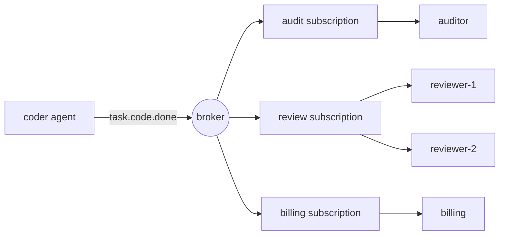

# एजेंटों के लिए पब/सब्मेसेजिंग

> एक प्रत्यक्ष कॉल कहता है, "तुम यह करो।" एक प्रकाशित घटना कहती है, "यह हुआ।" प्रकाशक नहीं जानता कि कौन सुन रहा है, और यही बात है।

**Type:** Build
**Languages:** Python
**Prerequisites:** Phase 16 · 13 (Shared Memory and Blackboard Patterns), Phase 16 · 22 (Production Scaling)
**Time:** ~75 minutes

## सीखने के लक्ष्य

- प्रकाशन-सब्स्क्राइब करने वाले तीन प्रकार के डिकोपलिंग की व्याख्या करें और प्रत्येक की लागत क्या है।
- विषय वन्य कार्ड, सदस्यता, मान्यता, पुनर्वितरण और मृत अक्षर सूची के साथ एक दलाल लागू करें।
- एक सदस्यता के भीतर प्रतिस्पर्धी उपभोक्ताओं से सदस्यता के बीच फैन-आउट को अलग करें।
- उपभोक्ताओं को स्केल करते हुए रूटिंग कुंजी के साथ प्रति रन ऑर्डर को बनाए रखें।
- कम से कम एक बार प्रसव में दुष्प्रभाव क्यों दोहराए जाते हैं, उसे दिखाएं और इसे एक अक्षम संभालकर ठीक करें।
- एक निश्चित एजेंट के लिए पब / सब, एक कार्य कतार, एक प्रत्यक्ष कॉल, और एक ब्लैकबोर्ड के बीच चयन करें।

## समस्या

एक कोडर एजेंट एक कार्य को पूरा करता है, एक समीक्षा एजेंट को इसकी जांच करनी चाहिए। इसलिए कोडर को समीक्षक को बुलाता है।

अगले महीने आप बिलिंग जोड़ते हैं, जिसे हर समाप्त कार्य के लिए चार्ज करना चाहिए। फिर एक ऑडिट लॉग। फिर एक मूल्यांकनकर्ता जो परिणामों का नमूना लेता है। प्रत्येक जोड़ कोडर को संपादित करता हैः एक और कॉल, एक और विफलता को संभालने के लिए, एक और कारण कोडर धीमा है। यदि बिलिंग डाउन है, तो क्या कोडर विफल हो जाता है? यदि मूल्यांकनकर्ता 40 सेकंड लेता है, तो क्या कोडर इंतजार करता है?

कोडर वह जगह बन गया है जहां हर दूसरे एजेंट की आवश्यकताएं पूरी होती हैं। यह जानता है कि वे कौन हैं, उन्हें क्रम में बुलाता है, और उनकी विफलताओं को विरासत में देता है।

प्रकाशित-सब्स्क्राइब निर्भरता को बदल देता है. कोडर घोषणा करता है `task.code.done`जो कोई भी परवाह करता है, वह सदस्यता लेता है। मूल्यांकनकर्ता जोड़ने से कोडर में कुछ भी नहीं बदलता है।

## अवधारणा

### तीन प्रकार के डिकोपलिंग

इस पैटर्न का क्लासिक सर्वेक्षण (Eugster et al., 2003) तीन नामों का उल्लेख करता हैः

| Decoupling | Meaning | What it costs |
|------------|---------|---------------|
| Space | Publisher and subscriber do not know each other | No one place shows the full workflow |
| Time | They need not be running at the same moment | The broker must store messages |
| Synchronization | The publisher does not block waiting for subscribers | There is no return value and no error to catch |

प्रत्येक पंक्ति एक वास्तविक लाभ और एक वास्तविक हानि है। पब/सब् कोऑर्डिनेशन को नहीं हटाता है। यह इसे कोड से बाहर ले जाता है और विषय नामों और सदस्यताओं में जाता है।

### विषय और वन्य कार्ड

एक विषय एक प्रकार की घटना के लिए एक नाम है। पदानुक्रमिक नाम एक ग्राहक को अपने हित के स्तर का चयन करने देते हैं। इस पाठ में NATS सम्मेलन का उपयोग किया जाता हैः टोकन को डॉट्स से अलग किया जाता है, `*`एक टोकन से मेल खाती है, और `>`अंत में एक या अधिक टोकन से मेल खाता है।

| Pattern | Matches | Does not match |
|---------|---------|----------------|
| `task.code.done` | `task.code.done` | `task.research.done` |
| `task.*.done` | `task.code.done`, `task.research.done` | `task.code.failed` |
| `task.>` | `task.code.done`, `task.code.failed` | `task`, `metrics.tokens` |

अतीत में तथ्यों के विषयों का नामकरण करें (`task.code.done`), आदेशों के लिए नहीं (`review.this`) एक कमांड में एक अभिप्रेत प्राप्तकर्ता होता है और इसे कतार या प्रत्यक्ष कॉल के रूप में भेजा जाता है।

### फैलाव और प्रतिस्पर्धी उपभोक्ता

एक तंत्र दो विपरीत व्यवहार देता है, और उन्हें भ्रमित करना सबसे आम पब/सब् गलती है।



- **Across subscriptions: fan-out.**प्रत्येक सदस्यता को प्रत्येक मेल खाने वाले संदेश की अपनी प्रति प्राप्त होती है। ऑडिट, समीक्षा और बिलिंग सभी घटना को देखते हैं।
- **Inside one subscription: competing consumers.**सदस्य सदस्यता के संदेश साझा करते हैं. प्रत्येक संदेश एक सदस्य को जाता है। जोड़ना `reviewer-2`भार को आधा करता है `reviewer-1`; यह सब कुछ दो बार नहीं देखता।

काफ़का ने सदस्यता को *उपभोक्ता समूह* कहा, NATS ने इसे *सूची समूह* कहा, और Google Cloud Pub/Sub ने इसे *सब्स्क्राइबमेंट* कहा। विचार एक ही है।

### वितरण की गारंटी

| Guarantee | Broker behaviour | Failure you accept |
|-----------|-----------------|--------------------|
| At-most-once | Send once, never retry | Messages are lost |
| At-least-once | Retry until acknowledged | Messages are duplicated |
| Exactly-once | Not available across a network in general | — |

उपभोक्ता एक संदेश (*ack*) को संभालने के बाद स्वीकार करता है। यदि ब्रोकर कुछ नहीं सुनता है, या एक नकारात्मक पुष्टि (*nack*) प्राप्त करता है, तो वह फिर से वितरित करता है।

अंतर यह हैः उपभोक्ता काम करता है, फिर ack खो जाता है। ब्रोकर "कभी संसाधित नहीं" से "प्रक्रिया, ack खो" को नहीं बता सकता है, इसलिए यह पुनः वितरित करता है। काम दो बार चलता है। जो लोग वास्तव में एक बार कहते हैं वह कम से कम एक बार वितरण है और एक *idempotent* उपभोक्ता, जो एक ही परिणाम देता है जब वह एक ही संदेश फिर से देखता है।

एजेंटों के लिए यह एक लागत मुद्दा है और साथ ही एक सटीकता मुद्दा है। एक दोहरा प्रबन्धक का मतलब एक दूसरे एलएलएम कॉल, एक दूसरे शुल्क, या एक ग्राहक को एक दूसरा ईमेल हो सकता है।

### विष संदेश और मृत अक्षरों की कतार

कुछ संदेश कभी सफल नहीं हो सकतेः एक गलत रूप से बनाया गया उपयोगिता लोड, एक योजना उपभोक्ता को समझ में नहीं आता है। पुनः प्रयास हमेशा के लिए इसके पीछे सब कुछ ब्लॉक करता है। एक वितरण सीमा नुकसान को सीमित करता है।`max_deliveries`प्रयासों के बाद ब्रोकर संदेश को *मृत अक्षर कतार* (DLQ) में ले जाता है, जहां एक मानव या मरम्मत कार्य इसे देख सकता है, और धारा आगे बढ़ जाती है।

### आदेश

प्रतिस्पर्धी उपभोक्ताओं के साथ, एक ही एजेंट रन से दो संदेश अलग-अलग सदस्यों तक पहुंच सकते हैं और क्रम से बाहर हो सकते हैं। फिक्स एक * राउटिंग कुंजी* हैः हैश कुंजी और हमेशा एक ही कुंजी के लिए एक ही सदस्य चुनें। सभी घटनाओं के लिए `run-a`एक समीक्षक तक पहुंचें, प्रकाशन क्रम में, जबकि अन्य रन समानांतर कहीं और जाते हैं।

आदेश देने की कीमत होती है। आदेश रखने के लिए, एक विफल संदेश को अगले संदेश को वितरित करने से पहले पुनः प्रयास किया जाना चाहिए, इसलिए एक जहरीला संदेश अपनी कतार को तब तक ब्लॉक करता है जब तक कि यह मृत अक्षर नहीं हो जाता। यह *हेड-ऑफ-लाइन ब्लॉक करना* है।

### पैटर्न चुनना

| Pattern | Use when | Example |
|---------|----------|---------|
| Direct call | One receiver, and you need the answer now | Agent calls a tool |
| Work queue | One receiver type, the work must happen once | Dispatch a task to any free worker |
| Pub/sub | Zero or more receivers react to a fact | `task.code.done` triggers review, billing, audit |
| Blackboard (Phase 16 · 13) | Agents share state and read it later | A shared plan that agents refine |

एक ब्लैकबोर्ड वर्तमान स्थिति को संग्रहीत करता है। पब / सब परिवर्तनों को ले जाता है। कई प्रणालियों दोनों का उपयोग करती हैं।

## इसे बनाओ

पूर्ण ब्रोकर है `code/main.py`यह बिना धागे के एक प्रक्रिया में चलता है, इसलिए प्रत्येक परीक्षण निर्धारक है।

### चरण 1: एक विषय को एक पैटर्न के साथ मिलाएं

```python
def topic_matches(pattern: str, topic: str) -> bool:
    pattern_tokens = pattern.split(".")
    topic_tokens = topic.split(".")
    for index, token in enumerate(pattern_tokens):
        if token == ">":
            return index == len(pattern_tokens) - 1 and len(topic_tokens) > index
        if index >= len(topic_tokens):
            return False
        if token != "*" and token != topic_tokens[index]:
            return False
    return len(pattern_tokens) == len(topic_tokens)
```

### चरण 2: प्रत्येक मेल खाने वाली सदस्यता के लिए एक प्रति प्रकाशित करें

```python
def publish(self, topic: str, payload: str, key: str | None = None) -> Message:
    message = Message(self._next_id, topic, payload, key)
    self._next_id += 1
    matched = [group for group in self.groups.values() if topic_matches(group.pattern, topic)]
    if not matched:
        self.dropped.append(message)
    for group in matched:
        group.queue.append(Delivery(message))
    return message
```

प्रत्येक `Group`एक फ़ैसले से फ़ैन आउट होता हैः तीन मिलान समूह एक संदेश के लिए तीन कतार प्रविष्टियों का मतलब होता है।`dropped`किसी को भी सदस्यता से पहले प्रकाशित एक संदेश चला गया है, और `publish`अभी भी सामान्य रूप से वापस आता है।

### चरण 3: समूह में एक सदस्य चुनें

```python
def _pick(self, group: Group, message: Message) -> tuple[str, Handler]:
    if message.key is not None:
        digest = hashlib.sha256(message.key.encode()).digest()
        index = int.from_bytes(digest[:8], "big") % len(group.members)
    else:
        index = group.next_member % len(group.members)
        group.next_member += 1
    return group.members[index]
```

एक कुंजी के बिना, सदस्य बारी बारी बदलते हैं. एक कुंजी के साथ, हैश निर्णय लेता है. पायथन में निर्मित है।`hash()`इसका इस्तेमाल नहीं किया जाता है क्योंकि यह स्ट्रिंग के लिए प्रक्रिया के अनुसार यादृच्छिक है, इसलिए दो ब्रोकर प्रक्रियाएं इस बारे में असहमत होंगी कि कुंजी के मालिक कौन है।

### चरण 4: वितरित करें, फिर एक, पुनः प्रयास करें, या मृत पत्र

```python
def _deliver(self, group: Group) -> None:
    delivery = group.queue.popleft()
    consumer, handler = self._pick(group, delivery.message)
    self.log.append((group.name, consumer, delivery.message.id, delivery.attempt))
    try:
        acked = handler(delivery.message)
    except Exception:
        acked = False
    if acked:
        return
    if delivery.attempt >= self.max_deliveries:
        self.dead_letters.append((group.name, delivery.message))
    else:
        group.queue.appendleft(Delivery(delivery.message, delivery.attempt + 1))
```

एक संचालक लौटता है `True`वापस आ रहा है`False`पुनः प्रयास लाइन के सामने वापस जाता है`appendleft`, जो व्यवस्था बनाए रखता है और लाइन के सिर की रोक का कारण बनता है. इसे बदलकर`append`और आप विपरीत व्यापार मिलता है.

### चरण 5: उपभोक्ता को स्वतंत्र बनाएं

```python
class IdempotentHandler:
    def __call__(self, message: Message) -> bool:
        if message.id in self.seen:
            self.duplicates += 1
            return True
        acked = self.handler(message)
        if acked:
            self.seen.add(message.id)
        return acked
```

एक संदेश को सफलता प्राप्त होने के बाद ही याद किया जाता है, इसलिए एक वास्तविक विफलता फिर से प्रयास की जाती है।

### इसे चलाओ

```bash
cd phases/16-multi-agent-and-swarms/26-pubsub-messaging-for-agents/code
python3 main.py
python3 -m unittest discover tests -v
```

डेमो दो एजेंटों से सात घटनाओं को प्रकाशित करता है तीन सदस्यता में चला जाता है बिलिंग एक पुष्टिकरण खो देता है, और एक उपयोगी लोड गलत है।

```text
delivery attempts:      19
audit received:         6 events
reviewer-1 handled:    run-a:step-1, run-a:step-2
reviewer-2 handled:    run-e:step-1, run-e:step-3
dead letters:           [('review', 5)]
dropped, no subscriber: ['metrics.tokens']

billing lost the acknowledgement for message 2, so the broker redelivered it.
charges with a plain handler:       6 (5 billable events)
charges with an idempotent handler: 5
```

प्रत्येक पंक्ति को उस अवधारणा के विपरीत पढ़ें जो यह दिखाता हैः

- सात घटनाओं ने 19 वितरण प्रयासों को जन्म दिया। फैन-आउट संदेशों को गुणा करता है, और पुनः प्रयासों में अधिक जोड़ता है।
- प्रत्येक रन एक समीक्षक पर रखा गया, क्रम में।
- संदेश 5 को समीक्षा द्वारा तीन बार आज़माया गया और फिर मृत पत्र। ऑडिट और बिलिंग ने एक ही संदेश को बिना किसी समस्या के संभाला, क्योंकि प्रत्येक सदस्यता स्वतंत्र रूप से विफल हो जाती है।
- `metrics.tokens`कोई ग्राहक नहीं था और बिना किसी त्रुटि के गायब हो गया।
- आम बिलिंग हैंडलर ने पांच घटनाओं के लिए छह बार शुल्क लिया।

## इसका प्रयोग करें

उत्पादन दलाल ज्यादातर अलग-अलग हैं कि वे क्या स्टोर करते हैं और वे क्या गारंटी देते हैं। डिफ़ॉल्ट पर भरोसा करने से पहले वर्तमान दस्तावेज की जांच करें।

| System | Subscription model | Delivery | Ordering |
|--------|-------------------|----------|----------|
| Apache Kafka | Consumer groups read a partitioned log by offset | At-least-once by default | Per partition, chosen by message key |
| NATS | Subjects with `*` and `>`; queue groups | Core NATS is at-most-once; JetStream adds at-least-once | Per stream in JetStream |
| Google Cloud Pub/Sub | Topics and named subscriptions | At-least-once, with an ack deadline and dead-letter topics | Optional ordering keys |
| Redis Pub/Sub | Channels and patterns | At-most-once; offline subscribers miss messages | None |
| Redis Streams | Consumer groups with explicit `XACK` | At-least-once | Per stream |

काफ़का और जेटस्ट्रीम लॉग रखते हैं, ताकि नया ग्राहक इतिहास को फिर से चला सके। इस पाठ में ब्रोकर, रेडिस पब / सब की तरह, एक ग्राहक के लिए कुछ भी नहीं रखता है जो वहां नहीं था।

एजेंट फ्रेमवर्क के बीच, ऑटोजेन कोर इस मॉडल पर बनाया गया हैः एजेंट एक विषय के लिए संदेश प्रकाशित करते हैं और रनटाइम उन्हें उन एजेंटों को वितरित करता है जिनकी सदस्यताएं मेल खाती हैं।

जो इन-मेमोरी ब्रोकर छोड़ देता हैः

- **Persistence.**दुर्घटना हर कतार खो देती है।
- **Ack deadlines.**एक वास्तविक ब्रोकर जब उपभोक्ता बहुत लंबे समय तक चुप रहता है तो फिर से वितरित करता है। यहां एक हैंडलर या तो वापस आता है या बढ़ता है।
- **Backpressure.**एक धीमी ग्राहक अपनी कतार को तब तक बढ़ाता है जब तक कि स्मृति समाप्त नहीं हो जाती।
- **Atomic dedupe.** `IdempotentHandler`प्रभाव के बाद आईडी रिकॉर्ड करता है। दोनों के बीच एक क्रैश प्रभाव को दोहराता है। उत्पादन में, एक डेटाबेस लेनदेन में प्रभाव और संसाधित आईडी लिखें, या संदेश आईडी को डाउनस्ट्रीम सिस्टम में एक idempotency कुंजी के रूप में पारित करें।

एजेंट सिस्टम के लिए विशेष रूप सेः

- **Carry a correlation id.**कॉल स्टैक के बिना, प्रत्येक संदेश में रन आईडी और ट्रैक संदर्भ जो हुआ है उसे फिर से बनाने का एकमात्र तरीका है (चरण 14 · 23) ।
- **Guard against event loops.**एजेंट ए बी की घटना पर प्रतिक्रिया करता है और एक प्रकाशित करता है कि बी प्रतिक्रिया करता है. प्रत्येक संदेश के लिए एक कूद गिनती जोड़ें और इसे एक सीमा से परे छोड़ दें.
- **Version the payload.**जिन ग्राहकों के बारे में आप नहीं जानते हैं, वे आपके स्कीम पर निर्भर करते हैं। फ़ील्ड जोड़ें; उन्हें नाम न दें या हटाएं।

## इसे भेजें

यह सबक हमें फल देता है`outputs/skill-pubsub-design-review.md`. एजेंटों के एक सेट और उनके बीच की घटनाओं को देखते हुए, यह विषय नामकरण, सदस्यता लेआउट, वितरण गारंटी, विमुक्ति, आदेश और मृत पत्रों के निपटान की समीक्षा करता है।

## व्यायाम

1. दौड़ें`code/main.py`. पुनः प्रयास में परिवर्तन .`_deliver`से`appendleft``append`. किस क्रम में करता है`reviewer-2`अब घटनाओं को संभालने के लिए `run-e`और यह आदेश कब स्वीकार्य होगा?
2. एक सीमाबद्ध कतार जोड़ें: `publish`बढ़ता है जब किसी समूह की कतार में  से अधिक हो`max_queue`यदि कोई व्यक्ति एक एजेंट प्रणाली में एक के लिए तर्क देता है तो उसे एक एजेंट प्रणाली में एक के लिए तर्क देना चाहिए।
3. एक जोड़ें `hops`क्षेत्र से `Message`और एक बार किसी संचालक द्वारा प्रकाशित किसी भी संदेश को ब्रोकर को मृत अक्षर बना दें `hops`एक सीमा से अधिक है. दो हैंडलर्स के साथ एक परीक्षण लिखें जो एक दूसरे को ट्रिगर करते हैं.
4. पुनःप्रकाशन जोड़ेंः प्रत्येक प्रकाशित संदेश को लॉग में रखें और एक नए समूह को शुरुआत से सदस्यता लेने दें। यह `dropped`सूची?
5. एक तीसरा समीक्षक `review`समूह के लिए संदेश के दौरान`run-a`कौन सी चाबियाँ मालिक को बदलती हैं`hash % members`लगातार हैशिंग के बारे में पढ़ें और समझाएं कि यह आंदोलन को कैसे कम करता है।

## प्रमुख शर्तें

| Term | What people say | What it actually means |
|------|----------------|------------------------|
| Pub/sub | "Event bus" | Messaging where publishers send to a topic and the broker delivers to whoever subscribed |
| Topic | "Channel" | A name for a kind of event; called a subject in NATS |
| Subscription | "Consumer group" | A named interest in a topic pattern with its own copy of each message |
| Fan-out | "Broadcast" | Each subscription receives every matching message |
| Competing consumers | "Load balancing" | Members of one subscription share its messages; each message goes to one |
| Ack / nack | "Confirm" | The consumer's report that handling succeeded or failed |
| At-least-once | "Guaranteed delivery" | Redelivery until acknowledged, so duplicates are possible |
| Idempotent consumer | "Dedupe" | A handler that gives the same result when a message is delivered again |
| Dead-letter queue | "DLQ" | Where a message goes after it exhausts its delivery attempts |
| Routing key | "Partition key" | A value hashed to pick the consumer, so related messages stay in order |
| Head-of-line blocking | "Stuck queue" | A failing message that delays everything behind it in an ordered queue |

## आगे पढ़ना

- [Eugster, Felber, Guerraoui, Kermarrec — The Many Faces of Publish/Subscribe (ACM Computing Surveys, 2003)](https://dl.acm.org/doi/10.1145/857076.857078) अंतरिक्ष, समय और समक्रमण विघटन को परिभाषित करने वाला सर्वेक्षण।
- [NATS — Subject-Based Messaging](https://docs.nats.io/nats-concepts/subjects) इस पाठ में वाइल्डकार्ड नियम लागू होते हैं।
- [Apache Kafka — Documentation](https://kafka.apache.org/documentation/) विभाजन, उपभोक्ता समूह और ऑफसेट।
- [Google Cloud Pub/Sub — Overview](https://cloud.google.com/pubsub/docs/overview) सदस्यता, समय सीमा, मृत अक्षर विषय, आदेश कुंजी।
- [Redis — Pub/Sub](https://redis.io/docs/latest/develop/pubsub/) सबसे अधिक एक बार चैनल संदेश।
- [AutoGen Core — Topic and Subscription](https://microsoft.github.io/autogen/stable/user-guide/core-user-guide/core-concepts/topic-and-subscription.html) एजेंट रनटाइम के भीतर एक ही मॉडल।
