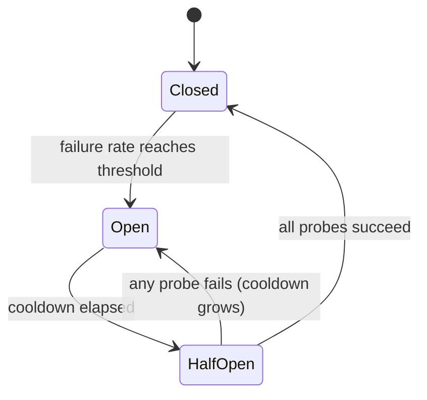

# LLM प्रदाताओं के लिए सर्किट ब्रेकर

> एक रिट्रीट पूछता है "क्या इस अनुरोध को फिर से प्रयास करना चाहिए? " एक सर्किट ब्रेकर पूछता है "क्या किसी को इस प्रदाता को अभी फोन करना चाहिए? " पहला एक अनुरोध की रक्षा करता है। दूसरा पूरी प्रणाली की रक्षा करता है।

**Type:** Build
**Languages:** Python
**Prerequisites:** Phase 17 · 19 (AI Gateways), Phase 17 · 24 (Chaos Engineering)
**Time:** ~75 minutes

## सीखने के लक्ष्य

- तीन ब्रेक स्टेट और प्रत्येक संक्रमण का कारण बनने वाली घटना को समझाएं।
- न्यूनतम कॉल गार्ड और अर्ध-खुले जांच बजट के साथ एक स्लाइडिंग विंडो सर्किट ब्रेकर लागू करें।
- LLM प्रदाता त्रुटियों को उन त्रुटियों में वर्गीकृत करें जो एक अस्वास्थ्यकर प्रदाता को संकेत देते हैं और उन त्रुटियों को जो अनुरोध को दोष देते हैं।
- समय सीमा, पुनः प्रयास और सही क्रम में वापसी मार्ग के साथ एक ब्रेकअप बनाएं।
- प्रदाता के विराम के दौरान ब्रेकअप से बचाए जाने वाले धन का मापन करें और पुनर्प्राप्ति के बाद इसकी लागत क्या होगी।
- किसी दिए गए तैनाती के लिए ब्रेकर दायरा (प्रदाता, मॉडल, क्षेत्र) चुनें।

## समस्या

आपका गेटवे एक प्राथमिक प्रदाता को प्रत्येक अनुरोध भेजता है और विफलता पर दूसरे पर गिर जाता है. प्राथमिक नीचे जाता है. प्रत्येक कॉल अब वापस चलने से पहले पूर्ण 10 सेकंड समय का इंतजार करता है.

कोई भी चीज नहीं खोई गई है. हर अनुरोध का अभी भी जवाब दिया जाता है। लेकिन प्रत्येक अनुरोध में अब 1 के बजाय 11 सेकंड लगते हैं, जब तक यह आउटेज रहता है। एक प्रदाता पर श्रमिक थ्रेड अवरुद्ध रहते हैं जो जवाब नहीं देगा। कतारें बढ़ती हैं। अपस्ट्रीम कॉलर्स अपने स्वयं के टाइमआउट को हिट करते हैं और फिर से प्रयास करते हैं, जो अधिक लोड जोड़ता है। एक प्रदाता पर आंशिक आउटेज आपकी सेवा में एक पूर्ण आउटेज बन जाता है।

एक अनुरोध के लिए री-ट्राई और बैक लॉजिक सही है। त्रुटि यह है कि अनुरोध संख्या 500 इससे पहले की 499 विफलताओं से कुछ भी नहीं सीखता है। एक सर्किट ब्रेकर साझा स्मृति है जो इसे ठीक करता है।

## अवधारणा

### तीन राज्य

इसका नाम विद्युत उपकरण से आया हैः जब दोष का पता चलता है, तो सर्किट खुलता है और वर्तमान रुक जाता है।



- **Closed**कॉल गुजरते हैं और प्रत्येक परिणाम रिकॉर्ड किया जाता है।
- **Open**यह प्रदाता से संपर्क किए बिना तुरंत कॉल से इनकार कर दिया जाता है। यह *त्वरित विफलता* है।
- **Half-open**एक शीतलन के बाद, वास्तविक कॉल की एक छोटी संख्या * जांच के रूप में पारित की अनुमति दी जाती है। उनके परिणाम अगले राज्य का फैसला करता है।

नामकरण जाल पर ध्यान देंः * बंद* स्वस्थ अवस्था है और * खुला* तोड़े हुए अवस्था है, जो दरवाजे के विपरीत है।

### कब ठोकर खाएं

सबसे सरल नियम "एन लगातार विफलताओं के बाद खोलें" है। यह बनाना आसान है, लेकिन एक भाग्यशाली सफलता गिनती को रीसेट करती है, इसलिए 80% कॉल विफल करने वाला प्रदाता इसे कभी भी ट्रिप नहीं कर सकता है।

एक स्लाइडिंग विंडो पर विफलता दर अधिक मजबूत है। अंतिम रखें।`window_size`परिणाम और खोलने जब विफल अंश सीमा तक पहुँचता है।`minimum_calls`गार्ड, या एक कॉल में एक विफलता एक 100% विफलता दर के रूप में पढ़ता है और एक पुनरारंभ के बाद पहली त्रुटि पर ब्रेकअप को ट्रिप करता है।

### असफलता क्या है

एक ब्रेकर प्रदाता स्वास्थ्य को मापता है, इसलिए केवल प्रदाता का वर्णन करने वाली त्रुटियों को गिनना चाहिए।

| Outcome | Counts as failure? | Reason |
|---------|-------------------|--------|
| Timeout or connection error | Yes | The provider did not answer |
| 5xx (500, 502, 503, 529) | Yes | The provider failed |
| 429 rate limit | Yes | The provider cannot serve you right now |
| 400 bad request, context too long | No | The request is wrong; another provider's model may reject it too |
| 401 or 403 | No | Your credentials are wrong; alert on this instead |
| Content filter refusal | No | The provider answered; the answer was a refusal |

400 वास्तव में प्रदाता स्वस्थ है इसका प्रमाण हैः उसने अनुरोध प्राप्त किया, उसे मान्य किया और जल्दी से जवाब दिया।

### आधा खुला और ठंडा

जब शीतलन समाप्त होता है, तो ब्रेकअप ने ढलानों को फिर से नहीं खोला। यह एक निश्चित संख्या में जांचों को स्वीकार करता है। यदि सभी सफल होते हैं, तो यह अपनी खिड़की को बंद करता है और साफ करता है। यदि कोई विफल होता है, तो यह फिर से खुलता है।

एक असफल जांच को अगले शीतलन को भी एक सीमा तक लंबा करना चाहिए। 30 सेकंड के बाद भी डाउन हो रहा प्रदाता 60 सेकंड के बाद भी डाउन हो सकता है, और प्रत्येक जांच वास्तविक उपयोगकर्ता को एक टाइमआउट लागत है।

### दायरा

एक ब्रेकर प्रति प्रदाता आमतौर पर बहुत मोटा होता है। एक आउटेज अक्सर एक मॉडल या एक क्षेत्र तक सीमित होता है, और एक प्रदाता-व्यापी ब्रेकर स्वस्थ तैनाती को काट देगा। एपीआई कुंजी और मॉडल और क्षेत्र और किरायेदार के लिए एक ब्रेकर बहुत ठीक हैः कोई भी ब्रेकर नहीं देखता है।`minimum_calls`एक आम प्रारंभिक बिंदु प्रति तैनाती एक ब्रेक है, जिसका अर्थ है प्रदाता, मॉडल, और क्षेत्र.

### संरचना का क्रम

तीन नियंत्रण एक ही कॉल को लपेटते हैं और आदेश मायने रखता हैः

```text
retry  ->  circuit breaker  ->  timeout  ->  provider call
```

टाइमआउट सबसे अंदर है, इसलिए एक लटकन कॉल एक विफलता बन जाता है जिसे ब्रेकर गिन सकता है। ब्रेकर रीट्री के अंदर बैठता है, इसलिए प्रत्येक रीट्री प्रयास पहले ब्रेकर से पूछता है और एक रीट्री लूप एक खुला सर्किट को हथौड़ा नहीं लगा सकता है। टाइमआउट के बिना ब्रेकर कभी भी धीमी प्रदाता को नहीं देखता है।

### यह अपने पड़ोसियों से कैसे भिन्न है

| Control | Question it answers | Triggered by |
|---------|--------------------|--------------|
| Timeout | How long may one call take? | A single slow call |
| Retry with backoff | Should this request try again? | A single failed call |
| Rate limit | How much traffic may a caller send? | Request volume |
| Circuit breaker | Is this dependency healthy enough to call? | Failures across many calls |
| Kill switch (Phase 15 · 14) | Should this system run at all? | A human or a safety policy |

## इसे बनाओ

पूर्ण कार्यान्वयन `code/main.py`. यह एक `ManualClock`कि कॉल करने वाला हाथ से आगे बढ़ता है, इसलिए डेमो और हर परीक्षण तुरंत बिना नींद के चला जाता है।

### चरण 1: त्रुटि को वर्गीकृत करें

```python
def counts_as_failure(status: int | None) -> bool:
    """Timeouts, 429 and 5xx blame the provider. Any other 4xx blames the request."""
    if status is None:
        return True
    return status == 429 or status >= 500
```

`status`है `None`समय के लिए, क्योंकि एक कॉल जो कभी नहीं लौटाया गया है कोई स्थिति कोड नहीं है.

### चरण 2: निर्णय लें कि क्या कॉल जारी किया जा सकता है

```python
def allow(self) -> bool:
    if self.state == OPEN and self.clock.now() - self.opened_at >= self.cooldown:
        self.probes_issued = 0
        self.probe_successes = 0
        self._move(HALF_OPEN)
    if self.state == CLOSED:
        return True
    if self.state == HALF_OPEN and self.probes_issued < self.config.half_open_probes:
        self.probes_issued += 1
        return True
    return False
```

कोई पृष्ठभूमि टाइमर नहीं है. खुले से आधे खुले तक का कदम आलसी होता है, पहली बार जब कोई कॉल करने वाला पूछता है कि शीतलन बीत गया है।

### चरण 3: परिणाम लिखिए

```python
def record_failure(self) -> None:
    if self.state == OPEN:
        return
    if self.state == HALF_OPEN:
        self.cooldown = min(
            self.cooldown * self.config.cooldown_multiplier,
            self.config.max_cooldown_seconds,
        )
        self._trip()
        return
    self.window.append(False)
    enough_calls = len(self.window) >= self.config.minimum_calls
    if enough_calls and self.failure_rate() >= self.config.failure_rate_threshold:
        self._trip()
```

पहले चेक वास्तविक प्रणालियों में मायने रखता है. ब्रेकअप के खोलने पर पहले से ही उड़ान में थे कॉल देर से अपनी विफलताओं की रिपोर्ट करेंगे। यदि उन देर से परिणामों को ठंडा करने को फिर से शुरू किया, तो उनमें से एक स्थिर ड्रिप ब्रेकअप को हमेशा के लिए खुला रख सकता है।

`record_success`यह इस बात का प्रतिबिंब हैः आधा खुला में यह जांच गिनता है और बजट पूरा होने पर बंद हो जाता है, खिड़की को साफ करने के लिए ताकि पुराने विफलताओं को फिर से ब्रेकअप को एक बार में नहीं झटका।

### चरण 4: कॉल को संभालें

```python
def call(self, fn: Callable[[], str]) -> str:
    if not self.allow():
        raise CircuitOpenError(self.name)
    try:
        result = fn()
    except ProviderError as error:
        if counts_as_failure(error.status):
            self.record_failure()
        else:
            self.record_success()
        raise
    except Exception:
        self.record_failure()
        raise
    self.record_success()
    return result
```

हर रास्ते जो गुजरता है`allow()`यदि एक पथ रिकॉर्ड करना भूल जाता है, तो एक आधा खुला ब्रेकर अपने जांच को वितरित करेगा, कोई प्रतिक्रिया नहीं सुनता है, और स्थायी रूप से आधा खुला रहता है।

### चरण 5: एक खुला ब्रेक के चारों ओर मार्ग

`FallbackRouter`मार्गों की क्रमबद्ध सूची पर चलता है।`CircuitOpenError`कॉल के लिए भुगतान करने के बाद एक प्रदाता विफलता अगले मार्ग पर जाती है। एक अनुरोध त्रुटि जैसे 400 को कॉल करने वाले को उठाया जाता है और विफल नहीं होता है।

### इसे चलाओ

```bash
cd phases/17-infrastructure-and-production/30-circuit-breakers-llm-providers/code
python3 main.py
python3 -m unittest discover tests -v
```

डेमो 150 अनुरोध भेजता है, प्रति सेकंड, एक प्राथमिक के माध्यम से जो दूसरे 20 से नीचे से दूसरे 80 तक हैः

```text
metric                        retry only     breaker
----------------------------------------------------
requests answered                    150         150
timeouts paid on primary              60           6
calls skipped (fast fail)              0          88
calls sent to fallback                60          94
mean latency (seconds)              5.00        1.40

breaker transitions:
  t=   24s     closed -> open
  t=   54s       open -> half_open
  t=   54s  half_open -> open
  t=  114s       open -> half_open
  t=  115s  half_open -> closed
```

दो लागतों को पढ़ें। ब्रेकआउट ने 60 के बजाय 6 टाइमआउट का भुगतान कियाः पांच ब्रेकआउट का पता लगाने के लिए और एक विफलता जांच 54 सेकंड पर। लेकिन उस असफल जांच ने शीतलन को दोगुना कर दिया, इसलिए ब्रेकर ने दूसरे 114 तक दोबारा परीक्षण नहीं किया। प्राथमिक 80 से स्वस्थ था, और 34 अनुरोधों को वापस करने के लिए चला गया था जो आवश्यक नहीं था। ब्रेकअवर धीमी गति से कम लागत वाली ब्रेकआउट के लिए व्यापार करता है। शीतलन, गुणक, और कैप उस व्यापार को निर्धारित करते हैं।

## इसका प्रयोग करें

उत्पादन गेटवे और प्रॉक्सी इस पैटर्न को विभिन्न नामों के तहत भेजते हैं। आप उन पर भरोसा करने से पहले डिफ़ॉल्ट के लिए वर्तमान प्रलेखन की जांच करें।

- **Resilience4j**(JVM) इस पाठ के सबसे निकटतम मैच है. इसकी सेटिंग्स एक से एक मैपः `failureRateThreshold`,`slidingWindowSize`,`minimumNumberOfCalls`,`waitDurationInOpenState`और `permittedNumberOfCallsInHalfOpenState`यह भी विफलता के रूप में धीमी कॉल गिनती करता है`slowCallDurationThreshold`. .
- **Envoy**यह *outlier detection* कहते हैंः एक मेजबान के बाद बाहर निकाला जाता है `consecutive_5xx` के लिए त्रुटियाँ`base_ejection_time`"सर्किट तोड़ने" नामक दूत की विशेषता एक अलग बात है, कनेक्शन पर एक टोपी और लंबित अनुरोधों पर.
- **LiteLLM Router**एक तैनाती को ठंडा करने के बाद डालता है `allowed_fails``cooldown_time`दूसरी और अन्य तैनाती के लिए मार्गों के बीच में.

दो चीजें उत्पादन संस्करणों में जोड़ते हैं कि सिम्युलेटर छोड़ देता हैः

- **Concurrency.**अर्ध-खुले को उड़ान में जांच को सीमित करना चाहिए, जिसे लॉक या परमाणु काउंटर की आवश्यकता होती है।
- **Shared state.**10 गेटवे प्रतिकृति में 10 अलग-अलग ब्रेकर होते हैं। प्रत्येक को खोलने से पहले अपनी विफलताओं को देखना चाहिए। रेडिस में साझा स्थिति उन्हें तेजी से सहमत करती है लेकिन निर्भरता विफलताओं को बचाने के लिए मार्ग में निर्भरता जोड़ती है। प्रति प्रतिकृति ब्रेकर सामान्य विकल्प हैं।

एलएलएम ट्रैफ़िक के लिए विशेष रूप सेः

- स्ट्रीमिंग कॉल के लिए समय को पहले टोकन के लिए निर्धारित करें। आउटपुट लंबाई के साथ कुल उत्पादन समय स्वास्थ्य संकेत होने के लिए बहुत अधिक भिन्न होता है।
- जब एक 429 एक `Retry-After`हेडर, अपने डिफ़ॉल्ट के बजाय उस मान को शीतलन के रूप में उपयोग करें।
- जांचें कि क्या पतन पूर्ण भार को अवशोषित कर सकता है। 100% ट्रैफ़िक को एक माध्यमिक के लिए स्थानांतरित करने के लिए एक कम दर सीमा के साथ माध्यमिक के ब्रेकर अगले चला जाता है।

## इसे भेजें

यह सबक हमें फल देता है`outputs/skill-circuit-breaker-review.md`. प्रदाता कॉल पथ को देखते हुए, यह यात्रा नियम, त्रुटि वर्गीकरण, अर्ध-खुले व्यवहार, दायरा और संरचना क्रम की समीक्षा करता है, और अंतराल की सूची देता है।

## व्यायाम

1. दौड़ें`code/main.py`सेट`cooldown_multiplier`कितने अतिरिक्त समय ब्रेकआउट भुगतान करता है, और कितने सेकंड पहले यह बंद करता है?
2. स्लाइडिंग विंडो को एक लगातार विफलता काउंटर के साथ बदलें। एक प्रदाता के साथ एक परीक्षण लिखें जो हर पांच में से चार कॉल को विफल करता है और दिखाता है कि काउंटर कभी भी पांच की सीमा पर नहीं ट्रिप करता है।
3. धीमी कॉल का पता लगाने का जोड़ेंः एक कॉल जो सफल हो लेकिन एक सीमा से अधिक समय लेती है, विफलता के रूप में गिना जाता है। आप पहली बार समय के लिए किस सीमा का चयन करेंगे?
4. दे दो`ProviderError`एक वैकल्पिक `retry_after`मूल्य और ब्रेकअप को उपयोग करने के लिए इसे ठंडा करने के रूप में जब मौजूद है।
5. डेमो का बैकअप कभी विफल नहीं होता है. इसे एक ब्रेक और प्रति सेकंड 0.5 अनुरोधों की दर की सीमा दें। आउटेज के दौरान क्या होता है, और प्रत्येक मार्ग खुले होने पर राउटर को क्या लौटना चाहिए?

## प्रमुख शर्तें

| Term | What people say | What it actually means |
|------|----------------|------------------------|
| Circuit breaker | "Stop calling it" | A state machine that refuses calls to a dependency after failures cross a threshold, then probes for recovery |
| Closed | "Healthy" | Calls pass through and outcomes are recorded |
| Open | "Tripped" | Calls are refused without contacting the dependency |
| Half-open | "Testing" | A limited number of probe calls decide whether to close or reopen |
| Fast fail | "Fail quickly" | Returning an error at once instead of waiting for a timeout |
| Sliding window | "Recent calls" | The last N outcomes used to compute the failure rate |
| Minimum calls | "Warm-up guard" | The fewest recorded calls before the failure rate is trusted |
| Cooldown | "Wait duration" | Time the breaker stays open before it allows probes |
| Probe | "Trial request" | A real request let through in half-open to test recovery |
| Outlier detection | "Envoy's breaker" | Ejecting an unhealthy host from a load-balancing pool |

## आगे पढ़ना

- [Michael Nygard — Release It! (2nd edition)](https://pragprog.com/titles/mnee2/release-it-second-edition/) पुस्तक जो पैटर्न का नाम देती है, स्थिरता पैटर्न अध्याय में।
- [Martin Fowler — CircuitBreaker](https://martinfowler.com/bliki/CircuitBreaker.html) तीन राज्यों के लिए संक्षिप्त संदर्भ।
- [Resilience4j — CircuitBreaker](https://resilience4j.readme.io/docs/circuitbreaker) गिनती और समय आधारित स्लाइडिंग विंडो, धीमी कॉल की सीमाएं।
- [Envoy — Outlier detection](https://www.envoyproxy.io/docs/envoy/latest/intro/arch_overview/upstream/outlier) निष्कासन नियम और बढ़ते निष्कासन समय।
- [LiteLLM — Routing](https://docs.litellm.ai/docs/routing) तैनाती में गिरावट और वापसी।
- [AWS Builders' Library — Timeouts, retries, and backoff with jitter](https://aws.amazon.com/builders-library/timeouts-retries-and-backoff-with-jitter/) एक ब्रेक के साथ नियंत्रण करता है।
