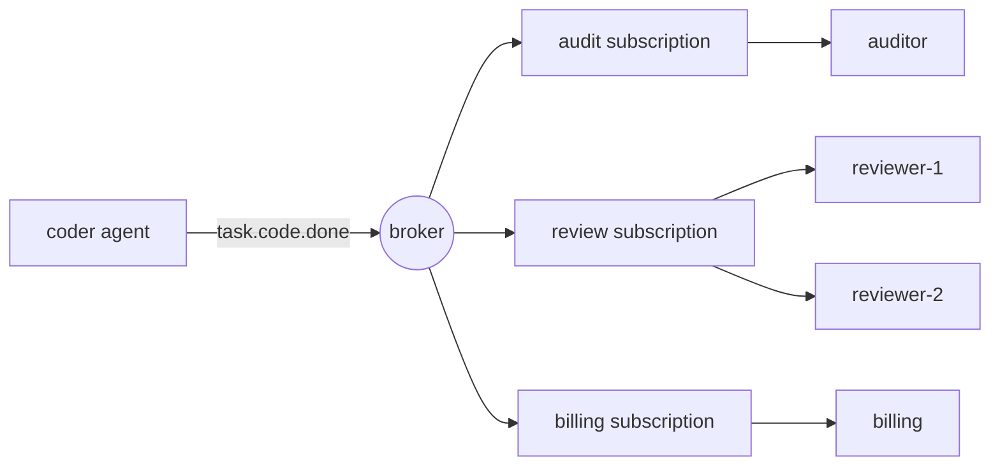

# Pub/Sub-Messagens para Agentes

> Um telefonema direto diz: "faça isso". Um evento publicado diz: "Isso aconteceu". O editor não sabe quem está ouvindo, e esse é o ponto.

**Type:** Build
**Languages:** Python
**Prerequisites:** Phase 16 · 13 (Shared Memory and Blackboard Patterns), Phase 16 · 22 (Production Scaling)
**Time:** ~75 minutes

## Objetivos de aprendizagem

- Explique os três tipos de desacoplamento que o editor-subscriber oferece e o que cada um custa.
- Implementar um corretor com cartões selvagens temáticos, assinaturas, reconhecimentos, redelivery e uma lista de letras mortas.
- Distinguir os fãs-out entre as assinaturas dos consumidores concorrentes dentro de uma assinatura.
- Preservar ordens por execução com uma chave de roteamento enquanto ainda escalando os consumidores.
- Mostre por que, pelo menos uma vez, o parto repete efeitos colaterais e corrija-o com um manipulador idempotente.
- Escolha entre pub/sub, uma fila de trabalho, uma chamada direta e um quadro para uma determinada interação de agentes.

## O problema

Um agente de codificação termina uma tarefa, um agente de revisão tem de verificar, então o codificador chama o revisor.

No mês que vem, você adiciona faturamento, que deve cobrar por cada tarefa concluída. Depois um registro de auditoria. Depois um avaliador que mostra os resultados. Cada adição edita o codificador: mais uma chamada, mais uma falha de manejo, mais uma razão para o codificador ser lento. Se a faturamento for baixo, o codificador falha? Se o avaliador levar 40 segundos, o codificador espera?

O codificador tornou-se o lugar onde os requisitos de todos os outros agentes se cumprem.

Publicar-subscrever transforma a dependência.`task.code.done`A adição do avaliador não muda nada no codificador.

## O conceito

### Três tipos de desacoplamento

A pesquisa clássica do padrão (Eugster et al., 2003) cita três:

| Decoupling | Meaning | What it costs |
|------------|---------|---------------|
| Space | Publisher and subscriber do not know each other | No one place shows the full workflow |
| Time | They need not be running at the same moment | The broker must store messages |
| Synchronization | The publisher does not block waiting for subscribers | There is no return value and no error to catch |

Cada linha é um verdadeiro benefício e uma perda real. Pub/sub não remove a coordenação.

### Tópicos e cartões

Um tópico é um nome para um tipo de evento. Os nomes hierárquicos deixam um assinante escolher seu nível de interesse.`*`coincide exatamente com um símbolo, e `>`coincide com um ou mais tokens no final.

| Pattern | Matches | Does not match |
|---------|---------|----------------|
| `task.code.done` | `task.code.done` | `task.research.done` |
| `task.*.done` | `task.code.done`, `task.research.done` | `task.code.failed` |
| `task.>` | `task.code.done`, `task.code.failed` | `task`, `metrics.tokens` |

Nomear os tópicos dos fatos no tempo passado (`task.code.done`), não para comandos (`review.this`O comando tem um receptor previsto e é melhor enviado para uma fila ou como uma chamada direta.

### Consumidores de distribuição e concorrentes

Um mecanismo dá dois comportamentos opostos, e confundir-os é o erro mais comum de pub/sub.



- **Across subscriptions: fan-out.**Cada assinatura recebe sua própria cópia de cada mensagem correspondente.
- **Inside one subscription: competing consumers.**Os membros compartilham as mensagens da assinatura.`reviewer-2`reduz a metade da carga .`reviewer-1`Não revisa tudo duas vezes.

Kafka chama a assinatura de um grupo de consumidores, a NATS chama-lhe de um grupo de filas e o Google Cloud Pub/Sub chama-lhe de uma assinatura. A ideia é a mesma.

### Garantias de entrega

| Guarantee | Broker behaviour | Failure you accept |
|-----------|-----------------|--------------------|
| At-most-once | Send once, never retry | Messages are lost |
| At-least-once | Retry until acknowledged | Messages are duplicated |
| Exactly-once | Not available across a network in general | — |

O consumidor reconhece uma mensagem (*ack*) depois de a ter manipulado.

O consumidor faz o trabalho, então o ac perde. O corretor não pode dizer "nunca processado" de "processado, ac perdido", então ele reentrega. O trabalho corre duas vezes. O que as pessoas chamam de exatamente uma vez é na prática, pelo menos, uma entrega mais um consumidor *idempotent*, que produz o mesmo resultado quando vê a mesma mensagem novamente.

Para os agentes, isso é uma questão de custo, bem como uma questão de corretão. Um manipulador duplicado pode significar uma segunda chamada de LLM, uma segunda cobrança ou um segundo e-mail para um cliente.

### Mensagens venenosas e a fila de letras mortas

Algumas mensagens nunca podem ter sucesso: uma carga útil mal formada, um esquema que o consumidor não entende.`max_deliveries`tentativas o corretor move a mensagem para uma fila de letras mortas (DLQ), onde um ser humano ou um trabalho de reparação pode inspecioná-la, e o fluxo passa.

### Ordenamento

Com consumidores concorrentes, duas mensagens do mesmo agente podem chegar a diferentes membros e acabar fora de ordem.`run-a`O artigo 92.° do Tratado de Roma é aplicável aos Estados-Membros.

Para manter a ordem, uma mensagem falhada deve ser tentada novamente antes de ser entregue a próxima, então uma mensagem venenosa bloqueia sua fila até que seja morta.

### Escolha do padrão

| Pattern | Use when | Example |
|---------|----------|---------|
| Direct call | One receiver, and you need the answer now | Agent calls a tool |
| Work queue | One receiver type, the work must happen once | Dispatch a task to any free worker |
| Pub/sub | Zero or more receivers react to a fact | `task.code.done` triggers review, billing, audit |
| Blackboard (Phase 16 · 13) | Agents share state and read it later | A shared plan that agents refine |

Um quadro negro armazena o estado atual. Pub / sub carrega as alterações. Muitos sistemas usam ambos.

## Construí-lo

O corretor completo está lá .`code/main.py`Ele funciona em um processo sem fios, por isso cada teste é determinista.

### Passo 1: Compare um tópico com um padrão

```python
def topic_matches(pattern: str, topic: str) -> bool:
    pattern_tokens = pattern.split(".")
    topic_tokens = topic.split(".")
    for index, token in enumerate(pattern_tokens):
        if token == ">":
            return index == len(pattern_tokens) - 1 and len(topic_tokens) > index
        if index >= len(topic_tokens):
            return False
        if token != "*" and token != topic_tokens[index]:
            return False
    return len(pattern_tokens) == len(topic_tokens)
```

### Passo 2: Publique uma cópia para cada assinatura correspondente

```python
def publish(self, topic: str, payload: str, key: str | None = None) -> Message:
    message = Message(self._next_id, topic, payload, key)
    self._next_id += 1
    matched = [group for group in self.groups.values() if topic_matches(group.pattern, topic)]
    if not matched:
        self.dropped.append(message)
    for group in matched:
        group.queue.append(Delivery(message))
    return message
```

Cada um .`Group`A decisão de uma única pessoa é um resultado de uma "fan out": três grupos correspondentes significam três entradas de fila para uma mensagem.`dropped`Uma mensagem publicada antes de alguém assinar desapareceu, e `publish`Ainda volta ao normal.

### Passo 3: Escolha um membro do grupo

```python
def _pick(self, group: Group, message: Message) -> tuple[str, Handler]:
    if message.key is not None:
        digest = hashlib.sha256(message.key.encode()).digest()
        index = int.from_bytes(digest[:8], "big") % len(group.members)
    else:
        index = group.next_member % len(group.members)
        group.next_member += 1
    return group.members[index]
```

Sem uma chave, os membros se alternam, com uma chave, o hash decide.`hash()`Não é usado porque é randomizado por processo para cadeias, então dois processos de corretor discordam sobre quem possui uma chave.

### Passo 4: Entregue, depois acerte, tente novamente ou escreva letra morta

```python
def _deliver(self, group: Group) -> None:
    delivery = group.queue.popleft()
    consumer, handler = self._pick(group, delivery.message)
    self.log.append((group.name, consumer, delivery.message.id, delivery.attempt))
    try:
        acked = handler(delivery.message)
    except Exception:
        acked = False
    if acked:
        return
    if delivery.attempt >= self.max_deliveries:
        self.dead_letters.append((group.name, delivery.message))
    else:
        group.queue.appendleft(Delivery(delivery.message, delivery.attempt + 1))
```

Um agente retorna .`True`Voltar.`False`A retomada vai para a frente da fila com`appendleft`O que mantém a ordem e faz com que o comando bloqueie.`append`E você obtém o troco oposto.

### Passo 5: Tornar o consumidor idempotente

```python
class IdempotentHandler:
    def __call__(self, message: Message) -> bool:
        if message.id in self.seen:
            self.duplicates += 1
            return True
        acked = self.handler(message)
        if acked:
            self.seen.add(message.id)
        return acked
```

Uma duplicação é reconhecida sem executar o efeito. Uma mensagem é lembrada apenas depois de ter sido bem sucedida, então um falha real é novamente tentada.

### - Corra.

```bash
cd phases/16-multi-agent-and-swarms/26-pubsub-messaging-for-agents/code
python3 main.py
python3 -m unittest discover tests -v
```

A demonstração publica sete eventos de dois agentes, e passa por três assinaturas.

```text
delivery attempts:      19
audit received:         6 events
reviewer-1 handled:    run-a:step-1, run-a:step-2
reviewer-2 handled:    run-e:step-1, run-e:step-3
dead letters:           [('review', 5)]
dropped, no subscriber: ['metrics.tokens']

billing lost the acknowledgement for message 2, so the broker redelivered it.
charges with a plain handler:       6 (5 billable events)
charges with an idempotent handler: 5
```

Leia cada linha contra o conceito que ela mostra:

- Sete eventos causaram 19 tentativas de entrega.
- Cada corrida ficou com um revisor, em ordem.
- A mensagem 5 foi testada três vezes por revisão e depois morta.
- `metrics.tokens`Não tinha assinante e desapareceu sem erro.
- O simples administrador de faturamento cobrou seis vezes por cinco eventos.

## Usá-lo

Os corretores de produção diferem principalmente no que armazenam e no que garantem.

| System | Subscription model | Delivery | Ordering |
|--------|-------------------|----------|----------|
| Apache Kafka | Consumer groups read a partitioned log by offset | At-least-once by default | Per partition, chosen by message key |
| NATS | Subjects with `*` and `>`; queue groups | Core NATS is at-most-once; JetStream adds at-least-once | Per stream in JetStream |
| Google Cloud Pub/Sub | Topics and named subscriptions | At-least-once, with an ack deadline and dead-letter topics | Optional ordering keys |
| Redis Pub/Sub | Channels and patterns | At-most-once; offline subscribers miss messages | None |
| Redis Streams | Consumer groups with explicit `XACK` | At-least-once | Per stream |

Kafka e JetStream mantêm um registro, para que um novo assinante possa reproduzir a história.

Entre os quadros de agentes, o AutoGen Core é construído sobre este modelo: os agentes publicam mensagens para um tópico e o runtime as entrega aos agentes cujas assinaturas coincidem.

O que o corretor de memória deixa de lado:

- **Persistence.**Um acidente perde todas as filas.
- **Ack deadlines.**Um corretor real re-entrega quando um consumidor fica em silêncio por muito tempo.
- **Backpressure.**As filas são ilimitadas, um assinante lento faz crescer a fila até que a memória se esgotar.
- **Atomic dedupe.** `IdempotentHandler`O resultado é um resultado de uma colisão de dados que ocorre após o efeito.

Para sistemas de agentes especificamente:

- **Carry a correlation id.**Sem uma pilha de chamadas, o contexto de execução e rastreamento em cada mensagem são a única maneira de reconstruir o que aconteceu (fase 14 · 23).
- **Guard against event loops.**O agente A reage ao evento do B e publica um que o B reage, adiciona uma contagem de saltos a cada mensagem e deixa-o acima de um limite.
- **Version the payload.**Os assinantes que você não conhece dependem do seu esquema. Adicione campos; não renome ou remova-los.

## Envia-o

Esta lição produz`outputs/skill-pubsub-design-review.md`- Tendo em conta um conjunto de agentes e os acontecimentos entre eles, revisa o nomeamento do tema, o layout das assinaturas, as garantias de entrega, a independência, os pedidos e o tratamento de letras mortas.

## Exercícios

1. Corra .`code/main.py`- Mudança de tentativa .`_deliver`de`appendleft`- Não .`append`- Em que ordem ?`reviewer-2`Agora, lidem com os eventos para o`run-e`E quando seria aceitável essa ordem?
2. Adicionar uma fila limitada: `publish`aumenta quando a fila de um grupo é superior a `max_queue`O que deve fazer o editor quando ele é levantado: bloquear, deixar cair ou falhar?
3. Adicionar um`hops`campo para `Message`e fazer com que o corretor não tenha qualquer mensagem publicada por um administrador uma vez `hops`Escreva um teste com dois manipuladores que se desencadeiam.
4. Adicionar replay: manter todas as mensagens publicadas em um registro e deixar um novo grupo subscrever desde o início.`dropped`- A lista?
5. Um terceiro revisor se junta à Comissão .`review`grupo enquanto mensagens para `run-a`Que chaves mudam de proprietário?`hash % members`Leia sobre o hashing consistente e explique como reduz o movimento.

## Termos-chave

| Term | What people say | What it actually means |
|------|----------------|------------------------|
| Pub/sub | "Event bus" | Messaging where publishers send to a topic and the broker delivers to whoever subscribed |
| Topic | "Channel" | A name for a kind of event; called a subject in NATS |
| Subscription | "Consumer group" | A named interest in a topic pattern with its own copy of each message |
| Fan-out | "Broadcast" | Each subscription receives every matching message |
| Competing consumers | "Load balancing" | Members of one subscription share its messages; each message goes to one |
| Ack / nack | "Confirm" | The consumer's report that handling succeeded or failed |
| At-least-once | "Guaranteed delivery" | Redelivery until acknowledged, so duplicates are possible |
| Idempotent consumer | "Dedupe" | A handler that gives the same result when a message is delivered again |
| Dead-letter queue | "DLQ" | Where a message goes after it exhausts its delivery attempts |
| Routing key | "Partition key" | A value hashed to pick the consumer, so related messages stay in order |
| Head-of-line blocking | "Stuck queue" | A failing message that delays everything behind it in an ordered queue |

## Mais leitura

- [Eugster, Felber, Guerraoui, Kermarrec — The Many Faces of Publish/Subscribe (ACM Computing Surveys, 2003)](https://dl.acm.org/doi/10.1145/857076.857078) a pesquisa que define o espaço, o tempo e a descoplagem de sincronização.
- [NATS — Subject-Based Messaging](https://docs.nats.io/nats-concepts/subjects) as regras do wildcard que esta lição impõe.
- [Apache Kafka — Documentation](https://kafka.apache.org/documentation/) partições, grupos de consumidores e compensações.
- [Google Cloud Pub/Sub — Overview](https://cloud.google.com/pubsub/docs/overview) subscrições, prazos de entrega, tópicos de letra morta, pedidos de chaves.
- [Redis — Pub/Sub](https://redis.io/docs/latest/develop/pubsub/) Na maioria das vezes, mensagens de canal.
- [AutoGen Core — Topic and Subscription](https://microsoft.github.io/autogen/stable/user-guide/core-user-guide/core-concepts/topic-and-subscription.html)O mesmo modelo dentro de um agente de tempo de execução.
