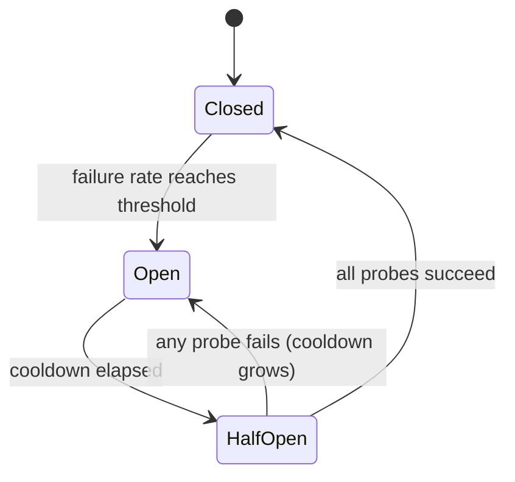

# Interruptores de circuito para os prestadores de LLM

> Uma nova tentativa pergunta: "deveria essa solicitação ser repetida?" Uma interruptor pergunta: "deveria alguém ligar para este provedor agora?" A primeira protege uma solicitação.

**Type:** Build
**Languages:** Python
**Prerequisites:** Phase 17 · 19 (AI Gateways), Phase 17 · 24 (Chaos Engineering)
**Time:** ~75 minutes

## Objetivos de aprendizagem

- Explique os três estados de interrupção e o evento que causa cada transição.
- Implementar um interruptor de circuito de janela deslizante com um guardão mínimo de chamada e um orçamento de sonda meio aberto.
- Classificar os erros do prestador de LLM entre os que indicam um prestador insalubre e os que culpam o pedido.
- Compõe um interruptor com timeouts, retemps e uma rota de retorno na ordem correta.
- Medir o que um interruptor economiza durante uma interrupção do fornecedor e o que custa após a recuperação.
- Escolha o escopo do interruptor (provedor, modelo, região) para uma determinada implantação.

## O problema

O seu gateway envia cada pedido para um provedor primário e volta para um segundo em caso de falha. O primário desce. Cada chamada agora espera o tempo de 10 segundos antes do retorno.

Não há nada perdido. Cada solicitação ainda é respondida. Mas cada solicitação agora leva 11 segundos em vez de 1, enquanto a interrupção dura. Os fios de trabalhadores ficam bloqueados em um provedor que não responderá. As filas crescem. Os chamadores upstream atingem seus próprios timeouts e retestam, o que adiciona mais carga. Uma interrupção parcial em um provedor torna-se uma interrupção completa no seu serviço.

A lógica de retry-and-fallback é correta para uma solicitação. O erro é que a solicitação número 500 não aprende nada dos 499 falhas anteriores.

## O conceito

### Três estados

O nome vem do dispositivo elétrico: quando a falha é detectada, o circuito abre e a corrente para.



- **Closed**As chamadas passam e cada resultado é gravado.
- **Open**O serviço de telefonia é negado imediatamente, sem contactar o prestador.
- **Half-open**Após um cooldown, um pequeno número de chamadas reais são permitidas como * sondas*.

Observe a armadilha de nomeamento: * fechado * é o estado saudável e * aberto * é o quebrado, o oposto de uma porta.

### Quando tropeçar

A regra mais simples é "abrir após N falhas consecutivas". É fácil de construir, mas um sucesso feliz retoma a contagem, de modo que um provedor que falha em 80% das chamadas pode nunca tropeçar.

A taxa de falha sobre uma janela deslizante é mais robusta.`window_size`Os resultados são obtidos e abertos quando a fracção falhada atinge o limiar.`minimum_calls`O sistema de alarme ou uma falha de uma chamada é 100% e deixa o interruptor em erro após a reinicialização.

### O que é um fracasso

Um interruptor mede a saúde do prestador, por isso só os erros que descrevem o prestador devem contar.

| Outcome | Counts as failure? | Reason |
|---------|-------------------|--------|
| Timeout or connection error | Yes | The provider did not answer |
| 5xx (500, 502, 503, 529) | Yes | The provider failed |
| 429 rate limit | Yes | The provider cannot serve you right now |
| 400 bad request, context too long | No | The request is wrong; another provider's model may reject it too |
| 401 or 403 | No | Your credentials are wrong; alert on this instead |
| Content filter refusal | No | The provider answered; the answer was a refusal |

Um 400 é, de facto, uma prova de que o prestador está saudável: recebeu o pedido, validou-o e respondeu rapidamente.

### Meio-aberto e o arrefecimento

Quando o arrefecimento termina, o interruptor não abre os portões de inundação novamente, ele admite um número fixo de sondas.

Uma sonda falhada também deve prolongar a próxima descontração, até um limite. Um provedor que ainda está em baixa após 30 segundos é provável que esteja em baixa após 60, e cada sonda custa um timeout a um usuário real.

### Ámbito de aplicação

Um interruptor por fornecedor é geralmente muito grosseiro. Uma interrupção é muitas vezes limitada a um modelo ou uma região, e um interruptor em todo o fornecedor cortaria implementações saudáveis. Um interruptor por chave API e modelo e região e inquilino é muito bom: nenhum único interruptor vê `minimum_calls`Um ponto de partida comum é um interruptor por implantação, ou seja, o provedor, modelo e região.

### Ordem de composição

Três controles envolvem a mesma chamada e a ordem importa:

```text
retry  ->  circuit breaker  ->  timeout  ->  provider call
```

O timeout é o mais interno, então uma chamada de interrupção se torna um fracasso que o interruptor pode contar. O interruptor fica dentro da retest, então cada tentativa de retestamento pede primeiro ao interruptor e um loop de retestamento não pode martelar um circuito aberto. Sem um timeout o interruptor nunca vê um provedor lento em tudo.

### Como é diferente dos seus vizinhos

| Control | Question it answers | Triggered by |
|---------|--------------------|--------------|
| Timeout | How long may one call take? | A single slow call |
| Retry with backoff | Should this request try again? | A single failed call |
| Rate limit | How much traffic may a caller send? | Request volume |
| Circuit breaker | Is this dependency healthy enough to call? | Failures across many calls |
| Kill switch (Phase 15 · 14) | Should this system run at all? | A human or a safety policy |

## Construí-lo

A execução completa está em`code/main.py`- Usa um .`ManualClock`que o chamador avança à mão, para que a demonstração e cada teste corram instantaneamente sem dormir.

### Passo 1: Classificar o erro

```python
def counts_as_failure(status: int | None) -> bool:
    """Timeouts, 429 and 5xx blame the provider. Any other 4xx blames the request."""
    if status is None:
        return True
    return status == 429 or status >= 500
```

`status`É o que é`None`para um timeout, porque uma chamada que nunca voltou não tem código de status.

### Passo 2: Decidir se uma chamada pode ser processada

```python
def allow(self) -> bool:
    if self.state == OPEN and self.clock.now() - self.opened_at >= self.cooldown:
        self.probes_issued = 0
        self.probe_successes = 0
        self._move(HALF_OPEN)
    if self.state == CLOSED:
        return True
    if self.state == HALF_OPEN and self.probes_issued < self.config.half_open_probes:
        self.probes_issued += 1
        return True
    return False
```

A mudança de aberta para meio aberta acontece preguiçosamente, a primeira vez que um telefonista pergunta depois que o resfriamento passou.

### Passo 3: Registre o resultado

```python
def record_failure(self) -> None:
    if self.state == OPEN:
        return
    if self.state == HALF_OPEN:
        self.cooldown = min(
            self.cooldown * self.config.cooldown_multiplier,
            self.config.max_cooldown_seconds,
        )
        self._trip()
        return
    self.window.append(False)
    enough_calls = len(self.window) >= self.config.minimum_calls
    if enough_calls and self.failure_rate() >= self.config.failure_rate_threshold:
        self._trip()
```

O primeiro controlo é importante em sistemas reais. chamadas que já estavam em voo quando o interruptor foi aberto, irão relatar as falhas tarde.

`record_success`O que é que se vê aqui? O que é que se vê aqui?

### Passo 4: Envolver a chamada

```python
def call(self, fn: Callable[[], str]) -> str:
    if not self.allow():
        raise CircuitOpenError(self.name)
    try:
        result = fn()
    except ProviderError as error:
        if counts_as_failure(error.status):
            self.record_failure()
        else:
            self.record_success()
        raise
    except Exception:
        self.record_failure()
        raise
    self.record_success()
    return result
```

Cada caminho que passa .`allow()`Se um caminho se esquecesse de gravar, um interruptor semabricado distribuiria as sondas, não ouvia nada e permanecia semabricado permanentemente.

### Passo 5: Circular uma rota aberta

`FallbackRouter`A lista de rotas é ordenada.`CircuitOpenError`O serviço de telefonia é gratuito, o serviço de telefonia é gratuito, o serviço de telefonia é gratuito, o serviço de telefonia é gratuito, o serviço de telefonia é gratuito, o serviço de telefonia é gratuito, o serviço de telefonia é gratuito, o serviço de telefonia é gratuito, o serviço de telefonia é gratuito, o serviço de telefonia é gratuito, o serviço de telefonia é gratuito, o serviço de telefonia é gratuito, o serviço de telefonia é gratuito, o serviço de telefonia é gratuito, o serviço de telefonia é gratuito, o serviço de telefonia é gratuito, o serviço de telefonia é gratuito, o serviço de telefonia é gratuito, o serviço de telefonia é gratuito e o serviço de telefonia é gratuito.

### - Corra.

```bash
cd phases/17-infrastructure-and-production/30-circuit-breakers-llm-providers/code
python3 main.py
python3 -m unittest discover tests -v
```

A demonstração envia 150 solicitações, uma por segundo, através de uma primeira que desce do segundo 20 para o segundo 80:

```text
metric                        retry only     breaker
----------------------------------------------------
requests answered                    150         150
timeouts paid on primary              60           6
calls skipped (fast fail)              0          88
calls sent to fallback                60          94
mean latency (seconds)              5.00        1.40

breaker transitions:
  t=   24s     closed -> open
  t=   54s       open -> half_open
  t=   54s  half_open -> open
  t=  114s       open -> half_open
  t=  115s  half_open -> closed
```

Leia os dois custos. O interruptor pagou 6 temporadas em vez de 60: cinco para detectar a interrupção e uma sonda falhou no segundo 54. Mas a sonda falhada dobrou o arrefecimento, por isso o interruptor não testou novamente até o segundo 114. A primeira foi saudável a partir do segundo 80, e 34 pedidos foram para o regresso que não precisava. Um interruptor troca recuperação mais lenta por interrupções mais baratas. O resfriamento, o multiplicador e o limite definem esse comércio.

## Usá-lo

Portais de produção e proxies enviam este padrão com nomes diferentes. Verifique a documentação atual para ver se há padrões antes de confiar neles.

- **Resilience4j**(JVM) é a mais próxima da lição.`failureRateThreshold`- Não .`slidingWindowSize`- Não .`minimumNumberOfCalls`- Não .`waitDurationInOpenState`, e `permittedNumberOfCallsInHalfOpenState`Também conta chamadas lentas como falhas através de`slowCallDurationThreshold`- Não .
- **Envoy**chama isto de detecção de fora: um hospedeiro é expulso depois de `consecutive_5xx`erros para `base_ejection_time`A característica do Enviado chamada "ruptura de circuito" é diferente, um limite às conexões e pedidos pendentes.
- **LiteLLM Router**coloca uma implantação em refrigeração depois de `allowed_fails`falhas para `cooldown_time`Segundo e rotas para outras instalações.

Duas coisas que as versões de produção adicionam que o simulador deixa de lado:

- **Concurrency.**A semia-aberta deve limitar as sondas em voo, que precisam de um bloqueio ou um contador atômico.
- **Shared state.**Dez réplicas de gateway contêm dez interruptores separados. Cada um deve ver suas próprias falhas antes de abrir. Compartilhar o estado em Redis faz com que eles concordam mais rápido, mas adiciona uma dependência ao caminho que é destinado a sobreviver às falhas de dependência.

Para o tráfego de LLM especificamente:

- Defina o tempo para o primeiro token para as chamadas de streaming. O tempo total de geração varia muito com o comprimento da saída para ser um sinal de saúde.
- Quando um 429 carrega um `Retry-After`Header, use esse valor como o cooldown em vez do seu padrão.
- Verifique se o fallback pode absorver toda a carga.

## Envia-o

Esta lição produz`outputs/skill-circuit-breaker-review.md`- Tendo em conta o caminho de chamada do prestador, revisa a regra de viagem, a classificação de erros, o comportamento de meio aberto, o âmbito e a ordem da composição, e lista as lacunas.

## Exercícios

1. Corra .`code/main.py`- Set .`cooldown_multiplier`Quantos tempos adicionais o interruptor paga e quantos segundos antes fecha?
2. Substitua a janela deslizante por um contador de falhas consecutivas. Escreva um teste com um provedor que falhe em quatro de cada cinco chamadas e mostre que o contador nunca falha em um limiar de cinco.
3. Adicione detecção de chamadas lentes: uma chamada que seja bem sucedida, mas que leve mais tempo do que um limiar, é considerada um fracasso.
4. Dá .`ProviderError`uma opcional `retry_after`O valor e fazer o interruptor a usar como o resfriamento quando presente.
5. O retrocesso da demonstração nunca falha. Dê-lhe um interruptor e um limite de taxa de 0,5 solicitações por segundo. O que acontece durante a interrupção, e o que o roteador deve retornar quando cada rota está aberta?

## Termos-chave

| Term | What people say | What it actually means |
|------|----------------|------------------------|
| Circuit breaker | "Stop calling it" | A state machine that refuses calls to a dependency after failures cross a threshold, then probes for recovery |
| Closed | "Healthy" | Calls pass through and outcomes are recorded |
| Open | "Tripped" | Calls are refused without contacting the dependency |
| Half-open | "Testing" | A limited number of probe calls decide whether to close or reopen |
| Fast fail | "Fail quickly" | Returning an error at once instead of waiting for a timeout |
| Sliding window | "Recent calls" | The last N outcomes used to compute the failure rate |
| Minimum calls | "Warm-up guard" | The fewest recorded calls before the failure rate is trusted |
| Cooldown | "Wait duration" | Time the breaker stays open before it allows probes |
| Probe | "Trial request" | A real request let through in half-open to test recovery |
| Outlier detection | "Envoy's breaker" | Ejecting an unhealthy host from a load-balancing pool |

## Mais leitura

- [Michael Nygard — Release It! (2nd edition)](https://pragprog.com/titles/mnee2/release-it-second-edition/) o livro que nomeou o padrão, no capítulo Padrões de Estabilidade.
- [Martin Fowler — CircuitBreaker](https://martinfowler.com/bliki/CircuitBreaker.html) breve referência para os três Estados.
- [Resilience4j — CircuitBreaker](https://resilience4j.readme.io/docs/circuitbreaker) janelas deslizantes com base em contagem e tempo, limiares de chamada lenta.
- [Envoy — Outlier detection](https://www.envoyproxy.io/docs/envoy/latest/intro/arch_overview/upstream/outlier) Regras de ejecção e tempo de ejecção crescente.
- [LiteLLM — Routing](https://docs.litellm.ai/docs/routing) reduções de nível de implantação e retrocessos.
- [AWS Builders' Library — Timeouts, retries, and backoff with jitter](https://aws.amazon.com/builders-library/timeouts-retries-and-backoff-with-jitter/) os controles com os quais compõe um interruptor.
