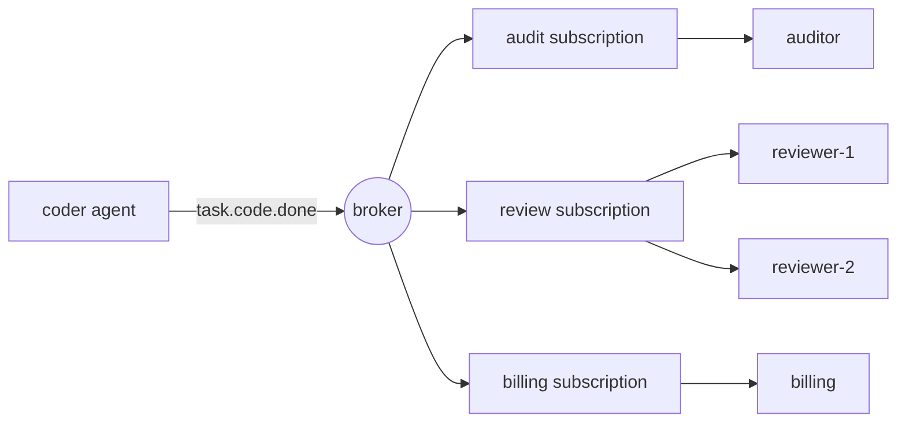

# Ajanlar için Pub/Sub Mesajlar

> Bir haber yayınlanmış bir olayda "Bu oldu". diyor. Yayıncı kimlerin dinlediğini bilmiyor ve asıl nokta budur.

**Type:** Build
**Languages:** Python
**Prerequisites:** Phase 16 · 13 (Shared Memory and Blackboard Patterns), Phase 16 · 22 (Production Scaling)
**Time:** ~75 minutes

## Öğrenme Hedefleri

- Yayıncı-Abone'nin verdiği üç tür kopmazlık ve her birinin maliyetini açıklayın.
- Konuya bağlı wildcard, abonelik, onay, yeniden teslimat ve ölü harf listesi ile bir broker uygulamak.
- Bir abonelik içindeki rekabetçi tüketicilerden abonentler arasındaki fan-out'u ayırt edin.
- Kullanıcıları ölçeklendirirken yönlendirme anahtarıyla bir atış için siparişleri korumak.
- En az bir kez doğumda yan etkileri neden tekrarlandığını göster ve bunu idempotent bir tedaviciyle düzelt.
- Bir ajan etkileşimi için pub/sub, bir iş sırası, bir doğrudan arama ve bir tablo arasında seçim yapın.

## Sorun

Bir kodlayıcı görev tamamlıyor, bir değerlendirmeci görevden geçiyor, bu yüzden kodlayıcı değerlendirmeciyi arıyor.

Bir sonraki ayda, her bitmiş görev için ücret ödenmesi gereken bir fatura eklersiniz. Sonra bir denetim günlüğü. Sonra sonuçları örnekleyen bir değerlendirici. Her eklem koderi düzenler: bir daha arama, bir daha işleme başarısızlığı, koderin yavaş olması için bir neden daha. Eğer faturalama düşerse, koder başarısız olur mu? Eğer değerlendirici 40 saniye alırsa, koder bekler mi?

Kodlayıcı, diğer ajanların gerekliliklerinin yerine getirilmesi için bir yer haline geldi. Kim olduklarını bilir, onları sıraya çağırır ve başarısızlıklarını miras alır.

Yayın-Abone bağımlılığını değiştirir.`task.code.done`Bu programı kullanmak için değerlendirici eklemek kodlayıcıyı değiştirmez.

## Anlaşım

### Üç tür kopartma

Klasik bir örnek araştırması (Eugster et al., 2003) üç isimlendirdi:

| Decoupling | Meaning | What it costs |
|------------|---------|---------------|
| Space | Publisher and subscriber do not know each other | No one place shows the full workflow |
| Time | They need not be running at the same moment | The broker must store messages |
| Synchronization | The publisher does not block waiting for subscribers | There is no return value and no error to catch |

Her satır gerçek bir fayda ve gerçek bir kayıptır. Pub/sub koordinasyonu kaldırmaz.

### Konular ve çılgın kartlar

Bir konu bir tür etkinlik için bir isimdir. Hiyerarşik isimler bir aboneye ilgi seviyesini seçmesine izin verir. Bu ders NATS'in sözleşmesini kullanır: noktalarla ayrılmış tokenler,`*`Tam olarak bir simgeyle eşleşir ve`>`Sonunda bir veya daha fazla token ile eşleşir.

| Pattern | Matches | Does not match |
|---------|---------|----------------|
| `task.code.done` | `task.code.done` | `task.research.done` |
| `task.*.done` | `task.code.done`, `task.research.done` | `task.code.failed` |
| `task.>` | `task.code.done`, `task.code.failed` | `task`, `metrics.tokens` |

Geçmişte gerçekler için konuları isimlendirin (`task.code.done`), komutlar için değil (`review.this`). Bir komut bir amaçlı alıcıya sahiptir ve bir kuyruk veya doğrudan çağrı olarak gönderilmek daha iyi.

### Yaygın ve rekabetçi tüketiciler

Bir mekanizma iki karşıt davranış verir ve onları karıştırmak en yaygın pub/sub hatasıdır.



- **Across subscriptions: fan-out.**Her abonelik, eşleşen mesajların kendi kopyasını alır.
- **Inside one subscription: competing consumers.**Üyeler abonelik mesajlarını paylaşıyor. Her mesaj tam olarak bir üyeye gidiyor. Ekle `reviewer-2`yükü yarıya düşürür.`reviewer-1`Her şeyi iki kez incelemez.

Kafka aboneliği * tüketici grubu* olarak adlandırır, NATS onu * kuyruğu grubu* olarak adlandırır ve Google Cloud Pub/Sub ise bunu * abonelik* olarak adlandırır.

### Teslimat garantileri

| Guarantee | Broker behaviour | Failure you accept |
|-----------|-----------------|--------------------|
| At-most-once | Send once, never retry | Messages are lost |
| At-least-once | Retry until acknowledged | Messages are duplicated |
| Exactly-once | Not available across a network in general | — |

Bir tüketicinin bir mesajı (*ack*) ele geçirdikten sonra kabul etmesi durumunda, eğer broker hiçbir şey duymadı veya olumsuz bir onay (*nack*) aldığında, yine teslim eder.

Bu nedenle, iş iki kez çalışır. İnsanlar tam olarak bir kez diyen şey pratikte en az bir kez teslimat artı * idempotent* bir tüketici, aynı mesajı tekrar gördüğünde aynı sonucu üreten bir tüketici.

Bu, ajanlar için bir maliyet sorunu hem de doğruluk sorunu olabilir.

### Zehirli mesajlar ve ölü harfler sırası

Bazı mesajlar asla başarılı olamaz: yanlış biçimlendirilmiş bir payload, tüketicinin anlamadığı bir şema. Yeniden denemek arkasındaki her şeyi sonsuza dek engeller.`max_deliveries`Broker, mesajı bir *dead-letter queue* (DLQ) 'a taşıyor ve bir insan veya tamir işi tarafından kontrol edilebilir ve akış devam ediyor.

### Sipariş

Rekabetçi tüketiciler için aynı ajanın çalıştırdığı iki mesaj farklı üyelerle erişebilir ve sıradan bir şekilde bitirebilir.`run-a`Bir eleştirmenin yayın sırasıyla ulaşması diğer yayınların paralel olarak başka bir yere gitmesi gerekir.

Sipariş vermek için bir fiyat vardır. Sipariş korumak için, başarısız bir mesaj bir sonraki mesaj teslim edilmeden önce tekrar denemeliyiz, bu yüzden zehirli bir mesaj, ölü yazıya kadar sırasını engeller. Bu * başlıca bir bloklama*.

### Şekil seçimi

| Pattern | Use when | Example |
|---------|----------|---------|
| Direct call | One receiver, and you need the answer now | Agent calls a tool |
| Work queue | One receiver type, the work must happen once | Dispatch a task to any free worker |
| Pub/sub | Zero or more receivers react to a fact | `task.code.done` triggers review, billing, audit |
| Blackboard (Phase 16 · 13) | Agents share state and read it later | A shared plan that agents refine |

Bir tahta mevcut durumu depolar. Pub / sub değişiklikleri taşır. Birçok sistem her ikisini de kullanır.

## Yapın

Tam bir broker var .`code/main.py`- İpuçsuz bir süreçte çalışır, bu yüzden her test belirleyici.

### Adım 1: Bir konuyu bir örneğe karşı eşleştir

```python
def topic_matches(pattern: str, topic: str) -> bool:
    pattern_tokens = pattern.split(".")
    topic_tokens = topic.split(".")
    for index, token in enumerate(pattern_tokens):
        if token == ">":
            return index == len(pattern_tokens) - 1 and len(topic_tokens) > index
        if index >= len(topic_tokens):
            return False
        if token != "*" and token != topic_tokens[index]:
            return False
    return len(pattern_tokens) == len(topic_tokens)
```

### Adım 2: Her eşleşen abonelik için bir kopya yayınlayın

```python
def publish(self, topic: str, payload: str, key: str | None = None) -> Message:
    message = Message(self._next_id, topic, payload, key)
    self._next_id += 1
    matched = [group for group in self.groups.values() if topic_matches(group.pattern, topic)]
    if not matched:
        self.dropped.append(message)
    for group in matched:
        group.queue.append(Delivery(message))
    return message
```

Her biri .`Group`Bu bir karar fan-out üretir: üç eşleşen gruplar bir mesaj için üç sırada giriş anlamına gelir.`dropped`Bir mesaj, herhangi bir kişi abone olmadan önce yayınlandı ve kayboldu.`publish`Hala normal dönüyor.

### Adım 3: Gruptan bir üye seçin

```python
def _pick(self, group: Group, message: Message) -> tuple[str, Handler]:
    if message.key is not None:
        digest = hashlib.sha256(message.key.encode()).digest()
        index = int.from_bytes(digest[:8], "big") % len(group.members)
    else:
        index = group.next_member % len(group.members)
        group.next_member += 1
    return group.members[index]
```

Bir anahtar olmadan üyeleri sırayla değişir.`hash()`Bu işlemler, bir anahtarın sahibi kim olduğuna dair anlaşmazlıklara neden olur.

### Dördüncü adım: teslim, sonra tekrar, tekrar denemek veya ölü harf

```python
def _deliver(self, group: Group) -> None:
    delivery = group.queue.popleft()
    consumer, handler = self._pick(group, delivery.message)
    self.log.append((group.name, consumer, delivery.message.id, delivery.attempt))
    try:
        acked = handler(delivery.message)
    except Exception:
        acked = False
    if acked:
        return
    if delivery.attempt >= self.max_deliveries:
        self.dead_letters.append((group.name, delivery.message))
    else:
        group.queue.appendleft(Delivery(delivery.message, delivery.attempt + 1))
```

Bir görevli geri dönüyor .`True`Geri dönüyorum.`False`Tekrar deneme, sıradanın önüne geri döner.`appendleft`Bu da düzen korur ve hattın kapalı olmasına neden olur.`append`Ve karşı karşıya bir ticaret elde edersin.

### Adım 5: Kullanıcıyı güçsüzleştir

```python
class IdempotentHandler:
    def __call__(self, message: Message) -> bool:
        if message.id in self.seen:
            self.duplicates += 1
            return True
        acked = self.handler(message)
        if acked:
            self.seen.add(message.id)
        return acked
```

Bir mesaj başarısız olduktan sonra hatırlanır, bu nedenle gerçek bir başarısızlık yine tekrar deneniyor.

### Çek şunu.

```bash
cd phases/16-multi-agent-and-swarms/26-pubsub-messaging-for-agents/code
python3 main.py
python3 -m unittest discover tests -v
```

Demo, iki ajanın yedi etkinliğini yayınlıyor ve üç abonelikten oluşuyor.

```text
delivery attempts:      19
audit received:         6 events
reviewer-1 handled:    run-a:step-1, run-a:step-2
reviewer-2 handled:    run-e:step-1, run-e:step-3
dead letters:           [('review', 5)]
dropped, no subscriber: ['metrics.tokens']

billing lost the acknowledgement for message 2, so the broker redelivered it.
charges with a plain handler:       6 (5 billable events)
charges with an idempotent handler: 5
```

Her satırın gösterdiği kavramla karşılaştırıldığını oku:

- Yedi olay 19 teslimat girişimine neden oldu.
- Her seferinde bir değerlendirmeci kalır.
- 5. Mesaj üç kez inceleme yoluyla denedi ve sonra ölü yazılı oldu.
- `metrics.tokens`Hiçbir abone yoktu ve hata olmadan kayboldu.
- Sıradan bir fatura yöneticisi beş olay için altı kez ücret aldı.

## Kullan

Üretim brokerleri, genellikle neyi sakladıkları ve neyi garanti ettikleri konusunda farklıdır.

| System | Subscription model | Delivery | Ordering |
|--------|-------------------|----------|----------|
| Apache Kafka | Consumer groups read a partitioned log by offset | At-least-once by default | Per partition, chosen by message key |
| NATS | Subjects with `*` and `>`; queue groups | Core NATS is at-most-once; JetStream adds at-least-once | Per stream in JetStream |
| Google Cloud Pub/Sub | Topics and named subscriptions | At-least-once, with an ack deadline and dead-letter topics | Optional ordering keys |
| Redis Pub/Sub | Channels and patterns | At-most-once; offline subscribers miss messages | None |
| Redis Streams | Consumer groups with explicit `XACK` | At-least-once | Per stream |

Kafka ve JetStream bir günlük tutarlar, böylece yeni bir abone geçmişi tekrar oynatabilir. Bu dersdeki broker, Redis Pub / Sub gibi, orada olmayan bir abone için hiçbir şey tutmaz.

Ajan çerçeveleri arasında, AutoGen Core bu model üzerinde inşa edilmiştir: Ajanlar bir konu için mesajlar yayınlar ve çalıştırma zamanı onları abonelikleri eşleşen ajanlara teslim eder.

Anıtındaki broker neyi bırakıyor:

- **Persistence.**Bir kaza her sırayı kaybeder.
- **Ack deadlines.**Gerçek bir broker, bir tüketici çok uzun süre sessiz kalırsa yeniden teslim eder.
- **Backpressure.**Sırlar sınırsız, yavaş bir abone hafıza bitene kadar sırasını büyütür.
- **Atomic dedupe.** `IdempotentHandler`Efektten sonra id kaydediyor. İki arasındaki bir çöküş, etkeni tekrarlar. Üretim sırasında, etki ve işlenen id'yi bir veritabanı işleminde yazın veya mesaj id'ini aşağıdaki sisteme idempotency anahtarı olarak gönderin.

Özellikle ajan sistemleri için:

- **Carry a correlation id.**Çağrı yığınları olmadan, her mesajın id ve iz bağlamı olanları yeniden inşa etmenin tek yolu (Fase 14 · 23).
- **Guard against event loops.**A ajanı B'nin olayına tepki gösterir ve B'nin tepkisi olan bir olayı yayınlar.
- **Version the payload.**Bilmediğiniz aboneler, şemaya bağlıdır. Alanlar ekleyin; isimlerini değiştirmeyin veya kaldırmayın.

## Gönder

Bu ders bize çok yararlı .`outputs/skill-pubsub-design-review.md`. Bir dizi ajan ve aralarındaki olayları göz önünde bulundurarak, konu isimlendirilmesi, abonelik düzenlemesi, teslimat garantileri, serbestlik, siparişler ve ölü harflerle işlemeyi gözden geçirir.

## Egzersizler

1. Çık .`code/main.py`Yeniden denemeyi değiştir .`_deliver`-`appendleft`- ...`append`- Ne sırada ?`reviewer-2`Şimdi olayları halledelim.`run-e`Bu emir ne zaman kabul edilebilir?
2. Sınırlı bir kuyruk ekle: `publish`grupların sırası `max_queue`Bu yüzden, bu yayıncı, yayıncıların bu yayınları kaldırdığında ne yapması gerekir: blok, düşüş veya başarısızlık?
3. Bir ekle`hops`alanı `Message`Ve bir kez bir işveren tarafından yayınlanan herhangi bir mesajı broker ' a ölü harf yaptırın .`hops`Bir sınırı geçince iki kontrolcü ile bir test yazın.
4. Tekrar oynatma ekle: yayınlanan her mesajı bir günlükte tutun ve yeni bir gruba baştan beri abone olmayı bırakın.`dropped`Listesi mi?
5. Üçüncü bir eleştirmen de katılıyor .`review`grup mesajları için`run-a`Hangi anahtarlar sahibi değiştiriyor?`hash % members`Sürekli haşlama hakkında okuyun ve hareketleri nasıl azaltdığını açıklayın.

## Anahtar Terimler

| Term | What people say | What it actually means |
|------|----------------|------------------------|
| Pub/sub | "Event bus" | Messaging where publishers send to a topic and the broker delivers to whoever subscribed |
| Topic | "Channel" | A name for a kind of event; called a subject in NATS |
| Subscription | "Consumer group" | A named interest in a topic pattern with its own copy of each message |
| Fan-out | "Broadcast" | Each subscription receives every matching message |
| Competing consumers | "Load balancing" | Members of one subscription share its messages; each message goes to one |
| Ack / nack | "Confirm" | The consumer's report that handling succeeded or failed |
| At-least-once | "Guaranteed delivery" | Redelivery until acknowledged, so duplicates are possible |
| Idempotent consumer | "Dedupe" | A handler that gives the same result when a message is delivered again |
| Dead-letter queue | "DLQ" | Where a message goes after it exhausts its delivery attempts |
| Routing key | "Partition key" | A value hashed to pick the consumer, so related messages stay in order |
| Head-of-line blocking | "Stuck queue" | A failing message that delays everything behind it in an ordered queue |

## Daha Fazla Okumak

- [Eugster, Felber, Guerraoui, Kermarrec — The Many Faces of Publish/Subscribe (ACM Computing Surveys, 2003)](https://dl.acm.org/doi/10.1145/857076.857078) uzay, zaman ve senkronizasyon kopartmasını tanımlayan anket.
- [NATS — Subject-Based Messaging](https://docs.nats.io/nats-concepts/subjects) bu ders uygulanır.
- [Apache Kafka — Documentation](https://kafka.apache.org/documentation/) bölünmeler, tüketim grupları ve karşılaştırmalar.
- [Google Cloud Pub/Sub — Overview](https://cloud.google.com/pubsub/docs/overview) abonelikler, tarihler, ölümcül makaleler, sipariş anahtarları.
- [Redis — Pub/Sub](https://redis.io/docs/latest/develop/pubsub/) en çok bir kanal mesajlaşması.
- [AutoGen Core — Topic and Subscription](https://microsoft.github.io/autogen/stable/user-guide/core-user-guide/core-concepts/topic-and-subscription.html) Bir ajanın çalışması sırasında aynı model.
