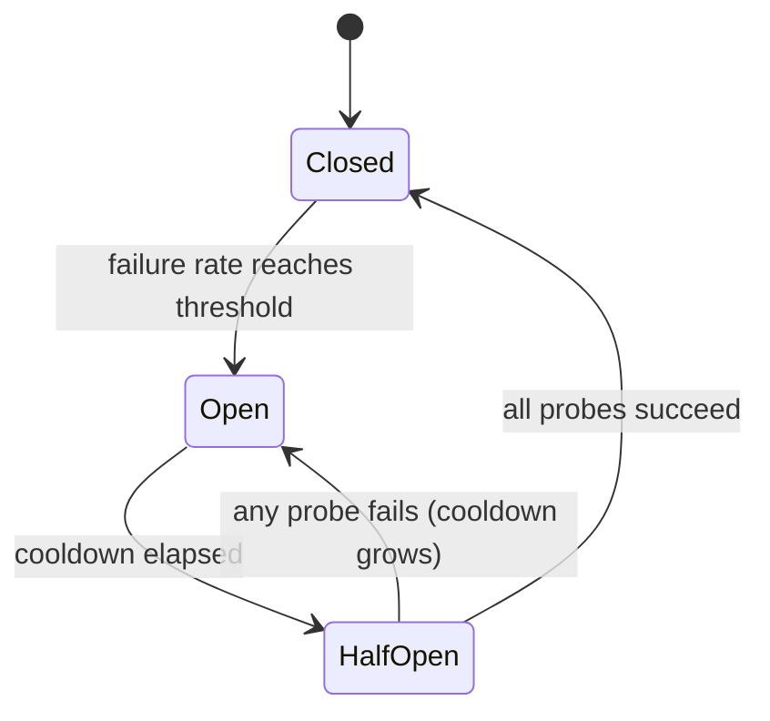

# LLM sağlayıcıları için devreler

> Bir tekrar deneme sorusu "Bu istek tekrar denemeli mi?" bir çevre kesicisi "Bu sağlayıcıyı şimdi kimse aramalı mı?" sorar.

**Type:** Build
**Languages:** Python
**Prerequisites:** Phase 17 · 19 (AI Gateways), Phase 17 · 24 (Chaos Engineering)
**Time:** ~75 minutes

## Öğrenme Hedefleri

- Üç kesinti durumunu ve her geçişin nedenini açıklayın.
- En az bir çağrı koruyucu ve yarı açık bir sonda bütçesi olan kaydırıcı pencereler için bir devrim kesici uygulayın.
- LLM sağlayıcısının hatalarını sağlıksız bir sağlayıcıyı işaretleyen ve talebi suçlayanlara sınıflandırın.
- Zamanlama, tekrar deneme ve geri dönüş yolu ile bir kesintiyi doğru sırada oluşturun.
- Bir servisçi kesilmesinde bir kesicinin ne kadar para biriktirdiğini ve kurtarıldıktan sonra ne kadar para harcadığını ölçün.
- Belirli bir dağıtım için kesinti alanını (bericisi, modeli, bölge) seçin.

## Sorun

Giriş kapısı her talebi birincil sağlayıcısına gönderir ve başarısızlık durumunda ikinciye düşer.

Hiçbir şey kaybolmuyor. Her istek hala cevaplanır. Ama her istek artık 1 yerine 11 saniye sürer. Kesinlik süreceği sürece. İşçi ipleri cevap vermeyecek bir sağlayıcıda engellenir. Sırlar büyüyor. Akıntılı aramacılar kendi zamanlarını belirler ve yeniden deneler, bu da daha fazla yük ekler. Bir sağlayıcıda kısmi kesinlik hizmetinizin tam kesintisine dönüşür.

Bir sorunun tekrar deneme ve geri dönüş mantığı doğru. Hata, sorunun 500 numarası, öncesindeki 499 başarısızlıktan hiçbir şey öğrenmez.

## Anlaşım

### Üç eyalet

İsim elektrik cihazından gelir: hatası tespit edildiğinde devre açılır ve akım durur.



- **Closed**Çağrılar geçer ve her sonuç kaydedilir.
- **Open**Bu durum, *hızlı başarısızlık* anlamına gelir.
- **Half-open**Bir soğutma sonrasında, küçük sayıda gerçek arama *probes* olarak geçebilir.

Adlandırma tuzağına dikkat edin: * kapatılmış* sağlıklı durumdur ve * açık* kırılmış olan, kapının tam karşısındadır.

### Ne zaman tökezleyelim

En basit kural "N ardılı başarısızlıktan sonra aç"dır. Yapılması kolaydır, ancak bir şanslı başarı sayıyı yeniden ayarlar, bu nedenle aramaların %80'ini başarısız yapan bir sağlayıcı asla tersine düşmeyebilir.

Çekilme penceresi üzerinde başarısızlık oranı daha güçlüdür.`window_size`Bu değerler, başarısız olan kısımın eşiğine ulaştığında açılır.`minimum_calls`guard, veya bir çağrının bir başarısızlığı %100 başarısızlık oranı olarak okunuyor ve yeniden başlatıldıktan sonra ilk hatada kesicini çalıştırır.

### Başarısızlık olarak ne sayılır?

Bir kesiciler sağlığı tedbirleri sağlayan, bu yüzden sadece sağlayıcıyı tanımlayan hatalar sayılmalıdır.

| Outcome | Counts as failure? | Reason |
|---------|-------------------|--------|
| Timeout or connection error | Yes | The provider did not answer |
| 5xx (500, 502, 503, 529) | Yes | The provider failed |
| 429 rate limit | Yes | The provider cannot serve you right now |
| 400 bad request, context too long | No | The request is wrong; another provider's model may reject it too |
| 401 or 403 | No | Your credentials are wrong; alert on this instead |
| Content filter refusal | No | The provider answered; the answer was a refusal |

400 aslında sağlığın sağ olduğuna dair bir kanıt: istek alındı, onaylandı ve hızlı bir şekilde yanıtlandı.

### Yarım açık ve soğutma

Sıcaklama bitince, kapı kapıları yeniden açılmaz. Sondalar belirlenmiş bir sayıya izin verir.

Başarısız bir sonda, bir sonraki soğutma sürecini bir sınırına kadar uzatmalıdır. 30 saniye sonra hala çökmüş olan bir sağlayıcı, 60 saniye sonra çökmüş olma olasılığı daha yüksek ve her sonda gerçek bir kullanıcıya bir zaman kaybı karşılıyor.

### Etkinlik kapsamı

Bir sunucu başına bir kesicik genellikle çok kaba. Bir kesim genellikle bir model veya bir bölge ile sınırlıdır ve bir sunucu genel kesicik sağlıklı dağıtımları keser. API anahtarı ve model ve bölge ve kiracı başına bir kesicik çok iyi: tek bir kesicik görmez.`minimum_calls`Ortak bir başlangıç noktası, dağıtım başına bir kesicidir, yani tedarikçi, model ve bölge.

### Yapılandırma sırası

Üç kontrol aynı çağrıda bulunur ve sipariş önemlidir:

```text
retry  ->  circuit breaker  ->  timeout  ->  provider call
```

Timeout en içindedir, bu nedenle bir arama kesintici sayılabilen bir başarısızlığa dönüşür. Kesintici yeniden deneme girişinin içinde oturuyor, bu nedenle her tekrar deneme girişinde önce kesinticiyi sorar ve yeniden deneme döngüsü açık bir devreyi çekişemez.

### Komşularından nasıl farklıdır

| Control | Question it answers | Triggered by |
|---------|--------------------|--------------|
| Timeout | How long may one call take? | A single slow call |
| Retry with backoff | Should this request try again? | A single failed call |
| Rate limit | How much traffic may a caller send? | Request volume |
| Circuit breaker | Is this dependency healthy enough to call? | Failures across many calls |
| Kill switch (Phase 15 · 14) | Should this system run at all? | A human or a safety policy |

## Yapın

Tam olarak uygulanması `code/main.py`- Bir `ManualClock`Arayan elden ilerler, böylece demo ve her test, hiç uyku olmadan anında çalışır.

### Adım 1: Hata sınıflandır

```python
def counts_as_failure(status: int | None) -> bool:
    """Timeouts, 429 and 5xx blame the provider. Any other 4xx blames the request."""
    if status is None:
        return True
    return status == 429 or status >= 500
```

`status`- Evet .`None`bir süreliğine, çünkü hiç geri dönmeyen bir arama durum kodu yoktur.

### Adım 2: Çağrı devam edip etmeyeceğini karar verin

```python
def allow(self) -> bool:
    if self.state == OPEN and self.clock.now() - self.opened_at >= self.cooldown:
        self.probes_issued = 0
        self.probe_successes = 0
        self._move(HALF_OPEN)
    if self.state == CLOSED:
        return True
    if self.state == HALF_OPEN and self.probes_issued < self.config.half_open_probes:
        self.probes_issued += 1
        return True
    return False
```

Arka planlı zamanlama yok. Açıktan yarı açık olan bir yere geçmek tembelliktir. Bir aramacı ilk kez soğutma bittikten sonra soruyor.

### Üçüncü adım: Sonuçları kaydet

```python
def record_failure(self) -> None:
    if self.state == OPEN:
        return
    if self.state == HALF_OPEN:
        self.cooldown = min(
            self.cooldown * self.config.cooldown_multiplier,
            self.config.max_cooldown_seconds,
        )
        self._trip()
        return
    self.window.append(False)
    enough_calls = len(self.window) >= self.config.minimum_calls
    if enough_calls and self.failure_rate() >= self.config.failure_rate_threshold:
        self._trip()
```

İlk kontrol gerçek sistemlerde önemlidir. Kesinleyici açıldığında uçuşta olan aramalar başarısızlıklarını geç saatlerde bildirir. Eğer bu geç sonuçlar soğutmayı yeniden başlatırsa, sürekli bir damla, kesinleyiciyi sonsuza dek açık tutabilir.

`record_success`Bu da aynası: yarı açıkken, sondaları sayıp bütçeyi karşıladığında kapanır, böylece eski başarısızlıklar bir anda tekrar kırıcıyı tökezletmez.

### Dördüncü adım: Aramayı tamamla

```python
def call(self, fn: Callable[[], str]) -> str:
    if not self.allow():
        raise CircuitOpenError(self.name)
    try:
        result = fn()
    except ProviderError as error:
        if counts_as_failure(error.status):
            self.record_failure()
        else:
            self.record_success()
        raise
    except Exception:
        self.record_failure()
        raise
    self.record_success()
    return result
```

Geçen her yol .`allow()`Eğer bir yol kaydetmeyi unutursa yarı açık bir kırıcı, sondalarını dağıtacak, geri hiçbir şey duymayacak ve yarı açık kalmayacaktır.

### Adım 5: Açık bir kırıcıyı dolaş

`FallbackRouter`Yolların sıralı bir listesinde yürür.`CircuitOpenError`Bir sunucu başarısızlığı, arama için ödeme yaptıktan sonra bir sonraki rotaya geçer. 400 gibi bir talep hatası arayan kişiye yüklenir ve başarısız olmaz.

### Çek şunu.

```bash
cd phases/17-infrastructure-and-production/30-circuit-breakers-llm-providers/code
python3 main.py
python3 -m unittest discover tests -v
```

Demo, ikinci 20'den ikinci 80'e düşen bir ilkci birimden 150 istek gönderir:

```text
metric                        retry only     breaker
----------------------------------------------------
requests answered                    150         150
timeouts paid on primary              60           6
calls skipped (fast fail)              0          88
calls sent to fallback                60          94
mean latency (seconds)              5.00        1.40

breaker transitions:
  t=   24s     closed -> open
  t=   54s       open -> half_open
  t=   54s  half_open -> open
  t=  114s       open -> half_open
  t=  115s  half_open -> closed
```

İki maliyeti oku. Kesicisi 60 yerine 6 çıkış yaptı. 5 çıkışın tespit edilmesi için ve bir sonda 54 saniyelik bir başarısızlık için. Ama bu başarısız sondada soğutma hızı iki katına çıktı. Bu yüzden kesicik ikinci 114'e kadar tekrar test etmedi. İlk 80'den sonra sağdıçlıydı ve 34 istek, gereksiz olan geri dönüşe gitti. Bir kesicik daha yavaş bir şekilde daha ucuz kesimlere alışveriş yapar. Bu işlemin sonunu soğutma, katılımcı ve kaplama belirler.

## Kullan

Üretim geçitleri ve vekiller bu örneği farklı isimlerle gönderir. Onlara güvenmeden önce mevcut belgeleri varsayımlar için kontrol edin.

- **Resilience4j**(JVM) bu derse en yakın eşleşme.`failureRateThreshold`- Evet .`slidingWindowSize`- Evet .`minimumNumberOfCalls`- Evet .`waitDurationInOpenState`ve`permittedNumberOfCallsInHalfOpenState`Ayrıca yavaş aramaları başarısızlık olarak sayıyor.`slowCallDurationThreshold`- Evet .
- **Envoy**Bu *outlier detection* olarak adlandırılır: bir ev sahibi `consecutive_5xx`hatalar için`base_ejection_time`Gönderin "işiklet kırılması" adı verilen özelliği farklı bir şeydir, bağlantıların ve bekleyen isteklerin bir kapı.
- **LiteLLM Router**bir dağıtımını soğutmaya koyur `allowed_fails``cooldown_time`Bu arada ikinci ve diğer yerleşimlere giden yollar.

İnsani versiyonlarda simülatörün dışladığı iki şey var:

- **Concurrency.**Yarım açık, bir kilit veya atom sayıcıya ihtiyaç duyan * uçuşta * sondları sınırlamak gerekir.
- **Shared state.**On kapı replikası on ayrı kırıcı tutar. Her biri açılmadan önce kendi başarısızlıklarını görmelidir. Redis'te paylaşım durumları onları daha hızlı kabul eder, ancak bağımlılık başarısızlıklarını hayatta kalmak için tasarlanmış olan bir bağımlılık ekler.

Özellikle LLM trafiği için:

- Akışlar için ilk simge olarak zaman sonunu belirleyin. Toplam üretim süresi çıkış uzunluğuna göre sağlık sinyali olmak için çok fazla değişir.
- 429'ın taşıdığı zaman`Retry-After`Başlık, bu değerleri öntanımlı yerine soğutma olarak kullan.
- Geriye düşmenin tüm yükü absorbe edebileceğini kontrol edin. %100 trafiği daha düşük bir hız sınırıyla ikinci bir tarafa taşınırken ikinci tarafa geçiş kesicisi bir sonraki seferini yapar.

## Gönder

Bu ders bize çok yararlı .`outputs/skill-circuit-breaker-review.md`. Bir sunucu çağrısı yolu göz önüne alındığında, seyahat kuralını, hata sınıflandırmasını, yarı açık davranışını, kapsamını ve kompozisyon sırasını gözden geçirir ve boşlukları listeler.

## Egzersizler

1. Çık .`code/main.py`- Yapılandır .`cooldown_multiplier`Bir kesicinin kaç ekstra zaman çıkışı ödüyor ve kaç saniye daha erken kapanıyor?
2. Sürükleyici pencerenin yerine ardıcıl bir başarısızlık sayıcısı koyun. Her beş seferinde dört kez başarısız olan bir sunucu ile bir test yazın ve sayıcının asla beş eşiğinde düşmediğini gösterin.
3. Yavaş arama algısını ekleyin: Başarılı ancak bir eşiğinden daha uzun süren bir arama başarısız sayılır.
4. Ver .`ProviderError`bir seçeneği `retry_after`değerini ve kesicini mevcut olduğunda soğutma olarak kullanmasını sağlayın.
5. Demo'nun geri dönüşü asla başarısız olmaz. Bir kesinti ve saniyede 0.5 talep oranı sınırını verin. Kesinti sırasında ne olur ve her rota açık olduğunda yönlendirici neyi geri göndermelidir?

## Anahtar Terimler

| Term | What people say | What it actually means |
|------|----------------|------------------------|
| Circuit breaker | "Stop calling it" | A state machine that refuses calls to a dependency after failures cross a threshold, then probes for recovery |
| Closed | "Healthy" | Calls pass through and outcomes are recorded |
| Open | "Tripped" | Calls are refused without contacting the dependency |
| Half-open | "Testing" | A limited number of probe calls decide whether to close or reopen |
| Fast fail | "Fail quickly" | Returning an error at once instead of waiting for a timeout |
| Sliding window | "Recent calls" | The last N outcomes used to compute the failure rate |
| Minimum calls | "Warm-up guard" | The fewest recorded calls before the failure rate is trusted |
| Cooldown | "Wait duration" | Time the breaker stays open before it allows probes |
| Probe | "Trial request" | A real request let through in half-open to test recovery |
| Outlier detection | "Envoy's breaker" | Ejecting an unhealthy host from a load-balancing pool |

## Daha Fazla Okumak

- [Michael Nygard — Release It! (2nd edition)](https://pragprog.com/titles/mnee2/release-it-second-edition/) Tabanlılık Şekilleri bölümünde, örneği isimlendiren kitap.
- [Martin Fowler — CircuitBreaker](https://martinfowler.com/bliki/CircuitBreaker.html) Üç devlet için kısa bir referans.
- [Resilience4j — CircuitBreaker](https://resilience4j.readme.io/docs/circuitbreaker) Sayıya dayalı ve zaman tabanlı kaydırıcı pencereler, yavaş çağrı eşiği.
- [Envoy — Outlier detection](https://www.envoyproxy.io/docs/envoy/latest/intro/arch_overview/upstream/outlier) Ejeksiyon kuralları ve artan ejeksiyon süresi.
- [LiteLLM — Routing](https://docs.litellm.ai/docs/routing) Deployment cooldowns ve fallback.
- [AWS Builders' Library — Timeouts, retries, and backoff with jitter](https://aws.amazon.com/builders-library/timeouts-retries-and-backoff-with-jitter/) bir kesicinin oluşturduğu kontroller.
