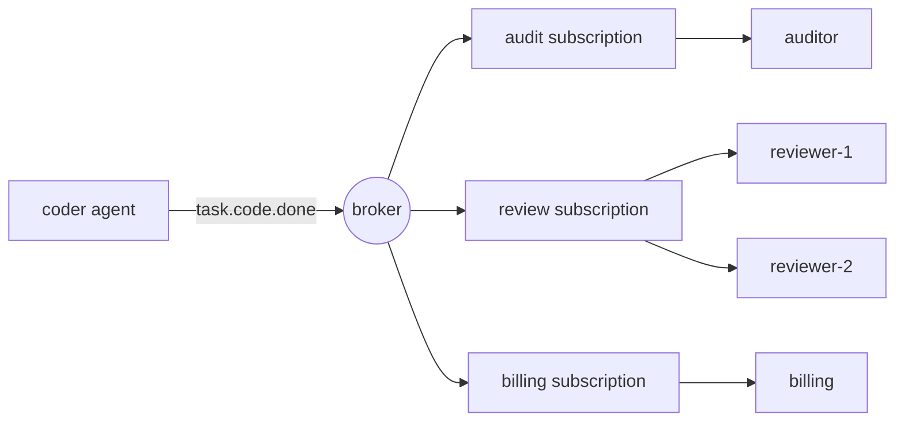

# Pub/Sub Messaging cho các đại lý

> Một lời kêu gọi trực tiếp nói "hãy làm điều này". Một sự kiện được xuất bản nói "điều này đã xảy ra".

**Type:** Build
**Languages:** Python
**Prerequisites:** Phase 16 · 13 (Shared Memory and Blackboard Patterns), Phase 16 · 22 (Production Scaling)
**Time:** ~75 minutes

## Mục tiêu học tập

- Giải thích ba loại giải khép kết nối mà publish-subscribe cung cấp và chi phí mỗi loại.
- Thực hiện một nhà môi giới với thẻ hoang dã chủ đề, đăng ký, xác nhận, chuyển giao lại, và một danh sách chữ cái chết.
- Để phân biệt các fan-out trên các thuê bao từ các khách hàng cạnh tranh trong một thuê bao.
- Giữ lệnh mỗi lần chạy với khóa định tuyến trong khi vẫn mở rộng quy mô người tiêu dùng.
- Hãy cho thấy tại sao ít nhất một lần sinh lại lặp lại các tác dụng phụ, và sửa chữa nó bằng một người xử lý không có khả năng.
- Chọn giữa quán rượu / tàu ngầm, một hàng lao động, một cuộc gọi trực tiếp, và một bảng màu cho một tương tác đặc vụ nhất định.

## Vấn đề

Một nhân viên lập trình hoàn thành một nhiệm vụ, một nhân viên kiểm tra phải kiểm tra nó, vì vậy người lập trình gọi cho người kiểm tra.

Tháng tới bạn thêm hóa đơn, phải tính phí cho mỗi nhiệm vụ hoàn thành. Sau đó là nhật ký kiểm toán. Sau đó là một nhà đánh giá lấy mẫu kết quả. Mỗi lần bổ sung chỉnh sửa bộ lập trình: một cuộc gọi nữa, một thất bại xử lý nữa, một lý do nữa vì sao bộ lập trình chậm. Nếu tính toán xuống, bộ lập trình sẽ thất bại? Nếu bộ đánh giá mất 40 giây, bộ lập trình sẽ chờ đợi?

Bộ lập trình đã trở thành nơi đáp ứng các yêu cầu của mọi nhân viên khác. Nó biết họ là ai, gọi họ theo thứ tự, và thừa hưởng những thất bại của họ.

Publish-subscribe biến đổi sự phụ thuộc.`task.code.done`Và dừng lại. Bất cứ ai quan tâm đăng ký. Thêm đánh giá không thay đổi gì trong coder.

## Khái niệm

### Ba loại giải ghép

Cuộc khảo sát cổ điển về mô hình (Eugster et al., 2003) nêu tên ba:

| Decoupling | Meaning | What it costs |
|------------|---------|---------------|
| Space | Publisher and subscriber do not know each other | No one place shows the full workflow |
| Time | They need not be running at the same moment | The broker must store messages |
| Synchronization | The publisher does not block waiting for subscribers | There is no return value and no error to catch |

Mỗi hàng là một lợi ích và một tổn thất thực sự. Pub / sub không loại bỏ sự phối hợp. Nó di chuyển nó ra khỏi mã và vào tên chủ đề và đăng ký.

### Các chủ đề và thẻ hoang dã

Một chủ đề là một cái tên cho một loại sự kiện. Tên hàng đầu cho phép người đăng ký chọn mức độ quan tâm của mình. Bài học này sử dụng quy ước NATS: token được tách ra bởi các chấm,`*`phù hợp chính xác với một biểu tượng, và `>`kết hợp với một hoặc nhiều token ở cuối.

| Pattern | Matches | Does not match |
|---------|---------|----------------|
| `task.code.done` | `task.code.done` | `task.research.done` |
| `task.*.done` | `task.code.done`, `task.research.done` | `task.code.failed` |
| `task.>` | `task.code.done`, `task.code.failed` | `task`, `metrics.tokens` |

Tên đề tài cho các sự kiện trong thời gian qua (`task.code.done`), không phải cho lệnh (`review.this`Một lệnh có một người nhận được dự định và tốt hơn là được gửi đến một hàng hoặc như một cuộc gọi trực tiếp.

### Người tiêu dùng phổ biến và cạnh tranh

Một cơ chế cho ra hai hành vi ngược lại, và nhầm lẫn chúng là sai lầm phổ biến nhất.



- **Across subscriptions: fan-out.**Mỗi người đăng ký nhận được bản sao của mình của mỗi tin nhắn phù hợp.
- **Inside one subscription: competing consumers.**Các thành viên chia sẻ các tin nhắn của đăng ký. Mỗi tin nhắn đi đến chính xác một thành viên.`reviewer-2`làm giảm một nửa tải trọng `reviewer-1`Nó không xem xét mọi thứ hai lần.

Kafka gọi thuê bao là * nhóm người tiêu dùng*, NATS gọi nó là * nhóm xếp hàng*, và Google Cloud Pub / Sub gọi nó là * thuê bao*. Ý tưởng là giống nhau.

### Chứng chỉ giao hàng

| Guarantee | Broker behaviour | Failure you accept |
|-----------|-----------------|--------------------|
| At-most-once | Send once, never retry | Messages are lost |
| At-least-once | Retry until acknowledged | Messages are duplicated |
| Exactly-once | Not available across a network in general | — |

Người tiêu dùng nhận được thông điệp (*ack*) sau khi xử lý nó. Nếu môi giới không nghe thấy gì, hoặc nhận được thông báo tiêu cực (*nack*), nó sẽ cung cấp lại.

Sự khác biệt là: người tiêu dùng làm công việc, sau đó ack bị mất. Người môi giới không thể phân biệt "không bao giờ xử lý" từ "được xử lý, ack bị mất", vì vậy nó chuyển giao lại. Công việc chạy hai lần. Những gì mọi người gọi là chính xác một lần thực tế là ít nhất một lần giao hàng cộng với một người tiêu dùng *idempotent*, một người tạo ra kết quả tương tự khi nó nhìn thấy cùng một thông điệp một lần nữa.

Đối với các đại lý, đây là một vấn đề về chi phí cũng như một vấn đề về tính chính xác.

### Thông điệp độc hại và hàng xếp chữ cái chết

Một số thông điệp không bao giờ thành công: một tải trọng hữu ích bị hình thành sai, một kế hoạch mà người tiêu dùng không hiểu.`max_deliveries`cố gắng môi giới di chuyển thông điệp đến một * dead-letter queue* (DLQ), nơi một con người hoặc một công việc sửa chữa có thể kiểm tra nó, và dòng chảy di chuyển tiếp.

### Đặt hàng

Với người tiêu dùng cạnh tranh, hai tin nhắn từ cùng một đại lý chạy có thể đạt đến các thành viên khác nhau và kết thúc không theo thứ tự.`run-a`đến một nhà phê bình, theo thứ tự xuất bản, trong khi các cuộc chạy khác đi đến nơi khác song song.

Để giữ trật tự, một tin nhắn thất bại phải được thử lại trước khi gửi tin nhắn tiếp theo, vì vậy một tin nhắn độc sẽ chặn hàng đợi cho đến khi nó bị viết tắt.

### Chọn mẫu

| Pattern | Use when | Example |
|---------|----------|---------|
| Direct call | One receiver, and you need the answer now | Agent calls a tool |
| Work queue | One receiver type, the work must happen once | Dispatch a task to any free worker |
| Pub/sub | Zero or more receivers react to a fact | `task.code.done` triggers review, billing, audit |
| Blackboard (Phase 16 · 13) | Agents share state and read it later | A shared plan that agents refine |

Một bảng ghi nhớ lưu trữ trạng thái hiện tại. Pub / sub mang lại những thay đổi. Nhiều hệ thống sử dụng cả hai.

## Hãy xây dựng nó

Đơn vị môi giới đầy đủ đã đến rồi.`code/main.py`Nó chạy trong một quá trình mà không có dây, vì vậy mỗi thử nghiệm là xác định.

### Bước 1: Đáp hợp một chủ đề với một mẫu

```python
def topic_matches(pattern: str, topic: str) -> bool:
    pattern_tokens = pattern.split(".")
    topic_tokens = topic.split(".")
    for index, token in enumerate(pattern_tokens):
        if token == ">":
            return index == len(pattern_tokens) - 1 and len(topic_tokens) > index
        if index >= len(topic_tokens):
            return False
        if token != "*" and token != topic_tokens[index]:
            return False
    return len(pattern_tokens) == len(topic_tokens)
```

### Bước 2: Giới thiệu một bản sao cho mỗi đăng ký phù hợp

```python
def publish(self, topic: str, payload: str, key: str | None = None) -> Message:
    message = Message(self._next_id, topic, payload, key)
    self._next_id += 1
    matched = [group for group in self.groups.values() if topic_matches(group.pattern, topic)]
    if not matched:
        self.dropped.append(message)
    for group in matched:
        group.queue.append(Delivery(message))
    return message
```

Mỗi người`Group`có một dòng. Một quyết định đó tạo ra fan-out: ba nhóm phù hợp có nghĩa là ba mục hàng cho một tin nhắn.`dropped`Một tin được đăng tải trước khi ai đăng ký đã biến mất, và `publish`vẫn trở lại bình thường.

### Bước 3: Chọn một thành viên trong nhóm

```python
def _pick(self, group: Group, message: Message) -> tuple[str, Handler]:
    if message.key is not None:
        digest = hashlib.sha256(message.key.encode()).digest()
        index = int.from_bytes(digest[:8], "big") % len(group.members)
    else:
        index = group.next_member % len(group.members)
        group.next_member += 1
    return group.members[index]
```

Không có chìa khóa, các thành viên thay lượt. Với một chìa khóa, hash quyết định. Python tích hợp.`hash()`không được sử dụng bởi vì nó được ngẫu nhiên cho mỗi quy trình cho chuỗi, vì vậy hai quy trình môi giới sẽ không đồng ý về ai sở hữu một chìa khóa.

### Bước 4: Đưa, sau đó ack, thử lại, hoặc chữ cái chết

```python
def _deliver(self, group: Group) -> None:
    delivery = group.queue.popleft()
    consumer, handler = self._pick(group, delivery.message)
    self.log.append((group.name, consumer, delivery.message.id, delivery.attempt))
    try:
        acked = handler(delivery.message)
    except Exception:
        acked = False
    if acked:
        return
    if delivery.attempt >= self.max_deliveries:
        self.dead_letters.append((group.name, delivery.message))
    else:
        group.queue.appendleft(Delivery(delivery.message, delivery.attempt + 1))
```

Một người quản lý quay lại`True`Trở lại.`False`Hoặc nâng cao là một cái cổ.`appendleft`, giữ trật tự và gây ra việc chặn đầu hàng.`append`và bạn có được giao dịch ngược lại.

### Bước 5: Làm cho người tiêu dùng có quyền lực

```python
class IdempotentHandler:
    def __call__(self, message: Message) -> bool:
        if message.id in self.seen:
            self.duplicates += 1
            return True
        acked = self.handler(message)
        if acked:
            self.seen.add(message.id)
        return acked
```

Một bản sao được thừa nhận mà không chạy hiệu ứng. Một tin nhắn chỉ được nhớ sau khi nó thành công, do đó một thất bại thực sự vẫn được thử lại.

### Đi thôi.

```bash
cd phases/16-multi-agent-and-swarms/26-pubsub-messaging-for-agents/code
python3 main.py
python3 -m unittest discover tests -v
```

Demo công bố bảy sự kiện từ hai đại lý chạy vào ba đăng ký.

```text
delivery attempts:      19
audit received:         6 events
reviewer-1 handled:    run-a:step-1, run-a:step-2
reviewer-2 handled:    run-e:step-1, run-e:step-3
dead letters:           [('review', 5)]
dropped, no subscriber: ['metrics.tokens']

billing lost the acknowledgement for message 2, so the broker redelivered it.
charges with a plain handler:       6 (5 billable events)
charges with an idempotent handler: 5
```

Hãy đọc từng dòng với khái niệm nó cho thấy:

- 7 sự kiện đã gây ra 19 nỗ lực giao thông.
- Mỗi lần chạy đều chỉ cần một người xem, theo thứ tự.
- Thông điệp 5 đã được thử ba lần bằng đánh giá và sau đó bị xóa sổ.
- `metrics.tokens`Không có người đăng ký và biến mất mà không có lỗi.
- Người quản lý hóa đơn thường xuyên đã tính phí sáu lần cho năm sự kiện.

## Sử dụng nó

Các nhà môi giới sản xuất khác nhau chủ yếu về những gì họ lưu trữ và những gì họ đảm bảo.

| System | Subscription model | Delivery | Ordering |
|--------|-------------------|----------|----------|
| Apache Kafka | Consumer groups read a partitioned log by offset | At-least-once by default | Per partition, chosen by message key |
| NATS | Subjects with `*` and `>`; queue groups | Core NATS is at-most-once; JetStream adds at-least-once | Per stream in JetStream |
| Google Cloud Pub/Sub | Topics and named subscriptions | At-least-once, with an ack deadline and dead-letter topics | Optional ordering keys |
| Redis Pub/Sub | Channels and patterns | At-most-once; offline subscribers miss messages | None |
| Redis Streams | Consumer groups with explicit `XACK` | At-least-once | Per stream |

Kafka và JetStream giữ nhật ký, để người đăng ký mới có thể chơi lại lịch sử.

Trong các khung đại lý, AutoGen Core được xây dựng dựa trên mô hình này: đại lý xuất bản tin nhắn cho một chủ đề và thời gian chạy đưa chúng đến các đại lý có đăng ký phù hợp.

Những gì người môi giới trong ký ức bỏ qua:

- **Persistence.**Một vụ tai nạn sẽ làm mất mọi thứ.
- **Ack deadlines.**Một nhà môi giới thực sự cung cấp lại khi người tiêu dùng im lặng quá lâu.
- **Backpressure.**Các hàng không không giới hạn, người đăng ký chậm làm cho hàng của mình tăng lên cho đến khi bộ nhớ hết.
- **Atomic dedupe.** `IdempotentHandler`ghi lại id sau hiệu ứng. Một sự cố giữa hai lặp lại hiệu ứng. Trong sản xuất, ghi lại hiệu ứng và ID được xử lý trong một giao dịch cơ sở dữ liệu, hoặc chuyển id tin nhắn đến hệ thống dòng chảy dưới dạng khóa idempotency.

Đối với hệ thống đại lý cụ thể:

- **Carry a correlation id.**Không có ngăn xếp cuộc gọi, run id và trace context trong mỗi tin nhắn là cách duy nhất để xây dựng lại những gì đã xảy ra (Phase 14 · 23).
- **Guard against event loops.**Đặc vụ A phản ứng với sự kiện của B và xuất bản một sự kiện mà B phản ứng với.
- **Version the payload.**Những người đăng ký mà bạn không biết về phụ thuộc vào kế hoạch của bạn.

## Chuyển nó

Bài học này sẽ mang lại kết quả `outputs/skill-pubsub-design-review.md`Với một tập hợp các đại lý và các sự kiện giữa họ, nó xem xét tên đề tài, bố cục đăng ký, bảo đảm giao hàng, quyền miễn phí, đặt hàng và xử lý chữ cái chết.

## Các bài tập

1. Đi chạy`code/main.py`- Thay đổi thử lại.`_deliver`từ `appendleft`đến`append`- Theo thứ tự nào?`reviewer-2`Giờ hãy xử lý các sự kiện cho `run-e`, và khi nào lệnh đó sẽ được chấp nhận?
2. Thêm một hàng giới hạn: `publish`tăng khi hàng xếp hàng của một nhóm giữ nhiều hơn `max_queue`Các nhà xuất bản nên làm gì khi nó được nâng lên: chặn, giảm hoặc thất bại?
3. Thêm một `hops`trường đến `Message`và làm cho môi giới không có thông tin được đăng bởi một người xử lý một lần `hops`viết một bài kiểm tra với hai người xử lý mà kích hoạt nhau.
4. Thêm replay: giữ mọi tin nhắn được xuất bản trong một nhật ký và để một nhóm mới đăng ký ngay từ đầu.`dropped`danh sách?
5. Một nhà phê bình thứ ba gia nhập `review`nhóm trong khi tin nhắn cho `run-a`- Chìa khóa nào thay đổi chủ sở hữu?`hash % members`Đọc về việc sử dụng hash liên tục và giải thích làm thế nào nó làm giảm chuyển động.

## Các điều khoản chính

| Term | What people say | What it actually means |
|------|----------------|------------------------|
| Pub/sub | "Event bus" | Messaging where publishers send to a topic and the broker delivers to whoever subscribed |
| Topic | "Channel" | A name for a kind of event; called a subject in NATS |
| Subscription | "Consumer group" | A named interest in a topic pattern with its own copy of each message |
| Fan-out | "Broadcast" | Each subscription receives every matching message |
| Competing consumers | "Load balancing" | Members of one subscription share its messages; each message goes to one |
| Ack / nack | "Confirm" | The consumer's report that handling succeeded or failed |
| At-least-once | "Guaranteed delivery" | Redelivery until acknowledged, so duplicates are possible |
| Idempotent consumer | "Dedupe" | A handler that gives the same result when a message is delivered again |
| Dead-letter queue | "DLQ" | Where a message goes after it exhausts its delivery attempts |
| Routing key | "Partition key" | A value hashed to pick the consumer, so related messages stay in order |
| Head-of-line blocking | "Stuck queue" | A failing message that delays everything behind it in an ordered queue |

## Đọc thêm

- [Eugster, Felber, Guerraoui, Kermarrec — The Many Faces of Publish/Subscribe (ACM Computing Surveys, 2003)](https://dl.acm.org/doi/10.1145/857076.857078) khảo sát xác định không gian, thời gian và giải ghép đồng bộ.
- [NATS — Subject-Based Messaging](https://docs.nats.io/nats-concepts/subjects) các quy tắc wildcard bài học này thực hiện.
- [Apache Kafka — Documentation](https://kafka.apache.org/documentation/) phân vùng, nhóm người tiêu dùng và bù đắp.
- [Google Cloud Pub/Sub — Overview](https://cloud.google.com/pubsub/docs/overview) đăng ký, thời hạn, các chủ đề chữ cái chết, đặt hàng chìa khóa.
- [Redis — Pub/Sub](https://redis.io/docs/latest/develop/pubsub/) truyền thông qua kênh nhất một lần.
- [AutoGen Core — Topic and Subscription](https://microsoft.github.io/autogen/stable/user-guide/core-user-guide/core-concepts/topic-and-subscription.html) mô hình tương tự trong một thời gian chạy của một đại lý.
