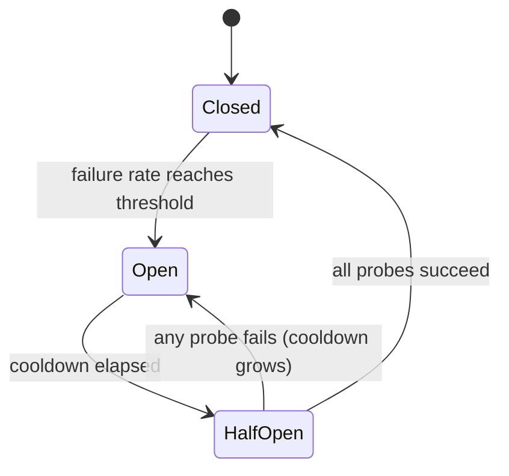

# Các bộ phá vỡ mạch cho các nhà cung cấp LLM

> Một lần thử lại hỏi "có nên thử lại yêu cầu này không?" một người cắt mạch hỏi "có ai gọi cho nhà cung cấp này ngay bây giờ không?"

**Type:** Build
**Languages:** Python
**Prerequisites:** Phase 17 · 19 (AI Gateways), Phase 17 · 24 (Chaos Engineering)
**Time:** ~75 minutes

## Mục tiêu học tập

- Giải thích ba trạng thái phá vỡ và sự kiện gây ra mỗi chuyển đổi.
- Thực hiện một bộ cắt mạch cửa sổ trượt với một bảo vệ gọi tối thiểu và một ngân sách thăm dò bán mở.
- Lớp loại lỗi của nhà cung cấp LLM vào những lỗi báo hiệu cho nhà cung cấp không khỏe mạnh và những lỗi đổ lỗi cho yêu cầu.
- Sắp xếp một bộ ngắt thời gian với thời gian, thử lại, và một tuyến đường quay lại theo thứ tự chính xác.
- Đánh giá chi phí của một bộ cắt giảm trong thời gian bị gián đoạn của nhà cung cấp và chi phí sau khi phục hồi.
- Chọn phạm vi giải pháp (công ty cung cấp, mô hình, khu vực) cho một triển khai nhất định.

## Vấn đề

Gateway của bạn gửi mọi yêu cầu đến một nhà cung cấp chính và rơi lại vào thứ hai khi thất bại.

Không có gì bị mất. Mỗi yêu cầu vẫn được trả lời. Nhưng mỗi yêu cầu bây giờ mất 11 giây thay vì 1, cho đến khi sự gián đoạn kéo dài. Các chủ đề công nhân bị chặn trên một nhà cung cấp không trả lời. Lịch hàng tăng lên. Người gọi trên dòng chảy chạm vào thời gian riêng của họ và thử lại, điều này thêm tải trọng. Một sự gián đoạn một phần tại một nhà cung cấp trở thành sự gián đoạn hoàn toàn trong dịch vụ của bạn.

logic thử lại và trở lại là đúng cho một yêu cầu. sai lầm là yêu cầu số 500 không học được gì từ 499 lỗi trước đó.

## Khái niệm

### Ba bang

Tên gọi này xuất phát từ thiết bị điện: khi phát hiện lỗi, mạch mở và dòng điện dừng lại.



- **Closed**Các cuộc gọi sẽ được ghi lại và mọi kết quả sẽ được ghi lại.
- **Open**nghĩa là nhà cung cấp được coi là không hoạt động. Các cuộc gọi được từ chối ngay lập tức, mà không liên hệ với nhà cung cấp. Đây là *fast failure*.
- **Half-open**Sau khi làm mát, một số lượng nhỏ các cuộc gọi thực được phép thông qua như là * thăm dò*. Kết quả của chúng quyết định trạng thái tiếp theo.

Lưu ý cái bẫy đặt tên: *closed* là trạng thái khỏe mạnh và *open* là trạng thái bị hỏng, ngược lại với một cánh cửa.

### Khi nào phải ngã

Quy tắc đơn giản nhất là "mở sau khi N thất bại liên tiếp". Nó dễ dàng xây dựng, nhưng một thành công may mắn đặt lại số lượng, vì vậy một nhà cung cấp thất bại 80% cuộc gọi có thể không bao giờ làm sai.

Tỷ lệ thất bại trên cửa sổ trượt là mạnh hơn.`window_size`kết quả và mở khi phần thất bại đạt ngưỡng.`minimum_calls`guard, hoặc một lỗi trong một cuộc gọi đọc như tỷ lệ thất bại 100% và làm cho bộ ngắt trên lỗi đầu tiên sau khi khởi động lại.

### Điều gì được coi là thất bại

Một sự phá vỡ đo lường sức khỏe của nhà cung cấp, vì vậy chỉ có lỗi mô tả nhà cung cấp nên được tính.

| Outcome | Counts as failure? | Reason |
|---------|-------------------|--------|
| Timeout or connection error | Yes | The provider did not answer |
| 5xx (500, 502, 503, 529) | Yes | The provider failed |
| 429 rate limit | Yes | The provider cannot serve you right now |
| 400 bad request, context too long | No | The request is wrong; another provider's model may reject it too |
| 401 or 403 | No | Your credentials are wrong; alert on this instead |
| Content filter refusal | No | The provider answered; the answer was a refusal |

Một 400 thực sự là bằng chứng cho thấy nhà cung cấp là khỏe mạnh: nó đã nhận được yêu cầu, xác nhận nó, và trả lời nhanh chóng.

### Nửa mở và làm mát

Khi làm mát kết thúc, máy phá vỡ không mở lại cửa ngõ. Nó cho phép một số lượng cố định của các thăm dò. Nếu tất cả thành công, nó đóng và làm sạch cửa sổ của nó.

Một tàu thăm dò thất bại cũng nên kéo dài thời gian làm mát tiếp theo, lên đến một mức giới hạn. Một nhà cung cấp vẫn đang bị hạ thấp sau 30 giây có thể sẽ bị hạ thấp sau 60, và mỗi tàu thăm dò chi phí cho người dùng thực sự một thời gian nghỉ.

### Khả năng

Một bộ phá vỡ trên mỗi nhà cung cấp thường quá thô. Một sự gián đoạn thường bị giới hạn ở một mô hình hoặc một khu vực, và một bộ phá vỡ trên toàn nhà cung cấp sẽ cắt giảm các triển khai lành mạnh.`minimum_calls`Một điểm khởi đầu chung là một bộ phá vỡ mỗi triển khai, nghĩa là nhà cung cấp, mô hình và khu vực.

### Trình tự thành phần

Ba bộ điều khiển bao gồm cùng một cuộc gọi và lệnh quan trọng:

```text
retry  ->  circuit breaker  ->  timeout  ->  provider call
```

Thời gian dừng lại là nội tâm nhất, vì vậy một cuộc gọi bị đập trở thành một thất bại mà người phá vỡ có thể đếm. Người phá vỡ ngồi bên trong thử lại, vì vậy mỗi lần thử lại hỏi người phá vỡ trước và vòng lặp thử lại không thể đập vào một mạch mở.

### Nó khác biệt với những người láng giềng của nó

| Control | Question it answers | Triggered by |
|---------|--------------------|--------------|
| Timeout | How long may one call take? | A single slow call |
| Retry with backoff | Should this request try again? | A single failed call |
| Rate limit | How much traffic may a caller send? | Request volume |
| Circuit breaker | Is this dependency healthy enough to call? | Failures across many calls |
| Kill switch (Phase 15 · 14) | Should this system run at all? | A human or a safety policy |

## Hãy xây dựng nó

Việc thực hiện đầy đủ là trong `code/main.py`Nó sử dụng một `ManualClock`người gọi tiến lên bằng tay, để demo và mỗi bài kiểm tra chạy ngay lập tức mà không ngủ.

### Bước 1: Đánh phân loại lỗi

```python
def counts_as_failure(status: int | None) -> bool:
    """Timeouts, 429 and 5xx blame the provider. Any other 4xx blames the request."""
    if status is None:
        return True
    return status == 429 or status >= 500
```

`status`là `None`vì một cuộc gọi không được trả lời không có mã trạng thái.

### Bước 2: Quyết định xem cuộc gọi có được tiến hành hay không

```python
def allow(self) -> bool:
    if self.state == OPEN and self.clock.now() - self.opened_at >= self.cooldown:
        self.probes_issued = 0
        self.probe_successes = 0
        self._move(HALF_OPEN)
    if self.state == CLOSED:
        return True
    if self.state == HALF_OPEN and self.probes_issued < self.config.half_open_probes:
        self.probes_issued += 1
        return True
    return False
```

Không có bộ hẹn giờ nền. Chuyển từ mở đến nửa mở diễn ra lười biếng, lần đầu tiên người gọi hỏi sau khi thời gian làm mát đã qua.

### Bước 3: Viết lại kết quả

```python
def record_failure(self) -> None:
    if self.state == OPEN:
        return
    if self.state == HALF_OPEN:
        self.cooldown = min(
            self.cooldown * self.config.cooldown_multiplier,
            self.config.max_cooldown_seconds,
        )
        self._trip()
        return
    self.window.append(False)
    enough_calls = len(self.window) >= self.config.minimum_calls
    if enough_calls and self.failure_rate() >= self.config.failure_rate_threshold:
        self._trip()
```

Việc kiểm tra đầu tiên quan trọng trong hệ thống thực. Các cuộc gọi đã bay khi máy cắt giảm mở sẽ báo cáo lỗi của họ muộn. Nếu những kết quả muộn bắt đầu lại việc làm mát, một sự chảy nước liên tục của họ có thể giữ cho máy cắt giảm mở mãi mãi.

`record_success`phản ánh điều này: trong nửa mở nó đếm các thăm dò và đóng cửa khi ngân sách được đáp ứng, làm sạch cửa sổ để thất bại cũ không làm cho bộ sập lại một lần nữa.

### Bước 4: Kết thúc cuộc gọi

```python
def call(self, fn: Callable[[], str]) -> str:
    if not self.allow():
        raise CircuitOpenError(self.name)
    try:
        result = fn()
    except ProviderError as error:
        if counts_as_failure(error.status):
            self.record_failure()
        else:
            self.record_success()
        raise
    except Exception:
        self.record_failure()
        raise
    self.record_success()
    return result
```

Mỗi con đường đi qua`allow()`Nếu một con đường quên ghi lại, một bộ phá vỡ bán mở sẽ đưa ra các con tin của nó, không nghe gì lại, và ở lại bán mở vĩnh viễn.

### Bước 5: Đi vòng quanh một bộ phá vỡ mở

`FallbackRouter`Đi theo một danh sách các tuyến đường theo thứ tự.`CircuitOpenError`chuyển sang tuyến đường tiếp theo mà không tốn kém. Một lỗi nhà cung cấp chuyển đến tuyến đường tiếp theo sau khi trả tiền cho cuộc gọi. Một lỗi yêu cầu như 400 được đưa lên người gọi và không bị thất bại.

### Đi thôi.

```bash
cd phases/17-infrastructure-and-production/30-circuit-breakers-llm-providers/code
python3 main.py
python3 -m unittest discover tests -v
```

Demos gửi 150 yêu cầu, một lần mỗi giây, qua một số chính từ thứ hai 20 xuống thứ hai 80:

```text
metric                        retry only     breaker
----------------------------------------------------
requests answered                    150         150
timeouts paid on primary              60           6
calls skipped (fast fail)              0          88
calls sent to fallback                60          94
mean latency (seconds)              5.00        1.40

breaker transitions:
  t=   24s     closed -> open
  t=   54s       open -> half_open
  t=   54s  half_open -> open
  t=  114s       open -> half_open
  t=  115s  half_open -> closed
```

Đọc về hai chi phí. Máy phá vỡ đã trả 6 thời gian thay vì 60: 5 để phát hiện sự cố và một thăm dò thất bại ở giây 54. Nhưng con thám phá thất bại đã làm tăng gấp đôi độ làm mát, vì vậy máy phá vỡ không thử lại cho đến lần thứ 114. Đội tuyển đầu tiên đã khỏe mạnh từ thứ 80 thứ hai, và 34 yêu cầu đã đi đến sự trở lại không cần thiết. Một bộ phận phá vỡ giao dịch phục hồi chậm hơn cho các sự cố phá vỡ rẻ hơn. Lượng giảm giá, nhân và giới hạn đặt ra giao dịch đó.

## Sử dụng nó

Các cửa ngõ sản xuất và đại diện gửi mẫu này dưới tên khác nhau. Kiểm tra tài liệu hiện tại cho các mặc định trước khi bạn dựa vào chúng.

- **Resilience4j**(JVM) là sự phù hợp gần nhất với bài học này.`failureRateThreshold`- `slidingWindowSize`- `minimumNumberOfCalls`- `waitDurationInOpenState`, và`permittedNumberOfCallsInHalfOpenState`Nó cũng tính đến các cuộc gọi chậm như thất bại thông qua`slowCallDurationThreshold`- Tôi không biết.
- **Envoy**gọi đây là * phát hiện ngoại lệ *: một máy chủ được phóng ra sau `consecutive_5xx`lỗi cho `base_ejection_time`Tính năng của người gửi được gọi là "pháo mạch" là một điều khác, một giới hạn trên các kết nối và yêu cầu chờ đợi.
- **LiteLLM Router**đưa một triển khai vào độ làm mát sau đó `allowed_fails`thất bại cho `cooldown_time`giây và các tuyến đường đến các triển khai khác trong khi đó.

Hai điều mà phiên bản sản xuất thêm vào mà máy mô phỏng bỏ qua:

- **Concurrency.**Nửa mở phải hạn chế các con thám * trong chuyến bay *, cần một khóa hoặc một bộ đếm nguyên tử.
- **Shared state.**10 cửa cổng có 10 bộ sập riêng biệt. Mỗi bộ phải nhìn thấy các lỗi của riêng mình trước khi mở. chia sẻ trạng thái trong Redis làm cho họ đồng ý nhanh hơn nhưng thêm một sự phụ thuộc vào con đường được thiết kế để tồn tại các lỗi phụ thuộc.

Đối với giao thông LLM cụ thể:

- Đặt thời gian ra vào thời gian để đầu tiên token cho các cuộc gọi phát trực tuyến. Tổng thời gian tạo thay đổi quá nhiều với chiều dài đầu ra để là một tín hiệu sức khỏe.
- Khi một chiếc 429 mang theo một chiếc `Retry-After`Header, sử dụng giá trị đó như là sự làm mát xuống thay vì mặc định của bạn.
- Kiểm tra xem chiếc xe quay lại có thể hấp thụ đầy đủ tải trọng. chuyển 100% lưu lượng đến một chiếc xe thứ cấp với giới hạn tốc độ thấp hơn sẽ làm cho chiếc xe pháo của chiếc xe thứ cấp đi tiếp theo.

## Chuyển nó

Bài học này sẽ mang lại kết quả `outputs/skill-circuit-breaker-review.md`. Với một con đường gọi của nhà cung cấp, nó xem xét quy tắc chuyến đi, phân loại lỗi, hành vi bán mở, phạm vi và thứ tự thành phần, và liệt kê các khoảng trống.

## Các bài tập

1. Đi chạy`code/main.py`- Đặt`cooldown_multiplier`và chạy lại. máy cắt giảm có bao nhiêu thời gian thêm và nó đóng sớm hơn bao nhiêu giây?
2. Thay thế cửa sổ trượt bằng một bộ đếm lỗi liên tiếp. Hãy viết một bài kiểm tra với một nhà cung cấp không thành công bốn cuộc gọi trong năm và cho thấy rằng bộ đếm không bao giờ bị lỗi ở ngưỡng năm.
3. Thêm nhận được cuộc gọi chậm: một cuộc gọi thành công nhưng mất nhiều thời gian hơn ngưỡng được coi là thất bại.
4. Đưa đi`ProviderError`một tùy chọn `retry_after`giá trị và làm cho bộ ngắt sử dụng nó như là làm mát khi hiện diện.
5. Phản ứng phản hồi của demo không bao giờ thất bại. Cho nó một bộ ngắt và giới hạn tốc độ 0,5 yêu cầu mỗi giây. Điều gì xảy ra trong thời gian bị gián đoạn, và router nên quay lại khi mỗi tuyến đường mở?

## Các điều khoản chính

| Term | What people say | What it actually means |
|------|----------------|------------------------|
| Circuit breaker | "Stop calling it" | A state machine that refuses calls to a dependency after failures cross a threshold, then probes for recovery |
| Closed | "Healthy" | Calls pass through and outcomes are recorded |
| Open | "Tripped" | Calls are refused without contacting the dependency |
| Half-open | "Testing" | A limited number of probe calls decide whether to close or reopen |
| Fast fail | "Fail quickly" | Returning an error at once instead of waiting for a timeout |
| Sliding window | "Recent calls" | The last N outcomes used to compute the failure rate |
| Minimum calls | "Warm-up guard" | The fewest recorded calls before the failure rate is trusted |
| Cooldown | "Wait duration" | Time the breaker stays open before it allows probes |
| Probe | "Trial request" | A real request let through in half-open to test recovery |
| Outlier detection | "Envoy's breaker" | Ejecting an unhealthy host from a load-balancing pool |

## Đọc thêm

- [Michael Nygard — Release It! (2nd edition)](https://pragprog.com/titles/mnee2/release-it-second-edition/) cuốn sách đặt tên cho mô hình, trong chương Stability Patterns.
- [Martin Fowler — CircuitBreaker](https://martinfowler.com/bliki/CircuitBreaker.html) giới thiệu ngắn cho ba bang.
- [Resilience4j — CircuitBreaker](https://resilience4j.readme.io/docs/circuitbreaker) cửa sổ trượt dựa trên con số và thời gian, ngưỡng gọi chậm.
- [Envoy — Outlier detection](https://www.envoyproxy.io/docs/envoy/latest/intro/arch_overview/upstream/outlier) Quy tắc phun và thời gian phun ngày càng tăng.
- [LiteLLM — Routing](https://docs.litellm.ai/docs/routing) Lượng triển khai giảm và giảm.
- [AWS Builders' Library — Timeouts, retries, and backoff with jitter](https://aws.amazon.com/builders-library/timeouts-retries-and-backoff-with-jitter/) các điều khiển một bộ sập kết hợp với.
