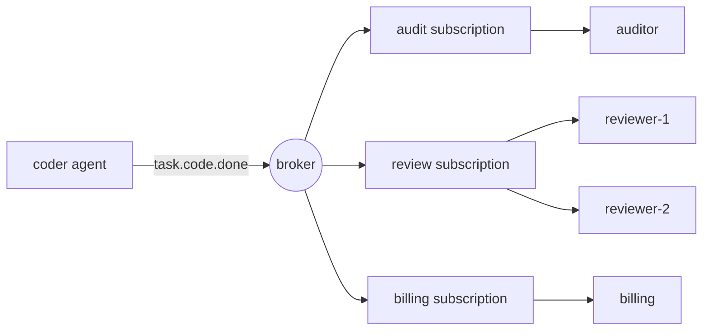

# 酒吧/代理子信息

> 一个发表的事件说",这发生了".出版者不知道谁在听,这就是全部的意义.

**Type:** Build
**Languages:** Python
**Prerequisites:** Phase 16 · 13 (Shared Memory and Blackboard Patterns), Phase 16 · 22 (Production Scaling)
**Time:** ~75 minutes

## 学习目标

- 解释出版/订阅提供的三种脱而出方式以及每种分离成本.
- 执行一个经纪人,有主题的字符,订阅,确认,重新交付,
- 区分用户用户之间的用户用户与用户的竞争.
- 保持每次订单的路由键,同时扩展消费者.
- 证明至少一次产后出现副作用,并用无力处理器来解决.
- 选择一个工作队列,一个直接电话和一个黑板,

## 问题

编码人员完成任务,审查人员必须检查它,所以编码人员打电话给审查员.

下个月你添加了账单,每个完成任务都必须收费.然后一个审计日志.然后一个评估员样本结果.每个补充编辑编码器:一个次调用,一个次处理失败,一个原因编码器缓慢.如果账单下降,编码器会失败吗?如果评估员需要40秒,编码器会等待吗?

编码器已经成为其他代理人的要求满足的地方. 它知道他们是谁,

编码器宣布了`task.code.done`任何关心的人都会订阅.添加评估器不会改变编码器.

## 概念

### 离合三种类型

经典的模式调查 (Eugster等人,2003) 列出了三个:

| Decoupling | Meaning | What it costs |
|------------|---------|---------------|
| Space | Publisher and subscriber do not know each other | No one place shows the full workflow |
| Time | They need not be running at the same moment | The broker must store messages |
| Synchronization | The publisher does not block waiting for subscribers | There is no return value and no error to catch |

每一行都是真正的收益和损失. Pub/sub不会删除协调. 它将其从代码中移动到主题名称和订阅中.

### 主题和字符

专题是某种事件的名称.等级名称让用户选择其兴趣水平.本课程使用NATS公约:分开点的代币,`*`完全与一个代币相匹配,`>`结尾匹配一个或多个代币.

| Pattern | Matches | Does not match |
|---------|---------|----------------|
| `task.code.done` | `task.code.done` | `task.research.done` |
| `task.*.done` | `task.code.done`, `task.research.done` | `task.code.failed` |
| `task.>` | `task.code.done`, `task.code.failed` | `task`, `metrics.tokens` |

过去时代的事实题名 (`task.code.done`),不是指令 (`review.this`命令有一个预期接收器,更好地将其发送到排队或直接调用.

### 广告和竞争的消费者

一种机制产生了两个相反的行为,



- **Across subscriptions: fan-out.**每个订阅者都会收到各自的相匹配消息.
- **Inside one subscription: competing consumers.**加入的用户会员分享订阅的信息.每个信息都向一个成员传递.`reviewer-2`减轻了负载`reviewer-1`它不会两次审查一切.

卡夫卡称订阅为*消费者群体*,NATS称其为*排队群体*,而谷歌云公寓/子公司称其为*订阅.*

### 交付保证

| Guarantee | Broker behaviour | Failure you accept |
|-----------|-----------------|--------------------|
| At-most-once | Send once, never retry | Messages are lost |
| At-least-once | Retry until acknowledged | Messages are duplicated |
| Exactly-once | Not available across a network in general | — |

如果经纪人听不到消息,或者收到负面确认,则再次交付.

差距是这样:消费者做了工作,然后的 ack 丢失了.经纪人不能区分"从未处理过"和"处理过, ack 丢失了",所以它重新交付.工作运行了两次.人们称之为"一次确切"实际上是"至少一次交付"加上一个"无力"的消费者,当它再次看到相同信息时,它产生相同的结果.

对于代理人来说,这是一项成本问题,也是一个正确性问题. 复制处理器可能意味着第二次LLM电话,第二次收费或第二次电子邮件给客户.

### 毒品信息和死字母排队

某些消息永远不会成功:一个错误的有效载荷,一个方案消费者不理解.再次尝试永远阻止了一切背后.一个交付限制限制了损害.`max_deliveries`经纪人将信息移动到*死字母队列* (DLQ),一个人或维修人员可以检查它,而流动继续.

### 订单

对于竞争的消费者来说,同一代理运行的两个消息可能会到达不同的成员,并最终不顺序.`run-a`其他行程则同时到达其他地方.

为了保持秩序,一个失败的消息必须在下一个消息交付之前再尝试,所以一个毒性消息会阻止其排队,直到它被死字母.这是*头条封锁*.

### 选择模式

| Pattern | Use when | Example |
|---------|----------|---------|
| Direct call | One receiver, and you need the answer now | Agent calls a tool |
| Work queue | One receiver type, the work must happen once | Dispatch a task to any free worker |
| Pub/sub | Zero or more receivers react to a fact | `task.code.done` triggers review, billing, audit |
| Blackboard (Phase 16 · 13) | Agents share state and read it later | A shared plan that agents refine |

许多系统都使用了两者.

## 建立它

整个经纪人已经到达了`code/main.py`没有线程的过程,所以每一次测试都是确定性的.

### 步骤1:将主题与图案相匹配

```python
def topic_matches(pattern: str, topic: str) -> bool:
    pattern_tokens = pattern.split(".")
    topic_tokens = topic.split(".")
    for index, token in enumerate(pattern_tokens):
        if token == ">":
            return index == len(pattern_tokens) - 1 and len(topic_tokens) > index
        if index >= len(topic_tokens):
            return False
        if token != "*" and token != topic_tokens[index]:
            return False
    return len(pattern_tokens) == len(topic_tokens)
```

### 步骤2: 发布每一个匹配的订阅

```python
def publish(self, topic: str, payload: str, key: str | None = None) -> Message:
    message = Message(self._next_id, topic, payload, key)
    self._next_id += 1
    matched = [group for group in self.groups.values() if topic_matches(group.pattern, topic)]
    if not matched:
        self.dropped.append(message)
    for group in matched:
        group.queue.append(Delivery(message))
    return message
```

每个`Group`单个决定产生粉丝:三组匹配意味着一个消息的三条排列入口.`dropped`没有人订阅之前发布的消息已经消失了,`publish`仍然正常返回.

### 步骤3:选择一个团队成员

```python
def _pick(self, group: Group, message: Message) -> tuple[str, Handler]:
    if message.key is not None:
        digest = hashlib.sha256(message.key.encode()).digest()
        index = int.from_bytes(digest[:8], "big") % len(group.members)
    else:
        index = group.next_member % len(group.members)
        group.next_member += 1
    return group.members[index]
```

没有钥匙,会员轮流,用钥匙,哈希决定.`hash()`由于它是随机对每个进程进行的,所以两个经纪过程会不同意谁拥有钥匙.

### 步骤4:交付,然后回复,再尝试,或死字母

```python
def _deliver(self, group: Group) -> None:
    delivery = group.queue.popleft()
    consumer, handler = self._pick(group, delivery.message)
    self.log.append((group.name, consumer, delivery.message.id, delivery.attempt))
    try:
        acked = handler(delivery.message)
    except Exception:
        acked = False
    if acked:
        return
    if delivery.attempt >= self.max_deliveries:
        self.dead_letters.append((group.name, delivery.message))
    else:
        group.queue.appendleft(Delivery(delivery.message, delivery.attempt + 1))
```

一个处理员回来了`True`返回`False`起是子. 复试回到排队前面.`appendleft`为了保持秩序,并导致线路的封锁.`append`现在你得到了相反的交易.

### 步骤5:让消费者具有无权力

```python
class IdempotentHandler:
    def __call__(self, message: Message) -> bool:
        if message.id in self.seen:
            self.duplicates += 1
            return True
        acked = self.handler(message)
        if acked:
            self.seen.add(message.id)
        return acked
```

复制文件被确认,但没有执行效果. 消息只会在成功后被记住,因此仍会重新尝试真正的失败.

### 运行它

```bash
cd phases/16-multi-agent-and-swarms/26-pubsub-messaging-for-agents/code
python3 main.py
python3 -m unittest discover tests -v
```

演示公布了两位代理的七个事件,分为三个订阅, 发票丢失了一个确认, 一个有效载荷是错误的.

```text
delivery attempts:      19
audit received:         6 events
reviewer-1 handled:    run-a:step-1, run-a:step-2
reviewer-2 handled:    run-e:step-1, run-e:step-3
dead letters:           [('review', 5)]
dropped, no subscriber: ['metrics.tokens']

billing lost the acknowledgement for message 2, so the broker redelivered it.
charges with a plain handler:       6 (5 billable events)
charges with an idempotent handler: 5
```

阅读每一行,对比其所显示的概念:

- 七起事件导致19次发送尝试. 扩散使消息增加,
- 每次运行都需要一个评审员,这是路由键.
- 审计和发票处理了相同的信息,因为每个订阅都独立失败.
- `metrics.tokens`没有订阅者,没有错误消失.
- 简单的账单处理者为五次活动收取了六次费用.

## 用它

产品经纪人主要在存储和保证方面不同.

| System | Subscription model | Delivery | Ordering |
|--------|-------------------|----------|----------|
| Apache Kafka | Consumer groups read a partitioned log by offset | At-least-once by default | Per partition, chosen by message key |
| NATS | Subjects with `*` and `>`; queue groups | Core NATS is at-most-once; JetStream adds at-least-once | Per stream in JetStream |
| Google Cloud Pub/Sub | Topics and named subscriptions | At-least-once, with an ack deadline and dead-letter topics | Optional ordering keys |
| Redis Pub/Sub | Channels and patterns | At-most-once; offline subscribers miss messages | None |
| Redis Streams | Consumer groups with explicit `XACK` | At-least-once | Per stream |

卡夫卡和JetStream记录记录,以便新用户可以重复历史. 这门课中的经纪人,就像Redis Pub/Sub一样,没有留下任何东西给没有在场的用户.

在代理框架中,AutoGen Core是基于这个模型的:代理发布消息给一个主题,运行时间将它们交给其订阅匹配的代理.

记忆中的经纪人遗漏的:

- **Persistence.**一场事故失去了每一个队列.
- **Ack deadlines.**实际的经纪人会在消费者太长时间保持沉默时重新提供.
- **Backpressure.**列表无限,一个缓慢的订阅者让列表增长,直到记忆尽.
- **Atomic dedupe.** `IdempotentHandler`在生产中,将效果和处理的id写入一个数据库交易中,或者将消息id传递到下游系统作为一个无效密钥.

对于代理系统,具体:

- **Carry a correlation id.**没有呼叫堆,每个消息中的运行 id 和追踪文本是重建发生的事情的唯一方法 (阶段14 · 23).
- **Guard against event loops.**代理A对B事件作出反应,并发布B反应的事件.
- **Version the payload.**您不知道的订阅者取决于您的方案.

## 运送它

这一课产生了`outputs/skill-pubsub-design-review.md`鉴于代理人群以及它们之间的事件,它审查了主题命名,订阅布局,交付保证,免费性,订单和死字处理.

## 运动

1. 跑步`code/main.py`换一次试验`_deliver`其他`appendleft`为了`append`按照什么顺序`reviewer-2`现在处理事件`run-e`什么时候可以接受这个命令?
2. 添加一个有界限的队列: `publish`增加了当一个群体的排队超过`max_queue`发行者应该做什么,当它被提升时:阻止,放弃或失败?
3. 添加一个`hops`字段到`Message`让经纪人一旦发布任何消息,`hops`写一个测试,用两个触发器触发彼此.
4. 添加重播:将每一个发表的消息都记录在日志中,并让一个新的组从一开始就订阅.`dropped`列表?
5. 另外一个评审员加入了`review`群组时的信息`run-a`哪些钥匙可以换到所有者?`hash % members`阅读关于持续的鱼,并解释它如何减少运动.

## 关键词

| Term | What people say | What it actually means |
|------|----------------|------------------------|
| Pub/sub | "Event bus" | Messaging where publishers send to a topic and the broker delivers to whoever subscribed |
| Topic | "Channel" | A name for a kind of event; called a subject in NATS |
| Subscription | "Consumer group" | A named interest in a topic pattern with its own copy of each message |
| Fan-out | "Broadcast" | Each subscription receives every matching message |
| Competing consumers | "Load balancing" | Members of one subscription share its messages; each message goes to one |
| Ack / nack | "Confirm" | The consumer's report that handling succeeded or failed |
| At-least-once | "Guaranteed delivery" | Redelivery until acknowledged, so duplicates are possible |
| Idempotent consumer | "Dedupe" | A handler that gives the same result when a message is delivered again |
| Dead-letter queue | "DLQ" | Where a message goes after it exhausts its delivery attempts |
| Routing key | "Partition key" | A value hashed to pick the consumer, so related messages stay in order |
| Head-of-line blocking | "Stuck queue" | A failing message that delays everything behind it in an ordered queue |

## 进一步阅读

- [Eugster, Felber, Guerraoui, Kermarrec — The Many Faces of Publish/Subscribe (ACM Computing Surveys, 2003)](https://dl.acm.org/doi/10.1145/857076.857078)定义空间,时间和同步脱节的调查.
- [NATS — Subject-Based Messaging](https://docs.nats.io/nats-concepts/subjects)这个课程执行了"牌规则".
- [Apache Kafka — Documentation](https://kafka.apache.org/documentation/)分区,消费者群体和抵消.
- [Google Cloud Pub/Sub — Overview](https://cloud.google.com/pubsub/docs/overview)订阅,收购期限,死字题,订单钥匙.
- [Redis — Pub/Sub](https://redis.io/docs/latest/develop/pubsub/)最多一次通道消息.
- [AutoGen Core — Topic and Subscription](https://microsoft.github.io/autogen/stable/user-guide/core-user-guide/core-concepts/topic-and-subscription.html)在代理运行时间内相同的模型.
