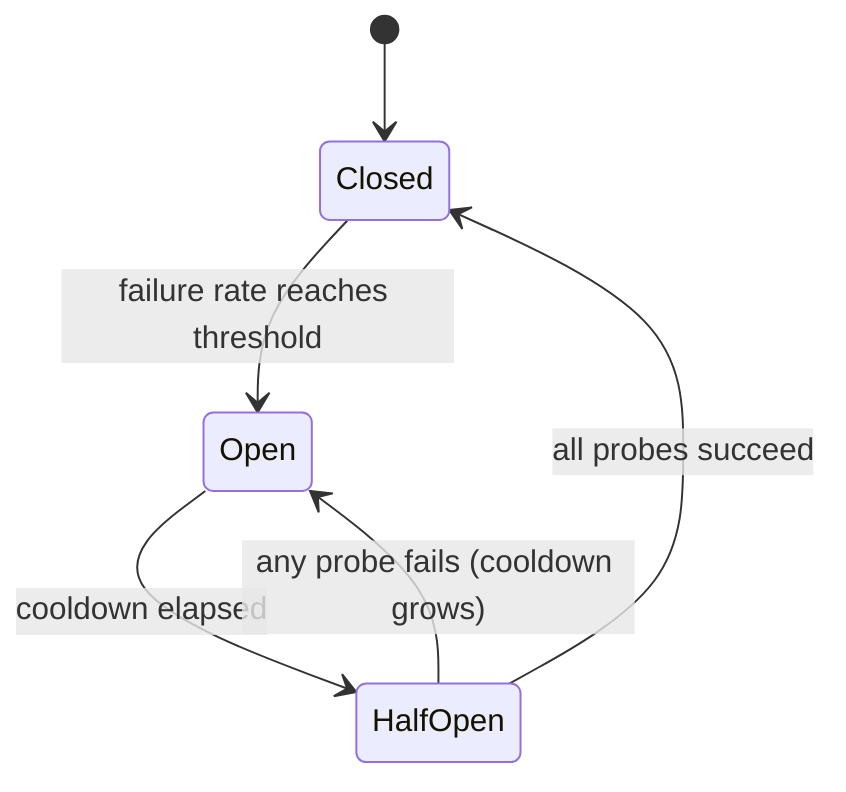

# 法律法学提供商的电路断裂器

> 一个再试问"该请求是否应该再试一次?"一个断路器问"现在有人应该打电话给这个提供商吗?"

**Type:** Build
**Languages:** Python
**Prerequisites:** Phase 17 · 19 (AI Gateways), Phase 17 · 24 (Chaos Engineering)
**Time:** ~75 minutes

## 学习目标

- 解释三个断裂状态以及导致每个转变的事件.
- 设置一个滑窗断路器,具有最低调用保护和半开放探测器预算.
- 归类为指向不健康的提供者和指责请求的错误.
- 按正确顺序编写一个时间切断器,重新尝试,
- 测量供应商停机期间断机节省的费用以及恢复后的成本.
- 选择一个特定部署的断裂器范围 (提供商,模型,地区).

## 问题

您的门将每次请求发送给主要提供商,如果失败,则返回第二次. 首次通话下降. 每次通话都等待了10秒的时间,

没有什么丢失.每一个请求都会得到回复.但是现在每个请求都需要11秒,而不是1,只要停电持续. 工作者线程在一个不响应的提供商上被阻止.排队增长.上游的通话者打出自己的时间,再试一次,这增加了更多的负载.在一个提供商中部分停电成为您的服务中完全停电.

试回逻辑对一个请求是正确的.错误是请求500号从之前的499个失败中学不到任何东西. 断路器是共享内存,它解决了这一问题.

## 概念

### 三个州

电气设备的名称来自电气设备:当发现故障时,电路打开,电流停止.



- **Closed**电话通过,每一个结果都会被记录.
- **Open**没有联系提供商,就会立即拒绝电话.
- **Half-open**通过"探测器"来测试. 冷却后,允许少数实话通过.

门的陷:门是门的陷,

### 什么时候会跌倒

最简单的规则是"在 N 连续失败后打开". 很容易构建,但一个幸运的成功重置了数量,因此一个失败的提供商80%的电话可能永远不会打倒它.

滑窗的失败率更强大.`window_size`输出结果,并在失败分数达到门时开放.`minimum_calls`电话中一次失败将会被视为100%的失败率,并且在重启后的第一个错误时会使断路器失败.

### 什么是失败

断路器的措施是提供商的健康,所以只需要描述提供商的错误.

| Outcome | Counts as failure? | Reason |
|---------|-------------------|--------|
| Timeout or connection error | Yes | The provider did not answer |
| 5xx (500, 502, 503, 529) | Yes | The provider failed |
| 429 rate limit | Yes | The provider cannot serve you right now |
| 400 bad request, context too long | No | The request is wrong; another provider's model may reject it too |
| 401 or 403 | No | Your credentials are wrong; alert on this instead |
| Content filter refusal | No | The provider answered; the answer was a refusal |

实际上,400是提供商健康的证据:它收到了请求,验证了它,并迅速回复.

### 半开放和冷却

机在冷却结束时不会重新打开门,只能使用一定的数量探测器.如果所有探测器都成功,它就会关闭和清除窗口.如果任何一个失败,它会再次打开.

试验室的试验室的时间可能会长到30秒,但试验室的试验室的时间可能会长到60秒.

### 范围

每个提供商的一个断断器通常太粗. 断断电通常仅限于一个模型或一个区域,而一个供应商范围内的断断电器会切断健康的部署. 每个API键,模型,区域和租户的一个断电器太好了:没有单个断电器看到`minimum_calls`总的来说,每次部署的一个断路器,就是提供商,模型和地区.

### 组成顺序

控制器的三个控制器包裹相同的电话,

```text
retry  ->  circuit breaker  ->  timeout  ->  provider call
```

时间停止是最内心的,因此打电话会成为打断器可以计算的失败.打断器坐在重试中,因此每次重试尝试都会首先要求打断器,重试循环无法打开电路.没有时间停止,打断器永远不会看到一个缓慢的提供者.

### 它与邻居有什么区别?

| Control | Question it answers | Triggered by |
|---------|--------------------|--------------|
| Timeout | How long may one call take? | A single slow call |
| Retry with backoff | Should this request try again? | A single failed call |
| Rate limit | How much traffic may a caller send? | Request volume |
| Circuit breaker | Is this dependency healthy enough to call? | Failures across many calls |
| Kill switch (Phase 15 · 14) | Should this system run at all? | A human or a safety policy |

## 建立它

全面实施在`code/main.py`它使用了`ManualClock`电话给电话的人手动前进,所以演示和每一次测试都会立即运行,

### 步骤1: 归类错误

```python
def counts_as_failure(status: int | None) -> bool:
    """Timeouts, 429 and 5xx blame the provider. Any other 4xx blames the request."""
    if status is None:
        return True
    return status == 429 or status >= 500
```

`status`是`None`由于未返回的电话没有状态代码.

### 决定是否可以进行调用

```python
def allow(self) -> bool:
    if self.state == OPEN and self.clock.now() - self.opened_at >= self.cooldown:
        self.probes_issued = 0
        self.probe_successes = 0
        self._move(HALF_OPEN)
    if self.state == CLOSED:
        return True
    if self.state == HALF_OPEN and self.probes_issued < self.config.half_open_probes:
        self.probes_issued += 1
        return True
    return False
```

转移从开放到半开放的过程是惰的,第一次一个打电话的人问了冷却时间过去了.

### 步骤3:记录结果

```python
def record_failure(self) -> None:
    if self.state == OPEN:
        return
    if self.state == HALF_OPEN:
        self.cooldown = min(
            self.cooldown * self.config.cooldown_multiplier,
            self.config.max_cooldown_seconds,
        )
        self._trip()
        return
    self.window.append(False)
    enough_calls = len(self.window) >= self.config.minimum_calls
    if enough_calls and self.failure_rate() >= self.config.failure_rate_threshold:
        self._trip()
```

首先,在实体系统中,检查是重要的.打断器打开时已经在飞行中的电话将迟到报告失败.如果这些迟到的结果重新启动冷却,

`record_success`半开放时,它会计探测器,并在预算完成时关闭,

### 步骤4: 打电话

```python
def call(self, fn: Callable[[], str]) -> str:
    if not self.allow():
        raise CircuitOpenError(self.name)
    try:
        result = fn()
    except ProviderError as error:
        if counts_as_failure(error.status):
            self.record_failure()
        else:
            self.record_success()
        raise
    except Exception:
        self.record_failure()
        raise
    self.record_success()
    return result
```

每条路都过去了`allow()`如果一个路径忘记录制, 一个半开放的断裂器会把探针交给, 听不到任何回复,

### 步骤5:绕开断路路

`FallbackRouter`走路列表.`CircuitOpenError`电话提供商失败后,在支付电话后,移动到下一条线路. 要求错误如400,被提升给调用者,并且不会被失败.

### 运行它

```bash
cd phases/17-infrastructure-and-production/30-circuit-breakers-llm-providers/code
python3 main.py
python3 -m unittest discover tests -v
```

演示程序每秒发送150个请求,通过一个初级,

```text
metric                        retry only     breaker
----------------------------------------------------
requests answered                    150         150
timeouts paid on primary              60           6
calls skipped (fast fail)              0          88
calls sent to fallback                60          94
mean latency (seconds)              5.00        1.40

breaker transitions:
  t=   24s     closed -> open
  t=   54s       open -> half_open
  t=   54s  half_open -> open
  t=  114s       open -> half_open
  t=  115s  half_open -> closed
```

读一读两项费用. 断电器支付了6次时间,而不是60次:五次检测断电, 但失败的探测器使冷却量增加了一倍,所以打断器直到第二114次才再次测试. 首次的要求从第二80开始, 断电器的恢复速度较慢, 降温,乘法和上限设定了交易.

## 用它

产品网关和代理运送这个模式以不同的名称. 在依赖它们之前,请检查当前的文件是否存在默认问题.

- **Resilience4j**设置图片是一个对一个:`failureRateThreshold`现在`slidingWindowSize`现在`minimumNumberOfCalls`现在`waitDurationInOpenState`其他`permittedNumberOfCallsInHalfOpenState`它还会把慢调用视为失败.`slowCallDurationThreshold`现在,我们要去.
- **Envoy**接下来,一个宿主被排放`consecutive_5xx`错误`base_ejection_time`发射者所谓的"断路"的特征是不同的,
- **LiteLLM Router**后将部署放缓`allowed_fails`失败`cooldown_time`在此期间,

制作版本增加了两个东西,

- **Concurrency.**半开放必须限制探测器*在飞行中*,需要锁或原子计数器.
- **Shared state.**网关复制器的10个分别设有10个断断断器.每一个必须在打开之前看到自己的故障.在Redis中共享状态使它们更快地一致,但增加了依赖性,这意味着生存依赖性故障的路径.每次断断断器是通常的选择.

对于LLM流量,具体:

- 总生成时间与输出长度相差,不能成为健康信号.
- 当429携带一个`Retry-After`标题,用这个值作为冷却,而不是默认的.
- 检查下跌可以吸收全部负载. 移动100%的交通到一个下降速度限制的下一步下降速度的断路.

## 运送它

这一课产生了`outputs/skill-circuit-breaker-review.md`根据提供商调用路径,它审查了旅行规则,错误分类,半开放行为,范围和组合顺序,并列出了空白.

## 运动

1. 跑步`code/main.py`设置`cooldown_multiplier`打断器支付多少额外的时间,而且它关闭多少秒早?
2. 通过连续失败计数来取代滑动窗口. 写一个测试,给出每5次中4次失败的服务商,并证明计数器从来没有在5次的门上出现失败.
3. 增加缓慢调用检测:一个成功但需要时间超过一个门的电话被认为是失败的.你会选择什么门来预测时间?
4. 给一个人`ProviderError`选择性`retry_after`机将其作为冷却装置,当它存在时.
5. 测试的倒退永远不会失败.给它一个断路器,每秒0.5次请求的速度限制. 停机期间发生什么,每条路线打开时路由器应该回归什么?

## 关键词

| Term | What people say | What it actually means |
|------|----------------|------------------------|
| Circuit breaker | "Stop calling it" | A state machine that refuses calls to a dependency after failures cross a threshold, then probes for recovery |
| Closed | "Healthy" | Calls pass through and outcomes are recorded |
| Open | "Tripped" | Calls are refused without contacting the dependency |
| Half-open | "Testing" | A limited number of probe calls decide whether to close or reopen |
| Fast fail | "Fail quickly" | Returning an error at once instead of waiting for a timeout |
| Sliding window | "Recent calls" | The last N outcomes used to compute the failure rate |
| Minimum calls | "Warm-up guard" | The fewest recorded calls before the failure rate is trusted |
| Cooldown | "Wait duration" | Time the breaker stays open before it allows probes |
| Probe | "Trial request" | A real request let through in half-open to test recovery |
| Outlier detection | "Envoy's breaker" | Ejecting an unhealthy host from a load-balancing pool |

## 进一步阅读

- [Michael Nygard — Release It! (2nd edition)](https://pragprog.com/titles/mnee2/release-it-second-edition/)本书中,该模式的名称,在稳定模式章.
- [Martin Fowler — CircuitBreaker](https://martinfowler.com/bliki/CircuitBreaker.html)三个国家简短引用.
- [Resilience4j — CircuitBreaker](https://resilience4j.readme.io/docs/circuitbreaker)基于数量和时间的滑窗,缓慢调用门.
- [Envoy — Outlier detection](https://www.envoyproxy.io/docs/envoy/latest/intro/arch_overview/upstream/outlier)排放规则和日益增长的排放时间.
- [LiteLLM — Routing](https://docs.litellm.ai/docs/routing)部署降低和倒退.
- [AWS Builders' Library — Timeouts, retries, and backoff with jitter](https://aws.amazon.com/builders-library/timeouts-retries-and-backoff-with-jitter/) 断路器所组合的控制器.
