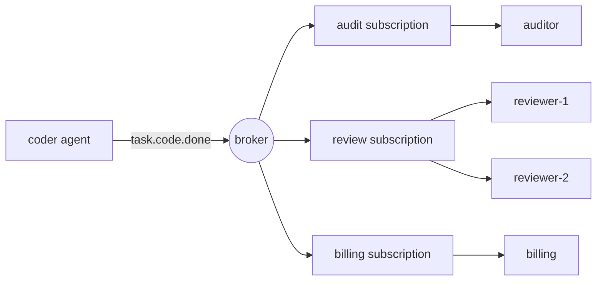

# Pub/Sub Messaging for Agents

> A direct call says "you, do this." A published event says "this happened." The publisher does not know who is listening, and that is the whole point.

**Type:** Build
**Languages:** Python
**Prerequisites:** Phase 16 · 13 (Shared Memory and Blackboard Patterns), Phase 16 · 22 (Production Scaling)
**Time:** ~75 minutes

## Learning Objectives

- Explain the three kinds of decoupling that publish-subscribe gives and what each one costs.
- Implement a broker with topic wildcards, subscriptions, acknowledgements, redelivery, and a dead-letter list.
- Distinguish fan-out across subscriptions from competing consumers inside one subscription.
- Preserve per-run ordering with a routing key while still scaling consumers.
- Show why at-least-once delivery repeats side effects, and fix it with an idempotent handler.
- Choose between pub/sub, a work queue, a direct call, and a blackboard for a given agent interaction.

## The Problem

A coder agent finishes a task. A reviewer agent must check it. So the coder calls the reviewer.

Next month you add billing, which must charge for every finished task. Then an audit log. Then an evaluator that samples results. Each addition edits the coder: one more call, one more failure to handle, one more reason the coder is slow. If billing is down, does the coder fail? If the evaluator takes 40 seconds, does the coder wait?

The coder has become the place where every other agent's requirements meet. It knows who they are, calls them in order, and inherits their failures.

Publish-subscribe turns the dependency around. The coder announces `task.code.done` and stops. Anyone who cares subscribes. Adding the evaluator changes nothing in the coder.

## The Concept

### Three kinds of decoupling

The classic survey of the pattern (Eugster et al., 2003) names three:

| Decoupling | Meaning | What it costs |
|------------|---------|---------------|
| Space | Publisher and subscriber do not know each other | No one place shows the full workflow |
| Time | They need not be running at the same moment | The broker must store messages |
| Synchronization | The publisher does not block waiting for subscribers | There is no return value and no error to catch |

Each row is a real benefit and a real loss. Pub/sub does not remove coordination. It moves it out of the code and into the topic names and subscriptions.

### Topics and wildcards

A topic is a name for a kind of event. Hierarchical names let a subscriber choose its level of interest. This lesson uses the NATS convention: tokens separated by dots, `*` matches exactly one token, and `>` matches one or more tokens at the end.

| Pattern | Matches | Does not match |
|---------|---------|----------------|
| `task.code.done` | `task.code.done` | `task.research.done` |
| `task.*.done` | `task.code.done`, `task.research.done` | `task.code.failed` |
| `task.>` | `task.code.done`, `task.code.failed` | `task`, `metrics.tokens` |

Name topics for facts in the past tense (`task.code.done`), not for commands (`review.this`). A command has one intended receiver and is better sent to a queue or as a direct call.

### Fan-out and competing consumers

One mechanism gives two opposite behaviours, and confusing them is the most common pub/sub mistake.



- **Across subscriptions: fan-out.** Each subscription receives its own copy of every matching message. Audit, review, and billing all see the event.
- **Inside one subscription: competing consumers.** The members share the subscription's messages. Each message goes to exactly one member. Adding `reviewer-2` halves the load on `reviewer-1`; it does not review everything twice.

Kafka calls the subscription a *consumer group*, NATS calls it a *queue group*, and Google Cloud Pub/Sub calls it a *subscription*. The idea is the same.

### Delivery guarantees

| Guarantee | Broker behaviour | Failure you accept |
|-----------|-----------------|--------------------|
| At-most-once | Send once, never retry | Messages are lost |
| At-least-once | Retry until acknowledged | Messages are duplicated |
| Exactly-once | Not available across a network in general | — |

A consumer acknowledges a message (*ack*) after handling it. If the broker hears nothing, or receives a negative acknowledgement (*nack*), it delivers again.

The gap is this: the consumer does the work, then the ack is lost. The broker cannot tell "never processed" from "processed, ack lost", so it redelivers. The work runs twice. What people call exactly-once is in practice at-least-once delivery plus an *idempotent* consumer, one that produces the same result when it sees the same message again.

For agents this is a cost issue as well as a correctness issue. A duplicated handler may mean a second LLM call, a second charge, or a second email to a customer.

### Poison messages and the dead-letter queue

Some messages can never succeed: a malformed payload, a schema the consumer does not understand. Retrying forever blocks everything behind it. A delivery limit bounds the damage. After `max_deliveries` attempts the broker moves the message to a *dead-letter queue* (DLQ), where a human or a repair job can inspect it, and the stream moves on.

### Ordering

With competing consumers, two messages from the same agent run may reach different members and finish out of order. The fix is a *routing key*: hash the key and always pick the same member for the same key. All events for `run-a` reach one reviewer, in publish order, while other runs go elsewhere in parallel.

Ordering has a price. To keep order, a failed message must be retried before the next one is delivered, so a poison message blocks its queue until it is dead-lettered. This is *head-of-line blocking*.

### Choosing the pattern

| Pattern | Use when | Example |
|---------|----------|---------|
| Direct call | One receiver, and you need the answer now | Agent calls a tool |
| Work queue | One receiver type, the work must happen once | Dispatch a task to any free worker |
| Pub/sub | Zero or more receivers react to a fact | `task.code.done` triggers review, billing, audit |
| Blackboard (Phase 16 · 13) | Agents share state and read it later | A shared plan that agents refine |

A blackboard stores the current state. Pub/sub carries the changes. Many systems use both.

## Build It

The full broker is in `code/main.py`. It runs in one process with no threads, so every test is deterministic.

### Step 1: Match a topic against a pattern

```python
def topic_matches(pattern: str, topic: str) -> bool:
    pattern_tokens = pattern.split(".")
    topic_tokens = topic.split(".")
    for index, token in enumerate(pattern_tokens):
        if token == ">":
            return index == len(pattern_tokens) - 1 and len(topic_tokens) > index
        if index >= len(topic_tokens):
            return False
        if token != "*" and token != topic_tokens[index]:
            return False
    return len(pattern_tokens) == len(topic_tokens)
```

### Step 2: Publish a copy to every matching subscription

```python
def publish(self, topic: str, payload: str, key: str | None = None) -> Message:
    message = Message(self._next_id, topic, payload, key)
    self._next_id += 1
    matched = [group for group in self.groups.values() if topic_matches(group.pattern, topic)]
    if not matched:
        self.dropped.append(message)
    for group in matched:
        group.queue.append(Delivery(message))
    return message
```

Each `Group` owns a queue. That one decision produces fan-out: three matching groups means three queue entries for one message. Note the `dropped` branch. A message published before anyone subscribes is gone, and `publish` still returns normally.

### Step 3: Pick one member of the group

```python
def _pick(self, group: Group, message: Message) -> tuple[str, Handler]:
    if message.key is not None:
        digest = hashlib.sha256(message.key.encode()).digest()
        index = int.from_bytes(digest[:8], "big") % len(group.members)
    else:
        index = group.next_member % len(group.members)
        group.next_member += 1
    return group.members[index]
```

Without a key, members take turns. With a key, the hash decides. Python's built-in `hash()` is not used because it is randomized per process for strings, so two broker processes would disagree about who owns a key.

### Step 4: Deliver, then ack, retry, or dead-letter

```python
def _deliver(self, group: Group) -> None:
    delivery = group.queue.popleft()
    consumer, handler = self._pick(group, delivery.message)
    self.log.append((group.name, consumer, delivery.message.id, delivery.attempt))
    try:
        acked = handler(delivery.message)
    except Exception:
        acked = False
    if acked:
        return
    if delivery.attempt >= self.max_deliveries:
        self.dead_letters.append((group.name, delivery.message))
    else:
        group.queue.appendleft(Delivery(delivery.message, delivery.attempt + 1))
```

A handler returns `True` to ack. Returning `False` or raising is a nack. The retry goes back to the *front* of the queue with `appendleft`, which keeps order and causes head-of-line blocking. Change it to `append` and you get the opposite trade.

### Step 5: Make the consumer idempotent

```python
class IdempotentHandler:
    def __call__(self, message: Message) -> bool:
        if message.id in self.seen:
            self.duplicates += 1
            return True
        acked = self.handler(message)
        if acked:
            self.seen.add(message.id)
        return acked
```

A duplicate is acknowledged without running the effect. A message is remembered only after it succeeds, so a real failure is still retried.

### Run it

```bash
cd phases/16-multi-agent-and-swarms/26-pubsub-messaging-for-agents/code
python3 main.py
python3 -m unittest discover tests -v
```

The demo publishes seven events from two agent runs into three subscriptions. Billing loses one acknowledgement, and one payload is malformed.

```text
delivery attempts:      19
audit received:         6 events
reviewer-1 handled:    run-a:step-1, run-a:step-2
reviewer-2 handled:    run-e:step-1, run-e:step-3
dead letters:           [('review', 5)]
dropped, no subscriber: ['metrics.tokens']

billing lost the acknowledgement for message 2, so the broker redelivered it.
charges with a plain handler:       6 (5 billable events)
charges with an idempotent handler: 5
```

Read each line against the concept it shows:

- Seven events caused 19 delivery attempts. Fan-out multiplies messages, and retries add more.
- Each run stayed on one reviewer, in order. That is the routing key.
- Message 5 was tried three times by review and then dead-lettered. Audit and billing handled the same message without trouble, because each subscription fails independently.
- `metrics.tokens` had no subscriber and vanished without an error.
- The plain billing handler charged six times for five events.

## Use It

Production brokers differ mostly in what they store and what they guarantee. Check current documentation before relying on a default.

| System | Subscription model | Delivery | Ordering |
|--------|-------------------|----------|----------|
| Apache Kafka | Consumer groups read a partitioned log by offset | At-least-once by default | Per partition, chosen by message key |
| NATS | Subjects with `*` and `>`; queue groups | Core NATS is at-most-once; JetStream adds at-least-once | Per stream in JetStream |
| Google Cloud Pub/Sub | Topics and named subscriptions | At-least-once, with an ack deadline and dead-letter topics | Optional ordering keys |
| Redis Pub/Sub | Channels and patterns | At-most-once; offline subscribers miss messages | None |
| Redis Streams | Consumer groups with explicit `XACK` | At-least-once | Per stream |

Kafka and JetStream keep a log, so a new subscriber can replay history. The broker in this lesson, like Redis Pub/Sub, keeps nothing for a subscriber that was not there.

Among agent frameworks, AutoGen Core is built on this model: agents publish messages to a topic and the runtime delivers them to agents whose subscriptions match.

What the in-memory broker leaves out:

- **Persistence.** A crash loses every queue.
- **Ack deadlines.** A real broker redelivers when a consumer stays silent too long. Here a handler either returns or raises.
- **Backpressure.** The queues are unbounded. A slow subscriber makes its queue grow until memory runs out.
- **Atomic dedupe.** `IdempotentHandler` records the id after the effect. A crash between the two repeats the effect. In production, write the effect and the processed id in one database transaction, or pass the message id to the downstream system as an idempotency key.

For agent systems specifically:

- **Carry a correlation id.** With no call stack, the run id and trace context in each message are the only way to rebuild what happened (Phase 14 · 23).
- **Guard against event loops.** Agent A reacts to B's event and publishes one that B reacts to. Add a hop count to each message and drop it past a limit.
- **Version the payload.** Subscribers you do not know about depend on your schema. Add fields; do not rename or remove them.

## Ship It

This lesson produces `outputs/skill-pubsub-design-review.md`. Given a set of agents and the events between them, it reviews topic naming, subscription layout, delivery guarantees, idempotency, ordering, and dead-letter handling.

## Exercises

1. Run `code/main.py`. Change the retry in `_deliver` from `appendleft` to `append`. In what order does `reviewer-2` now handle the events for `run-e`, and when would that order be acceptable?
2. Add a bounded queue: `publish` raises when a group's queue holds more than `max_queue` deliveries. Which should the publisher do when it is raised: block, drop, or fail? Argue for one in an agent system.
3. Add a `hops` field to `Message` and make the broker dead-letter any message published by a handler once `hops` passes a limit. Write a test with two handlers that trigger each other.
4. Add replay: keep every published message in a log and let a new group subscribe from the start. What does this change about the `dropped` list?
5. A third reviewer joins the `review` group while messages for `run-a` are in flight. Which keys change owner under `hash % members`? Read about consistent hashing and explain how it reduces the movement.

## Key Terms

| Term | What people say | What it actually means |
|------|----------------|------------------------|
| Pub/sub | "Event bus" | Messaging where publishers send to a topic and the broker delivers to whoever subscribed |
| Topic | "Channel" | A name for a kind of event; called a subject in NATS |
| Subscription | "Consumer group" | A named interest in a topic pattern with its own copy of each message |
| Fan-out | "Broadcast" | Each subscription receives every matching message |
| Competing consumers | "Load balancing" | Members of one subscription share its messages; each message goes to one |
| Ack / nack | "Confirm" | The consumer's report that handling succeeded or failed |
| At-least-once | "Guaranteed delivery" | Redelivery until acknowledged, so duplicates are possible |
| Idempotent consumer | "Dedupe" | A handler that gives the same result when a message is delivered again |
| Dead-letter queue | "DLQ" | Where a message goes after it exhausts its delivery attempts |
| Routing key | "Partition key" | A value hashed to pick the consumer, so related messages stay in order |
| Head-of-line blocking | "Stuck queue" | A failing message that delays everything behind it in an ordered queue |

## Further Reading

- [Eugster, Felber, Guerraoui, Kermarrec — The Many Faces of Publish/Subscribe (ACM Computing Surveys, 2003)](https://dl.acm.org/doi/10.1145/857076.857078) — the survey that defines space, time, and synchronization decoupling.
- [NATS — Subject-Based Messaging](https://docs.nats.io/nats-concepts/subjects) — the wildcard rules this lesson implements.
- [Apache Kafka — Documentation](https://kafka.apache.org/documentation/) — partitions, consumer groups, and offsets.
- [Google Cloud Pub/Sub — Overview](https://cloud.google.com/pubsub/docs/overview) — subscriptions, ack deadlines, dead-letter topics, ordering keys.
- [Redis — Pub/Sub](https://redis.io/docs/latest/develop/pubsub/) — at-most-once channel messaging.
- [AutoGen Core — Topic and Subscription](https://microsoft.github.io/autogen/stable/user-guide/core-user-guide/core-concepts/topic-and-subscription.html) — the same model inside an agent runtime.
