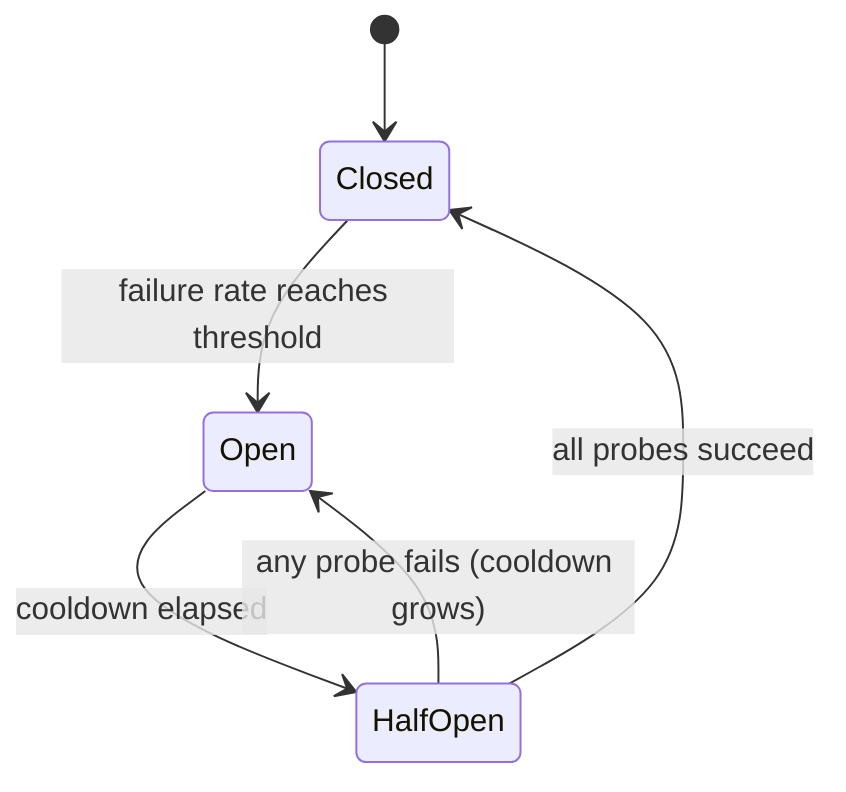

# Circuit Breakers for LLM Providers

> A retry asks "should this request try again?" A circuit breaker asks "should anyone call this provider right now?" The first protects one request. The second protects the whole system.

**Type:** Build
**Languages:** Python
**Prerequisites:** Phase 17 · 19 (AI Gateways), Phase 17 · 24 (Chaos Engineering)
**Time:** ~75 minutes

## Learning Objectives

- Explain the three breaker states and the event that causes each transition.
- Implement a sliding-window circuit breaker with a minimum-call guard and a half-open probe budget.
- Classify LLM provider errors into those that signal an unhealthy provider and those that blame the request.
- Compose a breaker with timeouts, retries, and a fallback route in the correct order.
- Measure what a breaker saves during a provider outage, and what it costs after recovery.
- Choose the breaker scope (provider, model, region) for a given deployment.

## The Problem

Your gateway sends every request to a primary provider and falls back to a second one on failure. The primary goes down. Each call now waits for the full 10 second timeout before the fallback runs.

Nothing is lost. Every request is still answered. But every request now takes 11 seconds instead of 1, for as long as the outage lasts. Worker threads sit blocked on a provider that will not answer. Queues grow. Upstream callers hit their own timeouts and retry, which adds more load. A partial outage at one provider becomes a full outage in your service.

The retry-and-fallback logic is correct for one request. The mistake is that request number 500 learns nothing from the 499 failures before it. A circuit breaker is the shared memory that fixes this.

## The Concept

### Three states

The name comes from the electrical device: when the fault is detected, the circuit opens and current stops.



- **Closed** is normal operation. Calls pass through and each outcome is recorded.
- **Open** means the provider is treated as down. Calls are refused immediately, without contacting the provider. This is the *fast fail*.
- **Half-open** is the test. After a cooldown, a small number of real calls are allowed through as *probes*. Their outcome decides the next state.

Note the naming trap: *closed* is the healthy state and *open* is the broken one, the opposite of a door.

### When to trip

The simplest rule is "open after N consecutive failures". It is easy to build, but one lucky success resets the count, so a provider failing 80% of calls may never trip it.

A failure rate over a sliding window is more robust. Keep the last `window_size` outcomes and open when the failed fraction reaches the threshold. Add a `minimum_calls` guard, or one failure out of one call reads as a 100% failure rate and trips the breaker on the first error after a restart.

### What counts as a failure

A breaker measures provider health, so only errors that describe the provider should count.

| Outcome | Counts as failure? | Reason |
|---------|-------------------|--------|
| Timeout or connection error | Yes | The provider did not answer |
| 5xx (500, 502, 503, 529) | Yes | The provider failed |
| 429 rate limit | Yes | The provider cannot serve you right now |
| 400 bad request, context too long | No | The request is wrong; another provider's model may reject it too |
| 401 or 403 | No | Your credentials are wrong; alert on this instead |
| Content filter refusal | No | The provider answered; the answer was a refusal |

A 400 is in fact evidence that the provider is healthy: it received the request, validated it, and replied quickly.

### Half-open and the cooldown

When the cooldown ends, the breaker does not reopen the floodgates. It admits a fixed number of probes. If all succeed, it closes and clears its window. If any fails, it opens again.

A failed probe should also lengthen the next cooldown, up to a cap. A provider that is still down after 30 seconds is likely to be down after 60, and each probe costs a real user a timeout.

### Scope

One breaker per provider is usually too coarse. An outage is often limited to one model or one region, and a provider-wide breaker would cut off healthy deployments. One breaker per API key and model and region and tenant is too fine: no single breaker sees `minimum_calls`, so none ever trips. A common starting point is one breaker per deployment, meaning the provider, model, and region.

### Order of composition

Three controls wrap the same call and the order matters:

```text
retry  ->  circuit breaker  ->  timeout  ->  provider call
```

The timeout is innermost, so a hung call becomes a failure the breaker can count. The breaker sits inside the retry, so each retry attempt asks the breaker first and a retry loop cannot hammer an open circuit. Without a timeout the breaker never sees a slow provider at all.

### How it differs from its neighbours

| Control | Question it answers | Triggered by |
|---------|--------------------|--------------|
| Timeout | How long may one call take? | A single slow call |
| Retry with backoff | Should this request try again? | A single failed call |
| Rate limit | How much traffic may a caller send? | Request volume |
| Circuit breaker | Is this dependency healthy enough to call? | Failures across many calls |
| Kill switch (Phase 15 · 14) | Should this system run at all? | A human or a safety policy |

## Build It

The full implementation is in `code/main.py`. It uses a `ManualClock` that the caller advances by hand, so the demo and every test run instantly with no sleeping.

### Step 1: Classify the error

```python
def counts_as_failure(status: int | None) -> bool:
    """Timeouts, 429 and 5xx blame the provider. Any other 4xx blames the request."""
    if status is None:
        return True
    return status == 429 or status >= 500
```

`status` is `None` for a timeout, because a call that never returned has no status code.

### Step 2: Decide whether a call may proceed

```python
def allow(self) -> bool:
    if self.state == OPEN and self.clock.now() - self.opened_at >= self.cooldown:
        self.probes_issued = 0
        self.probe_successes = 0
        self._move(HALF_OPEN)
    if self.state == CLOSED:
        return True
    if self.state == HALF_OPEN and self.probes_issued < self.config.half_open_probes:
        self.probes_issued += 1
        return True
    return False
```

There is no background timer. The move from open to half-open happens lazily, the first time a caller asks after the cooldown has passed.

### Step 3: Record the outcome

```python
def record_failure(self) -> None:
    if self.state == OPEN:
        return
    if self.state == HALF_OPEN:
        self.cooldown = min(
            self.cooldown * self.config.cooldown_multiplier,
            self.config.max_cooldown_seconds,
        )
        self._trip()
        return
    self.window.append(False)
    enough_calls = len(self.window) >= self.config.minimum_calls
    if enough_calls and self.failure_rate() >= self.config.failure_rate_threshold:
        self._trip()
```

The first check matters in real systems. Calls that were already in flight when the breaker opened will report their failures late. If those late results restarted the cooldown, a steady trickle of them could keep the breaker open forever.

`record_success` mirrors this: in half-open it counts probes and closes when the budget is met, clearing the window so old failures do not trip the breaker again at once.

### Step 4: Wrap the call

```python
def call(self, fn: Callable[[], str]) -> str:
    if not self.allow():
        raise CircuitOpenError(self.name)
    try:
        result = fn()
    except ProviderError as error:
        if counts_as_failure(error.status):
            self.record_failure()
        else:
            self.record_success()
        raise
    except Exception:
        self.record_failure()
        raise
    self.record_success()
    return result
```

Every path that passes `allow()` records exactly one outcome. If a path forgot to record, a half-open breaker would hand out its probes, hear nothing back, and stay half-open permanently.

### Step 5: Route around an open breaker

`FallbackRouter` walks an ordered list of routes. A `CircuitOpenError` moves to the next route at no cost. A provider failure moves to the next route after paying for the call. A request error such as a 400 is raised to the caller and is not failed over.

### Run it

```bash
cd phases/17-infrastructure-and-production/30-circuit-breakers-llm-providers/code
python3 main.py
python3 -m unittest discover tests -v
```

The demo sends 150 requests, one per second, through a primary that is down from second 20 to second 80:

```text
metric                        retry only     breaker
----------------------------------------------------
requests answered                    150         150
timeouts paid on primary              60           6
calls skipped (fast fail)              0          88
calls sent to fallback                60          94
mean latency (seconds)              5.00        1.40

breaker transitions:
  t=   24s     closed -> open
  t=   54s       open -> half_open
  t=   54s  half_open -> open
  t=  114s       open -> half_open
  t=  115s  half_open -> closed
```

Read the two costs. The breaker paid 6 timeouts instead of 60: five to detect the outage and one failed probe at second 54. But that failed probe doubled the cooldown, so the breaker did not test again until second 114. The primary was healthy from second 80, and 34 requests went to the fallback that did not need to. A breaker trades slower recovery for cheaper outages. The cooldown, multiplier, and cap set that trade.

## Use It

Production gateways and proxies ship this pattern under different names. Check the current documentation for defaults before you rely on them.

- **Resilience4j** (JVM) is the closest match to this lesson. Its settings map one to one: `failureRateThreshold`, `slidingWindowSize`, `minimumNumberOfCalls`, `waitDurationInOpenState`, and `permittedNumberOfCallsInHalfOpenState`. It also counts slow calls as failures through `slowCallDurationThreshold`.
- **Envoy** calls this *outlier detection*: a host is ejected after `consecutive_5xx` errors for `base_ejection_time`, which grows with each ejection. Envoy's feature named "circuit breaking" is a different thing, a cap on connections and pending requests.
- **LiteLLM Router** puts a deployment into cooldown after `allowed_fails` failures for `cooldown_time` seconds and routes to other deployments in the meantime.

Two things the production versions add that the simulator leaves out:

- **Concurrency.** Half-open must limit probes *in flight*, which needs a lock or an atomic counter.
- **Shared state.** Ten gateway replicas hold ten separate breakers. Each must see its own failures before it opens. Sharing state in Redis makes them agree faster but adds a dependency to the path that is meant to survive dependency failures. Per-replica breakers are the usual choice.

For LLM traffic specifically:

- Set the timeout on time to first token for streaming calls. Total generation time varies too much with output length to be a health signal.
- When a 429 carries a `Retry-After` header, use that value as the cooldown instead of your default.
- Check that the fallback can absorb the full load. Moving 100% of traffic to a secondary with a lower rate limit trips the secondary's breaker next.

## Ship It

This lesson produces `outputs/skill-circuit-breaker-review.md`. Given a provider-call path, it reviews the trip rule, error classification, half-open behaviour, scope, and composition order, and lists the gaps.

## Exercises

1. Run `code/main.py`. Set `cooldown_multiplier` to 1.0 and run it again. How many extra timeouts does the breaker pay, and how many seconds sooner does it close?
2. Replace the sliding window with a consecutive-failure counter. Write a test with a provider that fails four calls out of every five and show that the counter never trips at a threshold of five.
3. Add slow-call detection: a call that succeeds but takes longer than a threshold counts as a failure. What threshold would you choose for time to first token?
4. Give `ProviderError` an optional `retry_after` value and make the breaker use it as the cooldown when present.
5. The demo's fallback never fails. Give it a breaker and a rate limit of 0.5 requests per second. What happens during the outage, and what should the router return when every route is open?

## Key Terms

| Term | What people say | What it actually means |
|------|----------------|------------------------|
| Circuit breaker | "Stop calling it" | A state machine that refuses calls to a dependency after failures cross a threshold, then probes for recovery |
| Closed | "Healthy" | Calls pass through and outcomes are recorded |
| Open | "Tripped" | Calls are refused without contacting the dependency |
| Half-open | "Testing" | A limited number of probe calls decide whether to close or reopen |
| Fast fail | "Fail quickly" | Returning an error at once instead of waiting for a timeout |
| Sliding window | "Recent calls" | The last N outcomes used to compute the failure rate |
| Minimum calls | "Warm-up guard" | The fewest recorded calls before the failure rate is trusted |
| Cooldown | "Wait duration" | Time the breaker stays open before it allows probes |
| Probe | "Trial request" | A real request let through in half-open to test recovery |
| Outlier detection | "Envoy's breaker" | Ejecting an unhealthy host from a load-balancing pool |

## Further Reading

- [Michael Nygard — Release It! (2nd edition)](https://pragprog.com/titles/mnee2/release-it-second-edition/) — the book that named the pattern, in the Stability Patterns chapter.
- [Martin Fowler — CircuitBreaker](https://martinfowler.com/bliki/CircuitBreaker.html) — short reference for the three states.
- [Resilience4j — CircuitBreaker](https://resilience4j.readme.io/docs/circuitbreaker) — count-based and time-based sliding windows, slow-call thresholds.
- [Envoy — Outlier detection](https://www.envoyproxy.io/docs/envoy/latest/intro/arch_overview/upstream/outlier) — ejection rules and growing ejection time.
- [LiteLLM — Routing](https://docs.litellm.ai/docs/routing) — deployment cooldowns and fallbacks.
- [AWS Builders' Library — Timeouts, retries, and backoff with jitter](https://aws.amazon.com/builders-library/timeouts-retries-and-backoff-with-jitter/) — the controls a breaker composes with.
